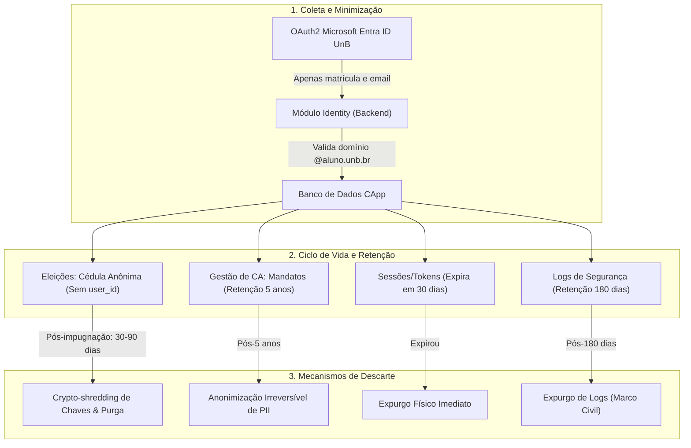
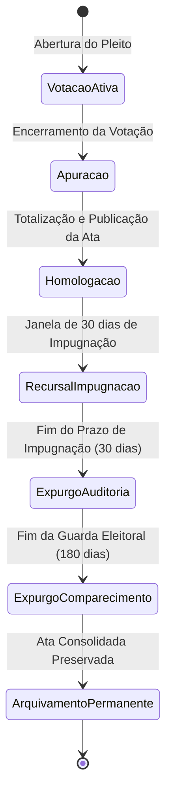
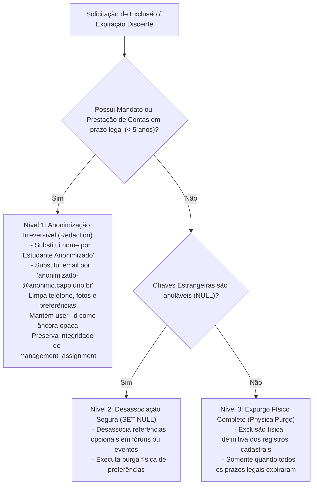

# Política Abrangente de Retenção, Minimização e Descarte Seguro de Dados Sensíveis — Projeto CApp

## 1. Visão Geral, Escopo e Fundamentação Normativa

### 1.1 Contexto da Plataforma e Instituição Única
O **CApp** é uma plataforma institucional concebida especificamente para a comunidade acadêmica da **Universidade de Brasília (UnB)**. Sua finalidade primordial é prover infraestrutura digital segura para a gestão, comunicação, representação estudantil, processos eleitorais e governança dos Centros Acadêmicos (CAs) da UnB.

A arquitetura do sistema adota os princípios de *Modular Monolith* no backend em Rust (com Axum, SQLx e PostgreSQL), clientes móveis em Flutter/Dart e especificações comportamentais BDD compartilhadas em Gherkin.

> **Invariante Estrutural de Instituição Única:**
> A plataforma atende com exclusividade à Universidade de Brasília (UnB). Em consonância estrita com as diretrizes de arquitetura do CApp, **o uso de atributos como `institution_id` é terminantemente proibido** no modelo de dados, contratos de API e lógica de domínio. Todos os domínios de correio eletrônico discente devem seguir rigorosamente o padrão `<matricula>@aluno.unb.br`.

### 1.2 Objetivo e Rastreabilidade da Política
Este documento formaliza as diretrizes, prazos, métodos operacionais e salvaguardas técnicas para a **retenção, minimização e descarte seguro de dados sensíveis** tratados na plataforma CApp, em atendimento à **Issue #262**, vinculada à entrega incremental **Sprint 1 — I01 ("Acesso e meu CA")** e à meta estratégica da Milestone 13 (**Issue #248 — "Reforçar a segurança e a proteção de dados da plataforma"**).

Esta política complementa e integra-se diretamente aos padrões de segurança homologados do projeto:
- **Modelo de Ameaças e Controles de Segurança** (Issue #254): definição de zonas de confiança, mitigação contra acesso indevido e preservação de integridade.
- **Política de Proteção e Rotação de Segredos** (Issue #255): segregação de ambientes, princípio do menor privilégio e proibição de segredos no código.

### 1.3 Marcos Regulatórios e Legais
A elaboração e a aplicação desta política submetem-se aos seguintes diplomas normativos:
1. **Lei Geral de Proteção de Dados Pessoais (LGPD — Lei Federal nº 13.709/2018):**
   - *Art. 6º, III (Necessidade e Minimização):* limitação do tratamento ao mínimo necessário para a realização de suas finalidades.
   - *Art. 7º (Bases Legais):* tratamento fundamentado em obrigação legal ou regulatória, execução de termos de uso/estatutos e exercício regular de direitos.
   - *Art. 11 (Dados Pessoais Sensíveis):* proteção rigorosa a dados que revelem convicções políticas ou escolhas de representação (voto secreto).
   - *Art. 16 (Término do Tratamento e Eliminação):* dever de descarte ou anonimização irreversível dos dados pessoais após atingida a finalidade ou encerrado o período legal de retenção.
   - *Art. 18, VI (Direitos do Titular):* direito à eliminação e anonimização de dados pessoais excessivos ou desnecessários.
2. **Marco Civil da Internet (Lei Federal nº 12.965/2014):**
   - *Art. 15:* dever de guarda dos registros de acesso a aplicações de internet, sob sigilo e em ambiente seguro, pelo prazo mínimo de 6 (seis) meses.
3. **Normas Internas da Universidade de Brasília (UnB) e Estatutos dos CAs:**
   - Resoluções do Conselho de Ensino, Pesquisa e Extensão (CEPE) e Conselho de Administração (CAD) quanto ao vínculo discente regular e representação estudantil.
   - Estatutos sociais dos Centros Acadêmicos quanto à prestação de contas obrigatória de diretorias e histórico de mandatos para fins de responsabilidade civil e administrativa.

### 1.4 Princípios Norteadores de Privacidade
- **Privacy by Design e Privacy by Default:** A proteção de dados e o descarte automatizado são projetados como requisitos nativos da arquitetura de software, e não adicionados retroativamente.
- **Minimização Estrita:** Nenhum dado pessoal adicional além do estritamente indispensável à identificação e elegibilidade discente é coletado. Senhas de rede institucional jamais trafegam ou residem nos servidores do CApp (autenticação federada delegada via Microsoft Entra ID UnB).
- **Finalidade e Vinculação de Uso:** Dados coletados para autenticação e verificação de vínculo acadêmico jamais são reutilizados para finalidades secundárias, comerciais ou de monitoramento comportamental abusivo.
- **Não Discriminação e Sigilo Democrático:** Votos emitidos em consultas e eleições de Centros Acadêmicos são dissociados de forma irreversível da identidade do votante, impedindo perseguição ou quebra de sigilo do voto.
- **Isolamento de Preferência:** A indicação de um Centro Acadêmico preferido (`favorite_ca_id`) constitui mera conveniência de navegação do aplicativo e não confere poderes administrativos, vínculo formal ou prerrogativa eleitoral.

### 1.5 Diretrizes de Dados Sintéticos e Proibição Estrita de Dados Reais
Em conformidade com as normas de engenharia e higiene do repositório:
- **Proibição Absoluta:** É terminantemente proibido o registro, teste, commit ou inserção em banco de dados da matrícula `242003979`, bem como de quaisquer dados pessoais, números de telefone, endereços de e-mail ou identificadores reais de estudantes, membros de CAs ou desenvolvedores.
- **Matrículas Didáticas Homologadas:** Quaisquer testes automatizados, documentações de exemplo, fixtures de dados e cenários BDD devem empregar exclusivamente as matrículas didáticas sintéticas homologadas:
  * `241098765` (`241098765@aluno.unb.br`) — Discente veterano regular;
  * `242011111` (`242011111@aluno.unb.br`) — Discente regular;
  * `231012345` (`231012345@aluno.unb.br`) — Discente veterano;
  * `262001234` (`262001234@aluno.unb.br`) — Discente calouro recém-ingressante.
- **Centros Acadêmicos Didáticos:**
  * `CAER` (Centro Acadêmico de Engenharia de Redes): UUID `018f0000-0000-7000-8000-000000000001`;
  * `CACC` (Centro Acadêmico de Ciência da Computação): UUID `018f0000-0000-7000-8000-000000000002`.

---

## 2. Matriz Geral de Classificação, Retenção e Descarte de Dados

A matriz a seguir consolida o inventário de dados tratados no CApp, sua classificação de sensibilidade, finalidade, embasamento legal, período estrito de guarda, responsável e o mecanismo técnico de descarte seguro:

| Categoria de Dado | Exemplos de Campos / Atributos | Finalidade do Tratamento | Base Legal / Justificativa | Nível de Sensibilidade | Período de Retenção | Responsável | Método de Descarte Seguro |
| :--- | :--- | :--- | :--- | :--- | :--- | :--- | :--- |
| **Dados Discentes e Cadastrais** | Matrícula UnB (9 dígitos), e-mail institucional (`@aluno.unb.br`), nome completo/social, curso, status de vínculo. | Identificação do estudante, validação de elegibilidade e acesso aos recursos do CA. | LGPD Art. 7º, II (cumprimento de obrigação legal) e V (termos de uso da plataforma). | **Restrito** | Durante a vigência do vínculo acadêmico ativo na UnB + 180 dias após encerramento do vínculo (tolerância para recursos). | Backend CApp / Módulo `identity` | Anonimização irreversível dos dados cadastrais (substituição por pseudônimos sintéticos e desassociação). |
| **Histórico Funcional de Gestão de CA** | Identificador de mandato (`management_term`), cargos exercidos (`management_assignment`), atas de posse, chapas eleitas. | Comprovação histórica de representação estudantil, emissão de certidões e prestação de contas estatutária. | LGPD Art. 7º, II e VI (exercício regular de direitos em processos de prestação de contas e obrigações estatutárias). | **Interno** | 5 (cinco) anos a contar do encerramento oficial da gestão (prazo prescricional cível/estatutário). | Diretoria do CA / Módulo `governance` | Anonimização dos contatos privados e preservação perene exclusiva da ata estatutária nominal de posse e encerramento. |
| **Prestação de Contas e Finanças do CA** | Relatórios financeiros (`financial_report`), demonstrativos de receitas e despesas, comprovantes contábeis. | Transparência financeira, prestação de contas aos estudantes e aos órgãos de controle (DCE, UnB). | LGPD Art. 7º, II e VI (cumprimento de dever estatutário e prestação de contas aos associados). | **Restrito** | 5 (cinco) anos após a homologação das contas pela assembleia geral de estudantes. | Tesouraria do CA / Módulo `governance` | Anonimização de dados pessoais de terceiros e arquivamento permanente do relatório contábil consolidado. |
| **Comparecimento Eleitoral (*Turnout*)** | `user_id`, `election_id`, data/hora de votação, hash do comprovante de votação do eleitor. | Controle de quorum eleitoral, prevenção a voto duplo e emissão de comprovante de comparecimento. | LGPD Art. 7º, V e VI (execução das regras eleitorais do estatuto do CA). | **Restrito** | 180 (cento e oitenta) dias após a homologação definitiva da eleição pela comissão eleitoral. | Comissão Eleitoral / Módulo `elections` | Expurgo físico (`PhysicalPurge`) do registro nominal de comparecimento, preservando apenas a métrica agregada de total de votantes. |
| **Cédulas Eleitorais e Votos Secretos** | `election_id`, `candidate_id` / `chapa_id`, voto cifrado, prova criptográfica de integridade. | Coleta, contagem e auditoria dos votos depositados no pleito democrático do CA. | LGPD Art. 11, II, "a" (cumprimento de obrigação estatutária eleitoral e sigilo democrático do voto). | **Crítico / Sensível** | Votos cifrados individuais: 90 dias após homologação definitiva. Boletim de apuração agregado: permanente. | Comissão Eleitoral / Módulo `elections` | Destruição de chaves de apuração (*Crypto-shredding*) e purga física dos registros individuais de cédula após o prazo recursal. |
| **Trilha Temporária de Auditoria Eleitoral** | Logs operacionais da urna, eventos de conexão e integridade de sessões de voto. | Garantia de lisura e suporte a eventuais pedidos de impugnação de urnas ou apuração. | LGPD Art. 7º, VI (exercício regular de direitos durante impugnações eleitorais). | **Crítico / Sensível** | 30 (trinta) dias após a proclamação oficial do resultado (prazo regimental de impugnação). | Comissão Eleitoral / Infraestrutura | Expurgo físico definitivo (`PhysicalPurge`) com sobrescrita de dados pós-homologação sem impugnação. |
| **Sessões e Tokens de Autenticação** | Refresh tokens (hash SHA-256), access tokens JWT, identificadores de sessão ativa, tokens OAuth2. | Manutenção de sessão segura, controle de concorrência e autorização de requisições à API. | LGPD Art. 7º, V (segurança da autenticação e execução do serviço). | **Crítico / Sensível** | Access token: até 60 minutos (sem persistência). Refresh token: até 30 dias. Sessão revogada: expurgo imediato. | Backend CApp / Módulo `identity` | Expurgo físico automático periódico por rotina de limpeza (*batch worker*) ou expiração nativa de TTL. |
| **Logs de Auditoria de Acesso e Segurança** | Timestamp UTC, IP do cliente (mascarado), método HTTP, endpoint, código de resposta, ID do operador. | Auditoria de incidentes de segurança, detecção de intrusão e rastreabilidade forense legal. | Marco Civil da Internet (Lei 12.965/2014, Art. 15) e LGPD Art. 6º, X (segurança). | **Restrito** | 6 (seis) meses (180 dias) a contar da data de geração do registro de acesso. | Engenharia de Segurança / Infraestrutura | Rotação periódica de arquivos de log e expurgo definitivo automatizado pós-180 dias via lifecycle policies. |
| **Telemetria e Métricas Operacionais** | Latência de requisições, taxas de erro HTTP, consumo de CPU/memória, contadores de uso agregados. | Monitoramento de desempenho, planejamento de capacidade e identificação de gargalos. | LGPD Art. 7º, IX (legítimo interesse operacional, dados estritamente desprovidos de PII). | **Interno** | 30 (trinta) dias para métricas detalhadas; 12 meses para médias consolidadas anônimas. | Operações / SRE | Expurgo automático programado por políticas de retenção da ferramenta de métricas e bancos de séries temporais. |

---

## 3. Detalhamento das Categorias de Dados e Regras Específicas



### 3.1 Dados Discentes, Cadastrais e Matrículas (Identidade e Perfil)

#### 3.1.1 Minimização na Entrada
Os dados dos estudantes são obtidos exclusivamente a partir da autenticação federada com a Microsoft Entra ID da UnB. O CApp coleta apenas os atributos mínimos necessários:
- Matrícula institucional (formato canônico de 9 dígitos numéricos: `AASXXXXXX`);
- Endereço de correio eletrônico institucional (`<matricula>@aluno.unb.br`);
- Nome civil ou social oficial;
- Identificador do curso de graduação vinculado.

Nenhum dado desnecessário (como endereço residencial, filiação, CPF, dados bancários ou senhas) é solicitado ou persistido nas tabelas de identidade do CApp.

#### 3.1.2 Ciclo de Vida do Vínculo e Período de Tolerância
- **Vínculo Ativo:** O estudante mantém acesso pleno aos recursos enquanto seu vínculo junto à UnB estiver confirmado pelo provedor institucional.
- **Desligamento / Formatural / Trancamento:** Quando a conta institucional é desativada ou o discente se desvincula da UnB, os dados cadastrais ingressam em **período de tolerância e recurso de 180 (cento e oitenta) dias**. Esse prazo assegura que eventuais trancamentos temporários ou recursos acadêmicos de reingresso não destruam prematuramente o histórico do estudante.
- **Término do Período de Tolerância:** Transcorridos os 180 dias sem reativação do vínculo, o registro do usuário é submetido à rotina de **anonimização irreversível**:
  1. O campo `email` é substituído por um identificador opaco aleatório no formato `anonimizado-<uuid>@anonimo.capp.unb.br`.
  2. O campo `name` é substituído pelo literal `"Estudante Anonimizado"`.
  3. Quaisquer dados facultativos de contato, fotografia ou preferências de interface são purgados de forma definitiva (`NULL`).
  4. O status de retenção é formalmente marcado como `Anonymized`.

#### 3.1.3 Exercício do Direito de Eliminação (LGPD Art. 18, VI)
Caso o discente solicite formalmente a exclusão de sua conta e de seus dados pessoais antes do desligamento automático:
- Se o discente **não possuir histórico funcional estatutário** (mandato em CA ou representação em comissão eleitoral): a eliminação de seus dados pessoais diretos é executada em até 15 (quinze) dias corridos mediante anonimização irreversível.
- Se o discente **possuir histórico funcional ativo ou em prazo de prestação de contas** (ver seção 3.2): os dados cadastrais pessoais de contato são anonimizados, mas o registro de exercício do cargo em atas e prestações de contas é preservado com esteio no art. 16, I e II da LGPD.

---

### 3.2 Histórico Funcional de Gestão de CA e Prestação de Contas

#### 3.2.1 Justificativa Jurídica e Estatutária da Retenção
Os Centros Acadêmicos são entidades representativas civis dotadas de personalidade jurídica ou vinculadas regimentalmente à estrutura universitária da UnB. Os diretores e membros da gestão desempenham funções com repercussão jurídica, administrativa e financeira perante a comunidade acadêmica.

Consequentemente, a eliminação sumária dos nomes dos gestores violaria a obrigação legal e estatutária de publicidade das contas, a rastreabilidade de recursos movimentados e a responsabilidade civil da diretoria (Código Civil, art. 206, § 5º, c/c LGPD, art. 7º, II e VI, e art. 16, I).

#### 3.2.2 Prazo e Escopo de Retenção
- **Prazo Estrito:** 5 (cinco) anos a contar da data de homologação do término do mandato ou da aprovação formal das contas da gestão em assembleia geral de estudantes.
- **Escopo Preservado:** Apenas as tabelas essenciais de governança mantêm o registro:
  * `management_term`: vigência da gestão e chapa eleita;
  * `management_assignment`: cargo exercido e período de atuação;
  * `ca_role`: denominação e atribuições regimentais do cargo;
  * `financial_report`: balancetes, livros-caixa, recibos e relatórios de receitas/despesas.
- **Segregação de Dados:** Telefones pessoais, endereços particulares e identificadores de rede dos membros da gestão são expurgados no encerramento do mandato, restando preservados unicamente o nome institucional e o número de matrícula para fins estritos de comprovação documental.

---

### 3.3 Registros Eleitorais, Votações Secretas e Sigilo Democrático

#### 3.3.1 O Princípio Inegociável do Voto Secreto
Em conformidade com a tradição democrática universitária e o art. 11 da LGPD (proteção qualificada a dados sobre convicção política), **o CApp garante o sigilo inviolável e irreversível do voto discente**.

> **Invariante Criptográfica e Relacional de Eleição:**
> 1. A tabela de cédulas eleitorais (`electoral_ballot`) **jamais conterá o identificador do usuário (`user_id`), matrícula, e-mail ou qualquer chave estrangeira que aponte para o eleitor**.
> 2. O registro de comparecimento à votação (`voter_turnout`) registra que determinado estudante participou da eleição para controle de quórum e prevenção de voto duplicado, mas não guarda nenhuma ligação com a cédula depositada na urna.
> 3. É expressamente vedada a correlação temporal entre o comparecimento e a cédula. O backend implementa **desacoplamento temporal** (arredondamento/quantização de horários de depósito para janelas horárias e inserção de cédulas com embaralhamento pseudoaleatório), neutralizando ataques de inferência por timestamp idêntico.

#### 3.3.2 Ciclo de Vida da Eleição em Quatro Fases



1. **Fase 1 — Votação Ativa:**
   - O eleitor autenticado confirma aptidão eleitoral.
   - O sistema insere um registro em `voter_turnout` (`user_id`, `election_id`, data de votação, hash do comprovante).
   - A cédula cifrada é depositada na urna sem vínculo com o usuário.
2. **Fase 2 — Apuração e Homologação:**
   - Ao término do prazo de votação, a comissão eleitoral executa o protocolo de apuração.
   - O boletim de urna consolidado é emitido com as contagens totais por chapa/candidato, brancos e nulos.
3. **Fase 3 — Janela de Impugnação e Recursos (30 dias):**
   - Durante 30 (trinta) dias após a publicação do resultado preliminar, a trilha de auditoria técnica da urna (`electoral_audit`) é preservada para dirimir recursos formais interpostos perante a comissão eleitoral.
4. **Fase 4 — Descarte Seguro Pós-Impugnação:**
   - **Aos 30 dias:** Caso não haja impugnação pendente, os logs efêmeros de auditoria e chaves de apuração são destruídos via *Crypto-shredding* e *PhysicalPurge*.
   - **Aos 180 dias:** O registro nominal de quem compareceu à eleição (`voter_turnout`) é expurgado do banco relacional, preservando-se apenas a quantidade agregada de votantes (quórum final).
   - **Preservação Permanente:** A ata final da eleição contendo o resultado totalizado e a composição da chapa eleita é arquivada perenemente para a memória histórica do Centro Acadêmico.

---

### 3.4 Sessões de Usuário, Tokens e Credenciais Efêmeras

#### 3.4.1 Política de Expiração de Credenciais de Acesso
Para mitigar sequestro de sessão (*session hijacking*) e vazamento de tokens em dispositivos móveis compartilhados:
- **JWT Access Tokens:** Tempo de vida máximo de 60 (sessenta) minutos. Não são armazenados no banco de dados relacional; a validação ocorre por assinatura criptográfica stateless (chave assimétrica ou HMAC seguro).
- **Refresh Tokens:** Tempo de vida máximo de 30 (trinta) dias com mecanismo de rotação obrigatória a cada uso (*Refresh Token Rotation*). Apenas o hash criptográfico SHA-256 do refresh token é armazenado no banco de dados.
- **Códigos Temporários OAuth2 / PKCE:** Validade estrita de 10 (dez) minutos, com uso único obrigatório e descarte imediato após troca por tokens de sessão.

#### 3.4.2 Procedimento de Revogação e Expurgo
- Ao efetuar *logout* ou ao registrar suspeita de comprometimento da conta, o refresh token correspondente é revogado imediatamente.
- Uma rotina agendada no backend executa a cada 24 horas a exclusão física (`DELETE`) de todos os tokens revogados e expirados há mais de 7 dias, impedindo o acúmulo desnecessário de linhas no banco.

---

### 3.5 Logs de Auditoria, Segurança e Telemetria

#### 3.5.1 Conformidade com o Marco Civil da Internet (Art. 15)
- **Obrigação Legal:** O CApp mantém os registros de acesso a aplicações de internet sob ambiente seguro e com controle de acesso estrito pelo prazo regulamentar de **6 (seis) meses (180 dias)**.
- **Conteúdo do Registro:** O registro compreende endereço IP (mascarado conforme abaixo), timestamp em UTC, identificador do recurso acessado e método HTTP.
- **Expurgo Pós-180 Dias:** Aos 181 dias a contar da geração do registro, os arquivos e registros de logs são expurgados de forma automatizada por regras de ciclo de vida do armazenamento, sem possibilidade de recuperação.

#### 3.5.2 Regras Estritas de Sanitização e Mascaramento de Logs
Nenhum dado pessoal desnecessário, credencial, segredo ou informação de voto pode ser registrado nos logs da aplicação.
O pipeline de logs do backend em Rust aplica filtros de redação antes da emissão:
- **Matrículas UnB:** Devem ser mascaradas para exibir apenas o ano/semestre e os dois últimos dígitos verificadores (ex.: `241098765` torna-se `2410***65`).
- **E-mails Institucionais:** Devem ocultar a parte central da matrícula (ex.: `241098765@aluno.unb.br` torna-se `2410***65@aluno.unb.br`).
- **Segredos e Tokens:** O cabeçalho `Authorization: Bearer <token>` é interceptado e substituído pelo literal `[REDACTED_BEARER_TOKEN]`. Senhas, chaves de API e variáveis de conexão jamais podem constar em mensagens de log.

---

## 4. Controles Técnicos de Minimização e Descarte Seguro

### 4.1 Ciclo de Vida e Expiração de Backups
Os backups do banco de dados relacional (PostgreSQL) são necessários para recuperação de desastres e resiliência operacional, mas constituem superfície de risco à privacidade se mantidos indefinidamente.

#### 4.1.1 Escalonamento e Retenção de Backups
- **Backups Diários (Snapshots):** Retenção de 30 (trinta) dias.
- **Backups Semanais:** Retenção de 12 (doze) semanas (aproximadamente 3 meses).
- **Backups Mensais:** Retenção máxima de 12 (doze) meses.
- **Proibição de Backups Legados Ad-hoc:** É terminantemente proibido manter dumps manuais em estações de trabalho de desenvolvedores ou em diretórios temporários sem controle de expiração.

#### 4.1.2 Criptografia e Descarte Criptográfico (*Crypto-shredding*)
- Todos os arquivos de backup são cifrados em repouso com algoritmo padrão de mercado (AES-256-GCM) utilizando chave gerenciada em serviço dedicado de cofre de chaves (*Key Management Service*).
- **Crypto-shredding:** Ao término da política de retenção do ciclo de backups, a chave criptográfica correspondente ao período arquivado é excluída ou rotacionada, tornando qualquer bloco remanescente em fitas ou discos frios matematicamente indecifrável e irrecuperável.
- **Políticas Automáticas de Bucket:** No armazenamento em nuvem, regras de ciclo de vida (*Lifecycle Management Rules*) garantem a exclusão física definitiva dos objetos após o número exato de dias estipulado.

---

### 4.2 Rotinas Automatizadas de Expiração e Purga no Backend
O descarte de dados expirados não depende de intervenções humanas manuais. A plataforma conta com rotinas de limpeza periódica (*background workers*) programadas para execução contínua:

1. **Parâmetros de Execução Segura:**
   - **Processamento em Lotes (Chunking):** A purga de registros volumosos (ex.: tokens expirados e sessões inativas) é fatiada em lotes de no máximo 1.000 registros por transação, evitando contenção de bloqueios (*table lock*) e degradação do throughput da API.
   - **Idempotência:** Toda rotina de limpeza é estritamente idempotente; falhas parciais de conexão ou reinicializações do serviço permitem a retomada a partir do ponto de parada sem duplicação de esforço ou corrupção de estado.
   - **Auditoria de Execução:** O término de cada rotina registra em log seguro a quantidade de registros purgados ou anonimizados e a duração da operação, sem ecoar PII.

---

### 4.3 Sanitização de Logs e Telemetria

A sanitização atua na origem da geração das mensagens de depuração e rastreamento. As seguintes regras de transformação são mandatórias na camada de infraestrutura e aplicação:

```rust
// Regras de Mascaramento Canônico no CApp:
// Matrícula (9 dígitos): Preserva os 4 primeiros e 2 últimos caracteres
// 241098765 -> 2410***65
// E-mail (@aluno.unb.br): Aplica o mascaramento sobre o prefixo da matrícula
// 241098765@aluno.unb.br -> 2410***65@aluno.unb.br
// Cabeçalho de Autorização:
// "Authorization: Bearer eyJhbGci..." -> "Authorization: [REDACTED_BEARER_TOKEN]"
```

Qualquer tentativa de registrar em log conteúdos de requisições contendo senhas, chaves de serviço ou dados biométricos/fotos é abortada por sanitizadores pré-formatados.

---

### 4.4 Integridade Referencial de Chaves Estrangeiras e Estratégia de Descarte

#### 4.4.1 O Dilema da Integridade Referencial na Exclusão de Contas
Em um modelo relacional normalizado (PostgreSQL), entidades de domínio como eleições, atas de posse, denúncias e prestação de contas fazem referência a usuários por meio de chaves estrangeiras (`user_id`).
Se o sistema executasse uma exclusão física destrutiva cega (`DELETE FROM app_user WHERE id = ... CASCADE`), duas consequências inaceitáveis ocorreriam:
1. Violação da integridade de registros de prestação de contas financeiras e atas de posse estatutárias; ou
2. Falha de integridade referencial com erro de chave estrangeira (`foreign key constraint violation`), travando a exclusão.

#### 4.4.2 A Estratégia de Descarte em Três Níveis do CApp
Para equacionar a eliminação de dados pessoais com a integridade do banco de dados, o CApp adota uma estratégia escalonada:



1. **Nível 1 — Anonimização Irreversível (Redaction de PII com Preservação de Âncora):**
   - Aplicado a discentes que exerceram cargos de gestão em CA ou figuram em relatórios financeiros sujeitos a guarda de 5 anos.
   - O registro na tabela `app_user` tem todos os atributos identificadores substituídos por literais sintéticos anônimos.
   - O valor de `user_id` (UUIDv4) é mantido exclusivamente como ponteiro referencial neutro e imutável para não corromper as chaves estrangeiras em `management_assignment` e `financial_report`. Como o vínculo entre o UUID e a pessoa física foi destruído sem volta, o dado deixa de ser considerado dado pessoal nos termos do art. 12 da LGPD.
2. **Nível 2 — Desassociação Segura (`ON DELETE SET NULL`):**
   - Aplicado a relações acessórias onde o registro pai não exige vínculo com um usuário individual (ex.: autor de dúvida arquivada no FAQ, participante de evento já encerrado).
   - A chave estrangeira é anulada, mantendo o histórico agregado do evento ou da dúvida sem ligação ao titular.
3. **Nível 3 — Expurgo Físico Completo (`PhysicalPurge`):**
   - Aplicado a registros cuja retenção expirou e não possuem chaves estrangeiras dependentes (ex.: tokens de sessão, credenciais temporárias, votos de teste e logs efêmeros de auditoria).
   - O comando SQL `DELETE` é executado diretamente, removendo fisicamente as linhas e permitindo a reutilização dos blocos de dados pelo PostgreSQL.

---

## 5. Procedimento de Revisão Anual e Tratamento Formal de Exceções

### 5.1 Governança e Papéis de Segurança
A governança e a fiscalização do cumprimento desta política cabem aos seguintes atores:
- **Encarregado pelo Tratamento de Dados Pessoais (DPO):** Responsável por orientar os administradores da plataforma sobre as práticas de proteção de dados, receber comunicações da Autoridade Nacional de Proteção de Dados (ANPD) e dos titulares discentes, e conduzir as auditorias de retenção.
- **Comitê de Segurança e Engenharia do CApp:** Responsável pela manutenção e auditoria do código-fonte do backend, pipelines de CI/CD, rotinas automatizadas de purga e monitoramento de integridade.
- **Diretorias e Comissões Eleitorais dos CAs:** Responsáveis pelo cumprimento dos prazos regimentais de prestação de contas, homologação eleitoral e requisições formais no âmbito de suas entidades.

### 5.2 Ciclo de Revisão Anual da Política
Esta política é submetida a **revisão obrigatória ordinária anual** (a cada 12 meses), com o objetivo de:
1. Auditar a eficácia das rotinas automatizadas de descarte e purga em produção;
2. Atualizar a Matriz de Classificação de Dados em decorrência de novas funcionalidades ou alterações regimentais da UnB;
3. Verificar a conformidade dos procedimentos de backup e *Crypto-shredding*;
4. Publicar relatório formal de conformidade de privacidade no repositório oficial da plataforma.

A revisão anual deve ocorrer obrigatoriamente no início de cada ano letivo regular da UnB, sob a coordenação do Encarregado de Dados e do time de engenharia.

---

### 5.3 Tratamento Formal de Exceções à Política de Retenção

#### 5.3.1 Hipóteses Excepcionais Admissíveis
A retenção de dados além dos prazos estipulados nesta política é medida extraordinária e restritiva, admitida **exclusivamente** nas seguintes hipóteses:
- **Ordem Judicial ou Requisição Administrativa Formal:** Determinação expressa de autoridade judiciária competente, do Ministério Público ou de processo disciplinar administrativo instaurado pelos órgãos superiores da UnB.
- **Impugnação Eleitoral Litigiosa em Andamento:** Pleito eleitoral objeto de recurso formal pendente de julgamento pela comissão eleitoral do CA, Conselho de Centros Acadêmicos (CCA) ou DCE da UnB.
- **Investigação de Incidente Crítico de Segurança:** Auditoria forense decorrente de violação de segurança ou tentativa de fraude ativa contra o sistema de votação ou integridade da plataforma.

#### 5.3.2 Fluxo Formal de Solicitação, Análise e Concessão
Nenhuma exceção pode ser concedida verbalmente ou por decisão monocrática de um desenvolvedor. O procedimento formal compreende:
1. **Abertura de Solicitação Formal de Exceção (SFE):** A parte interessada (comissão eleitoral, diretoria de CA ou autoridade administrativa da UnB) submete requerimento circunstanciado contendo:
   - Categoria e identificadores específicos dos dados pretendidos;
   - Justificativa jurídica e fática indispensável;
   - Prazo impreterível pretendido para a extensão da retenção (máximo de 90 dias por solicitação);
   - Indicação expressa dos controles de segurança adicionais a serem aplicados.
2. **Análise de Risco e Parecer do DPO:** O Encarregado de Dados e o líder de segurança avaliam o impacto aos direitos dos titulares envolvidos e emitem parecer técnico em até 5 (cinco) dias úteis.
3. **Decisão e Registro Formal:** Em caso de deferimento, a exceção é registrada no **Livro de Registro de Exceções de Dados** do CApp, com assinatura do DPO e do responsável técnico.
4. **Aplicação de Controles Compensatórios:** Os dados objeto de exceção são isolados em partição de acesso restrito (*air-gapped* logicamente), com acesso auditado em log imutável e proibição de leitura por rotinas ordinárias do aplicativo.
5. **Revogação Automática:** Transcorrido o prazo estipulado sem renovação fundamentada, o isolamento cessa e a rotina de descarte seguro é executada imediatamente.

---

### 5.4 Protocolo de Resposta a Incidentes de Privacidade e Notificação
Caso ocorra qualquer incidente de segurança que comprometa a confidencialidade, integridade ou descarte indevido de dados pessoais:
1. **Contenção Imediata (Até 2 horas):** O time de infraestrutura isola os componentes afetados, revoga sessões ativas e bloqueia pontos de exposição.
2. **Avaliação de Gravidade (Até 24 horas):** Determinação das categorias de titulares atingidos e do volume de dados envolvidos.
3. **Comunicação Institucional e Notificação:** Se o incidente gerar risco relevante aos direitos e liberdades individuais dos estudantes:
   - A Administração Superior da Universidade de Brasília e os Centros Acadêmicos envolvidos são notificados;
   - Em conformidade com o art. 48 da LGPD, a comunicação é encaminhada à Autoridade Nacional de Proteção de Dados (ANPD) e aos titulares em prazo razoável.
4. **Relatório Pós-Incidente:** Documentação circunstanciada das causas, ações tomadas e melhorias implementadas na arquitetura de segurança do CApp.
