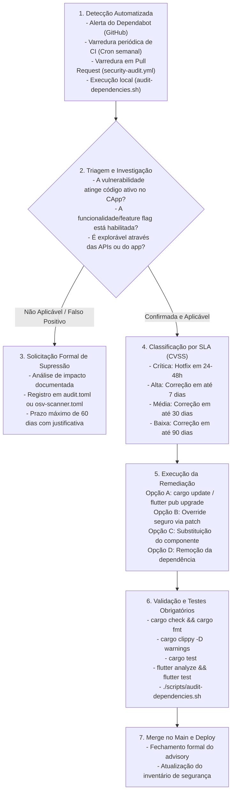

# Política de Gestão de Vulnerabilidades de Dependências e Atualizações Contínuas — Projeto CApp

## 1. Visão Geral, Escopo e Fundamentação Normativa

### 1.1 Contexto da Plataforma e Instituição Única
O **CApp** é uma plataforma institucional concebida especificamente para a comunidade acadêmica da **Universidade de Brasília (UnB)**. Sua finalidade primordial é prover infraestrutura digital segura para a gestão, comunicação, representação estudantil, processos eleitorais e governança dos Centros Acadêmicos (CAs) da UnB.

A arquitetura do sistema adota os princípios de *Modular Monolith* no backend em Rust (utilizando Axum, SQLx e PostgreSQL), clientes móveis multiplataforma em Flutter/Dart e especificações comportamentais BDD compartilhadas em Gherkin.

> **Invariante Estrutural de Instituição Única:**
> A plataforma atende com exclusividade à Universidade de Brasília (UnB). Em consonância estrita com as diretrizes de arquitetura do CApp, **o uso de atributos como `institution_id` é terminantemente proibido** no modelo de dados, contratos de API e lógica de domínio. Todos os domínios de correio eletrônico discente devem seguir rigorosamente o padrão `<matricula>@aluno.unb.br`. O campo `favorite_ca_id` em `user_preference` constitui mera conveniência de navegação de interface e **não confere vínculo acadêmico, privilégios de gestão nem direitos eleitorais**.

### 1.2 Objetivo e Rastreabilidade da Política
Este documento formaliza as diretrizes, procedimentos técnicos, critérios de risco e automações operacionais para a **análise contínua de vulnerabilidades em dependências de software** e as **políticas de atualização rotineira** do ecossistema CApp.

Esta política atende aos requisitos mandatórios da **Issue #256** ("Implementar e automatizar análise contínua de vulnerabilidades de dependências e políticas de atualização"), vinculada à entrega incremental **Sprint 2 — I02 ("Gestão e Governança do CA")** e à meta estratégica da Milestone 13 (**Issue #248 — "Reforçar a segurança e a proteção de dados da plataforma"**).

Esta política atua em harmonia e complementariedade com as políticas de segurança previamente homologadas:
- **Modelo de Ameaças e Controles de Segurança** (Issue #254): identificação de superfícies de ataque, limites de confiança e mitigação de exploração de falhas em componentes de terceiros.
- **Política de Proteção, Governança e Rotação de Segredos** (Issue #255): segregação de credenciais, proibição de segredos no código e proteção contra exfiltração por dependências comprometidas.
- **Política de Retenção, Minimização e Descarte Seguro de Dados Sensíveis** (Issue #262): proteção ao ciclo de vida de dados pessoais (LGPD) e mitigação contra vazamento de informações discentes e votos secretos.

### 1.3 Marcos Normativos e Padrões da Indústria
A elaboração e a operacionalização desta política fundamentam-se nas seguintes normas técnicas e referenciais internacionais de segurança em desenvolvimento de software:
1. **NIST SP 800-218 (Secure Software Development Framework - SSDF):**
   - *Prática PW.4:* Utilizar componentes de software de terceiros seguros e verificar continuamente vulnerabilidades conhecidas.
   - *Prática RV.1:* Identificar e confirmar vulnerabilidades em software e dependências em bases contínuas.
2. **ISO/IEC 27001 / ISO/IEC 27002:2022:**
   - *Controle 8.8 (Gestão de Vulnerabilidades Técnicas):* Obtenção tempestiva de informações sobre vulnerabilidades técnicas de sistemas e dependências, avaliação da exposição e aplicação de medidas apropriadas.
   - *Controle 8.9 (Gestão de Configuração):* Estabelecimento e manutenção de configurações padronizadas e controle estrito sobre versões de dependências e bloqueios de lockfile.
3. **OWASP Software Component Verification Standard (SCVS):**
   - Adoção de inventário explícito de software (SBOM / lockfiles), monitoramento de vulnerabilidades em tempo de build/CI e governança de componentes obsoletos.
4. **OpenSSF (Open Source Security Foundation):**
   - Adoção do ecossistema Open Source Vulnerabilities (OSV) e diretrizes de integridade da cadeia de suprimentos de software (*Software Supply Chain Security*).

### 1.4 Princípios Norteadores de Segurança em Dependências
- **Zero Trust em Dependências de Terceiros:** Nenhum pacote externo adicionado ao backend ou mobile é considerado implicitamente confiável. Todo componente deve ser analisado quanto à procedência, maturidade, licença e histórico de vulnerabilidades.
- **Minimização da Árvore de Dependências:** Novas bibliotecas somente são introduzidas quando a funcionalidade demandada for complexa e inviável de ser implementada internamente com segurança.
- **Determinismo e Reprodutibilidade com Lockfiles Obrigatórios:** O código em produção e homologação deve ser construído rigorosamente a partir de dependências bloqueadas por hash (`Cargo.lock` e `pubspec.lock` comitados e imutáveis sem processo formal de PR).
- **Detecção Contínua e Antecipada (*Shift-Left Security*):** Análises de segurança de dependências devem ocorrer localmente na máquina do desenvolvedor e na esteira de integração contínua (CI/CD) antes de qualquer mesclagem (*merge*) na branch principal.
- **Fail-Fast no Pipeline de CI/CD:** A presença de vulnerabilidades conhecidas não mitigadas bloqueia a conclusão de Pull Requests e impede a promoção de artefatos para homologação ou produção.

---

## 2. Inventário de Ecossistemas e Fontes de Ameaça em Cadeia de Suprimentos

A plataforma CApp opera sob um monorepo contendo dois ecossistemas principais de código-fonte, além da camada de infraestrutura e automação:

| Componente | Linguagem / Framework | Gerenciador de Pacotes | Arquivo de Manifesto | Lockfile Versionado | Base de Conhecimento de Vulnerabilidades | Ferramenta de Varredura Automatizada |
| :--- | :--- | :--- | :--- | :--- | :--- | :--- |
| **Backend** | Rust (Axum, SQLx) | Cargo | `backend/Cargo.toml` | `backend/Cargo.lock` | RustSec Advisory Database (GitHub / RustSec) | `cargo-audit` |
| **Mobile** | Dart / Flutter | Flutter pub | `mobile/pubspec.yaml` | `mobile/pubspec.lock` | Open Source Vulnerabilities (OSV.dev / GitHub Advisories) | `osv-scanner` / `flutter pub outdated` |
| **CI / CD** | GitHub Actions YAML | GitHub Actions | `.github/workflows/*.yml` | Tags / Commit SHAs imutáveis | GitHub Advisory Database | Dependabot / Security Alerts |
| **Scripts** | Bash / POSIX Shell | Não aplicável | `scripts/*.sh` | Não aplicável | Não aplicável | ShellCheck / Revisão por Pares |

### 2.1 Especificidades do Backend em Rust
- **Ecossistema:** Crates distribuídos via [crates.io](https://crates.io).
- **Mecanismo de Auditoria:** O `cargo-audit` realiza a inspeção estática das dependências diretas e transitivas registradas no `Cargo.lock`, comparando versões e hashes com o [RustSec Advisory Database](https://rustsec.org).
- **Políticas Configuradas em `backend/.cargo/audit.toml`:**
  - `deny = ["unmaintained"]`: Reprova o build se houver crates declarados como abandonados ou sem manutenção ativa pelos mantenedores originais.
  - `informational_warnings = ["unmaintained", "unsound"]`: Notifica crates com falhas de segurança de memória (*unsoundness*) que possam quebrar garantias do compilador Rust.
  - `severity_threshold = "low"`: Notifica vulnerabilidades a partir de severidade Baixa e bloqueia o pipeline em caso de severidades Média, Alta ou Crítica sem exceção cadastrada.

### 2.2 Especificidades do Cliente Mobile em Flutter/Dart
- **Ecossistema:** Pacotes distribuídos via [pub.dev](https://pub.dev).
- **Mecanismo de Auditoria:**
  - O `osv-scanner` (desenvolvido pelo Google e OpenSSF) analisa o `mobile/pubspec.lock`, confrontando os pacotes e versões mapeadas com a base unificada de dados de vulnerabilidades abertas [OSV.dev](https://osv.dev).
  - O comando `flutter pub outdated` avalia a defasagem temporal das bibliotecas, identificando quebras de versão maior (*major*) e pacotes desatualizados que contenham patches de segurança.
- **Configuração em `mobile/osv-scanner.toml`:** Registra regras de supressão temporária devidamente aprovadas pelo time de engenharia e segurança.

### 2.3 Matriz de Ameaças em Cadeia de Suprimentos (Supply Chain Risks)
O CApp cataloga as seguintes ameaças potenciais relacionadas a dependências:
1. **Typosquatting:** Criação de pacotes maliciosos em registros públicos com nomes visualmente similares a crates ou pacotes consagrados (ex.: `tokioo` em vez de `tokio`).
   - *Mitigação:* Revisão rigorosa de novas dependências no `Cargo.toml` e `pubspec.yaml` por pelo menos dois revisores técnicos.
2. **Dependency Confusion / Hijacking:** Comprometimento de contas de mantenedores legítimos em `crates.io` ou `pub.dev` com posterior injeção de código malicioso em versões patch.
   - *Mitigação:* `Cargo.lock` e `pubspec.lock` estritamente versionados e validados por hash SHA-256; monitoramento contínuo via `cargo-audit` e `osv-scanner`.
3. **Vulnerabilidades de Memória ou Transbordamento de Buffer (Backend):** Embora o compilador Rust garanta segurança de memória em código seguro (*safe Rust*), blocos `unsafe` em crates de baixo nível (ex.: parsers de protocolos, wrappers C de criptografia) podem apresentar falhas críticas.
   - *Mitigação:* Ativação da flag de detecção de crates `unsound` e priorização de implementações em *pure safe Rust*.
4. **Vulnerabilidades em Componentes Nativos do Mobile (Android/iOS):** Dependências do Flutter que envolvam código nativo (Kotlin/Swift/C++) podem herdar vulnerabilidades dos SDKs subjacentes.
   - *Mitigação:* Execução de compilação de validação (`flutter build apk --debug --no-pub`) em ambiente limpo de CI e acompanhamento de boletins de segurança do Flutter e Android/iOS.

---

## 3. Classificação de Severidade (CVSS) e Níveis de Serviço de Remediação (SLA)

### 3.1 Padrão CVSS (Common Vulnerability Scoring System)
As vulnerabilidades reportadas pelas bases de segurança (RustSec, OSV, CVE, GHSA) são classificadas segundo a métrica CVSS v3.1 / v4.0.

### 3.2 Tabela de Severidades e Prazos Obrigatórios de Remediação (SLA)

| Severidade | Pontuação CVSS | Descrição e Impacto no CApp | Ação Obrigatória Imediata | Prazo Máximo de Remediação (SLA) |
| :--- | :--- | :--- | :--- | :--- |
| **Crítica** | **9.0 – 10.0** | Vulnerabilidade explorável remotamente sem autenticação, permitindo execução remota de código (RCE), vazamento irrestrito de banco de dados, quebra de sigilo de voto em eleições ou comprometimento de segredos de produção. | Bloqueio imediato de novos deploys. Convocação extraordinária do time de engenharia e segurança. Criação de hotfix prioritário. | **Até 24 a 48 horas** |
| **Alta** | **7.0 – 8.9** | Falha grave com pré-condições limitadas (ex.: exige token de estudante autenticado), permitindo escalonamento de privilégios para diretoria de CA, bypass de autorização ou indisponibilidade severa (Denial of Service - DoS). | Priorização imediata na sprint em andamento. Inclusão de issue de segurança crítica. Bloqueio de merge de novas features até resolução. | **Até 7 dias corridos** |
| **Média** | **4.0 – 6.9** | Falha de impacto moderado com vetor de ataque improvável, complexidade alta de exploração ou vazamento de metadados não confidenciais de interface. | Planejamento e correção agendados para a sprint subsequente ou ciclo regular de manutenção. | **Até 30 dias corridos** |
| **Baixa** | **0.1 – 3.9** | Vulnerabilidade de baixo risco, sem impacto direto na integridade cadastral ou eleitoral, ou que dependa de cenário hipotético inviável em produção. | Atualização e remediação na rotina ordinária de revisão trimestral de dependências. | **Até 90 dias corridos** |
| **Informativa / Unmaintained** | **N/A** | Avisos de crates descontinuados (*unmaintained*), substituições recomendadas ou avisos de compatibilidade futura da linguagem/framework. | Avaliação técnica em até 15 dias. Definição de substituição programada no backlog técnico. | **Até 60 dias corridos** |

### 3.3 Critérios de Ponderação e Contexto Operacional no CApp
A severidade teórica do CVSS deve ser contextualizada com a arquitetura real do CApp. Uma vulnerabilidade em crate ou pacote é considerada de **risco efetivo máximo** quando atingir:
1. O mecanismo de autenticação federada (Microsoft Entra ID UnB / OAuth2) e validação de tokens JWT;
2. As rotinas criptográficas de anonimização e apuração de eleições e consultas estudantis;
3. O pool de conexões com o PostgreSQL (`sqlx`) ou serialização de requisições HTTP (`axum`, `serde`);
4. A persistência segura de preferências e tokens em dispositivos móveis (`shared_preferences`, `flutter_secure_storage`).

---

## 4. Fluxo Operacional de Triagem, Investigação e Resposta a Incidentes

### 4.1 Ciclo de Vida da Gestão de Vulnerabilidades



### 4.2 Procedimento Detalhado de Triagem
Ao ser reportada uma vulnerabilidade por qualquer canal (CI, Dependabot ou varredura local), o engenheiro responsável deve responder formalmente a três perguntas de triagem:
1. **Presença no Grafo de Chamadas:** O código vulnerável da dependência é realmente invocado pelo CApp, ou pertence a submódulos não utilizados/features desativadas?
2. **Exposição de Superfície:** O vetor de exploração requer acesso à rede externa não autenticada, ou exige privilégios de administrador do sistema que o invasor não possui?
3. **Existência de Mitigações Compensatórias:** Há controles de camada de aplicação (ex.: validação de payload com `validator`, tipagem estrita de UUIDs, mascaramento com `SecretString`) que neutralizem a entrada maliciosa antes que ela alcance o componente vulnerável?

### 4.3 Estratégias de Remediação em Ordem de Preferência
1. **Atualização Menor/Patch do Pacote (*In-Place Upgrade*):**
   - No Backend: `cargo update -p <crate_name>`
   - No Mobile: `flutter pub upgrade <package_name>`
   - Preserva compatibilidade de API e minimiza alterações colaterais no lockfile.
2. **Atualização Maior com Ajuste de Código (*Breaking Change Upgrade*):**
   - Atualização do manifesto (`Cargo.toml` ou `pubspec.yaml`) seguida de refatoração das chamadas de API afetadas.
3. **Substituição da Biblioteca (*Component Replacement*):**
   - Se o pacote original foi abandonado ou o mantenedor não publicou correção, adota-se crate/pacote alternativo mantido e referendado pela comunidade técnica.
4. **Aplicação de Patch Temporário (*Patching via Repository Override*):**
   - No Rust: Utilização da seção `[patch.crates-io]` no `Cargo.toml` raiz apontando para fork interno do CApp com o patch de segurança aplicado, até a liberação de versão upstream.
5. **Remoção da Dependência (*Dependency Inlining/Pruning*):**
   - Caso a dependência proveja utilitários triviais (ex.: manipulação simples de strings ou datas), remove-se o pacote e implementa-se o comportamento internamente sob testes unitários estritos.

---

### 4.4 Procedimento Operacional Padrão (SOP) para Supressão e Exceções Temporárias

A supressão de um alerta de vulnerabilidade em arquivos de configuração (`audit.toml` ou `osv-scanner.toml`) é procedimento de **caráter estritamente excepcional** e requer aprovação explícita.

#### 4.4.1 Requisitos Mínimos para Concessão de Exceção
Uma supressão temporária só poderá ser aprovada se cumprir cumulativamente os seguintes requisitos:
1. **Inviabilidade Comprovada de Patch Imediato:** Inexistência de versão corrigida fornecida pelo mantenedor upstream no momento da triagem.
2. **Demonstração Técnica de Não Exploração:** Parecer técnico formal demonstrando que o caminho de código vulnerável não é alcançável por entradas de usuários ou requisições de rede no CApp.
3. **Ausência de Risco a Dados Sensíveis:** Certeza técnica de que a falha não expõe credenciais, dados discentes ou votos eleitorais.
4. **Prazo de Expiração Impreterível:** Toda supressão possui prazo máximo de **60 (sessenta) dias corridos**, ao término dos quais a esteira de CI volta a falhar compulsoriamente se o pacote não tiver sido atualizado ou substituído.

#### 4.4.2 Estrutura Formal de Registro em Arquivo de Configuração
No Backend (`backend/.cargo/audit.toml`):
```toml
[advisories]
ignore = [
    # RUSTSEC-202X-XXXX: Vulnerabilidade em função X.
    # Justificativa Técnica: O CApp não utiliza a feature 'X', conforme comprovado na Issue #YYY.
    # Data de Aprovação: 2026-10-18 | Validade Máxima: 2026-12-18 | Responsável: Time de Segurança
    "RUSTSEC-202X-XXXX"
]
```

No Mobile (`mobile/osv-scanner.toml`):
```toml
[[IgnoredVulns]]
id = "GHSA-xxxx-xxxx-xxxx"
reason = "Código vulnerável não alcançável pelo cliente mobile. Detalhes técnicos e plano de migração na Issue #YYY."
ignoreUntil = 2026-12-18
```

---

## 5. Política de Atualização Rotineira e Controle de Lockfiles

### 5.1 Regra Inviolável de Lockfiles Versionados no Git
- O arquivo `backend/Cargo.lock` e o arquivo `mobile/pubspec.lock` são **cidadãos de primeira classe no controle de versão** e devem permanecer permanentemente comitados no repositório.
- A flag `--locked` no backend (`cargo check --locked`, `cargo test --locked`, `cargo clippy --locked`) e `--enforce-lockfile` no mobile (`flutter pub get --enforce-lockfile`) são obrigatórias em todos os ambientes de automação e CI/CD.
- É terminantemente proibido deletar o lockfile para "resolver conflitos" ou executar atualizações indiscriminadas em massa sem justificativa de PR.

### 5.2 Fluxo Controlado de Atualização de Dependências
As atualizações de dependências no CApp obedecem a dois fluxos padronizados:

#### 5.2.1 Atualização de Rotina Semanal Automatizada (Dependabot)
O repositório CApp possui automação configurada via `.github/dependabot.yml`:
- **Periodicidade:** Toda segunda-feira às 06:00 (Horário de Brasília).
- **Escopos Segregados:**
  - Pull Requests dedicados ao Backend (`chore(deps-backend): ...`)
  - Pull Requests dedicados ao Mobile (`chore(deps-mobile): ...`)
  - Pull Requests dedicados a GitHub Actions (`chore(ci): ...`)
- **Limite de PRs Abertos:** Máximo de 5 (cinco) PRs simultâneos por ecossistema, prevenindo sobrecarga de revisão no time.

#### 5.2.2 Atualização Pontual sob Demanda (Desenvolvedor)
Caso o desenvolvedor necessite atualizar um pacote específico durante o desenvolvimento de uma feature ou correção de bug:
```bash
# No Backend: atualiza apenas a crate específica e suas dependências diretas
cd backend
cargo update -p <nome_da_crate>

# No Mobile: verifica versão mais recente compatível
cd mobile
flutter pub outdated
flutter pub upgrade <nome_do_pacote>
```

### 5.3 Bateria Obrigatória de Validação Pré-Merge de Dependências
Qualquer Pull Request que altere `Cargo.lock` ou `pubspec.lock` deve obrigatoriamente ser aprovado na seguinte suíte de testes locais e de CI:

```bash
# 1. Validação completa do Backend
cd backend
cargo fmt --all -- --check
cargo clippy --all-targets --all-features --locked -- -D warnings
cargo test --all-features --locked --no-fail-fast

# 2. Auditoria de vulnerabilidades local
cd ..
./scripts/audit-dependencies.sh

# 3. Validação completa do Mobile
cd mobile
flutter analyze --no-pub
flutter test --no-pub
flutter build apk --debug --no-pub
```

---

## 6. Automação Contínua em CI/CD e Ferramental Local

### 6.1 Workflow de Auditoria no GitHub Actions (`.github/workflows/security-audit.yml`)
O pipeline de segurança do CApp é executado automaticamente nas seguintes condições:
1. **Pull Requests:** Toda vez que um PR modificar arquivos de manifesto (`Cargo.toml`, `pubspec.yaml`), arquivos de bloqueio (`Cargo.lock`, `pubspec.lock`) ou configurações de auditoria (`audit.toml`, `osv-scanner.toml`).
2. **Pushes na branch `main`:** Para assegurar que o histórico consolidado permanece em estado de conformidade permanente.
3. **Agendamento Periódico (Cron Semanal):** Executado compulsoriamente toda **segunda-feira às 06:00 UTC** (`cron: "0 6 * * 1"`), identificando de forma proativa vulnerabilidades recém-cadastradas no RustSec ou OSV sobre dependências de código estático já implantadas.
4. **Acionamento Manual (`workflow_dispatch`):** Permite auditorias sob demanda pelo time de engenharia a qualquer instante.

### 6.2 Script Local de Auditoria (`scripts/audit-dependencies.sh`)
Para assegurar a filosofia *Shift-Left*, o CApp disponibiliza um script padronizado e multiplataforma para desenvolvedores executarem antes da submissão de código:

```bash
# Executa auditoria completa (Backend e Mobile)
./scripts/audit-dependencies.sh

# Executa auditoria exclusiva no Backend (Rust)
./scripts/audit-dependencies.sh --backend

# Executa auditoria exclusiva no Mobile (Flutter)
./scripts/audit-dependencies.sh --mobile

# Modo informativo: checa pacotes desatualizados disponíveis
./scripts/audit-dependencies.sh --update
```

O script identifica se as ferramentas locais (`cargo-audit`, `flutter`, `osv-scanner`) estão instaladas e fornece instruções imediatas de instalação em caso de ausência, assegurando conformidade com o padrão de execução local.

### 6.3 Integração com Ambientes de Desenvolvimento (VS Code)
O monorepo disponibiliza a tarefa de execução direta no arquivo `.vscode/tasks.json` através do comando:
- `security: audit dependencies` (executa `scripts/audit-dependencies.sh`).

---

## 7. Governança, Ciclo de Vida e Checklist de Conformidade

### 7.1 Papéis e Responsabilidades
- **Líder de Segurança e DevOps:**
  - Manter as esteiras de auditoria do GitHub Actions ativas e atualizadas;
  - Avaliar, aprovar ou rejeitar solicitações formais de exceção temporária em `audit.toml` ou `osv-scanner.toml`;
  - Coordenar a resposta a vulnerabilidades críticas (CVSS >= 9.0) no prazo regulamentar de 24 a 48 horas.
- **Desenvolvedores e Contribuidores de Código:**
  - Executar `./scripts/audit-dependencies.sh` antes de abrir Pull Requests;
  - Não comitar pacotes com vulnerabilidades conhecidas sem solução aprovada;
  - Preservar a integridade estrita dos lockfiles versionados.
- **Revisores de Pull Request (Code Reviewers):**
  - Inspecionar cuidadosamente qualquer alteração nos manifestos `Cargo.toml` ou `pubspec.yaml`;
  - Verificar a procedência, reputação e número de dependências transitivas de novas bibliotecas propostas.

### 7.2 Ciclo de Revisão e Atualização da Política
Esta política é submetida a **revisão obrigatória ordinária semestral** (a cada 6 meses) e extraordinária sempre que:
1. Houver atualização de versão principal (*major release*) da linguagem Rust, do framework Axum ou do Flutter SDK;
2. For detectado incidente de segurança na cadeia de suprimentos de software que afete componentes do CApp;
3. Forem publicadas novas resoluções ou diretrizes normativas pela Universidade de Brasília (UnB) ou órgãos reguladores.

---

### 7.3 Checklist de Conformidade Pré-Merge de Pull Request (Gatekeeper)

Antes de aprovar e realizar o merge de qualquer PR no repositório CApp, os revisores devem validar o seguinte checklist:

- [ ] **Lockfile Atualizado e Íntegro:** As alterações em dependências estão refletidas de forma limpa em `backend/Cargo.lock` ou `mobile/pubspec.lock`.
- [ ] **Sem Dependências Desnecessárias:** A biblioteca adicionada é estritamente indispensável e não introduz árvore desproporcional de dependências transitivas.
- [ ] **Licenciamento Compatível:** A licença do pacote é compatível com o projeto (MIT, Apache-2.0, BSD-3-Clause) e não impõe restrições hostis.
- [ ] **Varredura Local Aprovada:** O script `./scripts/audit-dependencies.sh` foi executado e retornou status zero sem avisos de pacotes `unmaintained` ou vulneráveis.
- [ ] **Esteira CI Concluída com Sucesso:** O workflow `Security Audit` (`.github/workflows/security-audit.yml`), `Backend CI` e `Mobile CI` finalizaram com sucesso no GitHub Actions.
- [ ] **Exceções Documentadas (se houver):** Qualquer supressão excepcional de advisory possui ID, justificativa técnica circunstanciada, data limite de até 60 dias e aprovação do time de segurança.
- [ ] **Privacidade e Proteção Estrita de Dados:** Nenhum dado pessoal real, matrícula discente ou credencial privada está presente no código, mensagens de commit ou documentação.
