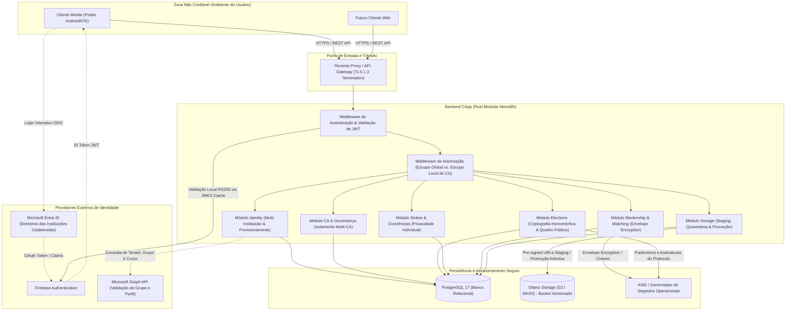
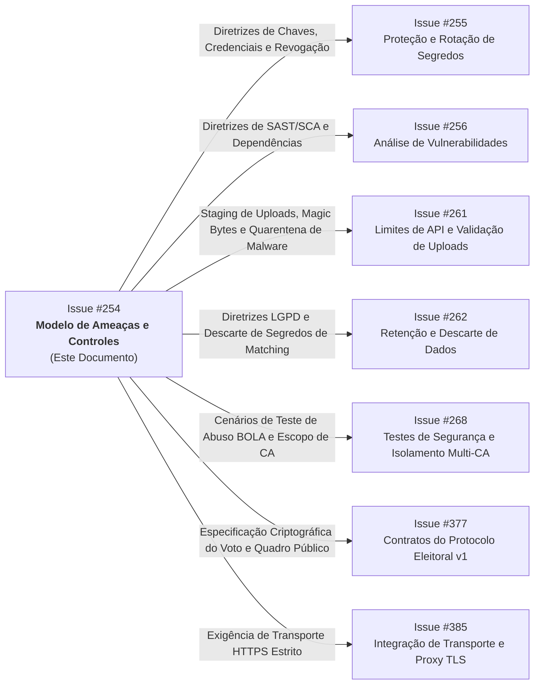

# Modelo de Ameaças e Controles de Segurança — Projeto CApp

## 1. Contexto, Objetivos e Escopo

### 1.1 Contexto da Plataforma
O **CApp** é uma plataforma institucional multi-tenant concebida para atender à comunidade universitária, fornecendo infraestrutura comum para que diferentes Centros Acadêmicos (CAs) gerenciem informações, processos eleitorais, representação estudantil, comunicação, eventos, demandas acadêmicas, programas de acolhimento e governança interna.

A arquitetura adota o modelo de *Modular Monolith* no backend (desenvolvido em Rust utilizando Axum, SQLx e PostgreSQL), clientes distribuídos (aplicativo móvel em Flutter/Dart e interfaces web futuras) e especificações comportamentais BDD compartilhadas (Gherkin).

Embora a Universidade de Brasília (UnB) figure como a instituição pioneira cadastrada e integrada para validação operacional e testes do projeto, o modelo de domínio e a arquitetura foram concebidos de forma nativamente multi-institucional, suportando múltiplas instituições de ensino superior cadastradas (`institution`), cada qual associada ao seu respectivo diretório corporativo/educacional Microsoft Entra ID e ao seu grupo institucional de estudantes.

### 1.2 Objetivo do Documento
Este documento formaliza o **Mapeamento de Riscos e Definição de Controles de Segurança** do CApp, em atendimento à **Issue #254** ("Mapear riscos e definir controles de segurança do CApp"), vinculada à entrega incremental **I01 ("Acesso e meu CA")** e à issue agregadora **#248 ("Reforçar a segurança e a proteção de dados da plataforma")** da Milestone 13.

Seus objetivos específicos são:
1. Estabelecer o inventário exaustivo de ativos de informação, integrações externas, credenciais operacionais e superfícies de ataque da plataforma.
2. Mapear os limites de confiança (*trust boundaries*) e isolamentos lógicos essenciais, especialmente entre diferentes Centros Acadêmicos (*Multi-CA Tenant Isolation*) e entre escopos de administração global da plataforma e gestão local de CA.
3. Aplicar metodologia estruturada de modelagem de ameaças (**STRIDE** e **OWASP Top 10 / OWASP API Security Top 10**), com ênfase nas especificidades de negócio do produto.
4. Definir a matriz de riscos (Probabilidade x Impacto), distinguindo rigorosamente os **controles implementados e verificados** daqueles **planejados ou pendentes**, condicionando as estimativas de redução de risco residual à futura entrega desses controles.
5. Estabelecer o processo contínuo de revisão e governança de segurança após mudanças arquiteturais.

### 1.3 Rastreabilidade de Diretrizes e Invariantes Institucionais
O modelo de segurança implementado respeita rigorosamente as diretrizes e invariantes arquiteturais do projeto CApp, as especificações comportamentais BDD e a legislação aplicável:
- **Modelo Multi-Institucional e Vínculo Estudantil**: A plataforma suporta múltiplas instituições de ensino devidamente cadastradas no banco de dados (`institution`). A instituição de origem da conta é identificada exclusivamente pelo identificador do diretório Microsoft Entra ID (`microsoft_tenant_id`) associado à identidade externa autenticada e confrontado com a base de instituições do CApp. A comprovação de vínculo estudantil é realizada pela verificação de pertencimento ao grupo institucional configurado (`microsoft_student_group_id`) e pela confirmação de curso institucional não vazio retornado via Microsoft Graph. O domínio de e-mail institucional não é utilizado como regra ou prova de vínculo estudantil, permitindo que cada instituição cadastrada adote seus próprios padrões de e-mail. Contas pessoais Microsoft (sem diretório institucional corporativo/educacional) e contas vinculadas a instituições ainda não cadastradas no CApp são categoricamente rejeitadas. Contas institucionais válidas sem confirmação de vínculo estudantil ou com curso ausente/em branco recebem acesso estritamente limitado, sem concessão de direitos de estudante em nenhum Centro Acadêmico.
- **Separação de Escopos de Autorização**: As ações globais de plataforma (`PlatformAdministration`) e as ações locais de gestão de Centro Acadêmico (`CaManagement`) seguem fluxos e requisitos de verificação independentes. O acúmulo dos papéis de administrador da plataforma e gestor local de um CA pelo mesmo usuário é suportado e não invalida nem bloqueia suas permissões legítimas em nenhum dos dois escopos.
- **Isolamento de Preferência**: O campo `favorite_ca_id` em `user_preference` é uma mera facilidade de interface para definição do contexto inicial exibido; **não confere vínculo acadêmico, nem privilégios de gestão, nem direitos eleitorais**.
- **Privacidade e Proteção de Dados**: Aderência aos princípios da Lei Geral de Proteção de Dados (LGPD - Lei 13.709/2018), com minimização de coleta, finalidade específica, segregação de segredos de apadrinhamento e vedação à discriminação discente.
- **Proibição de Dados Reais**: Utilização exclusiva de dados e identificadores didáticos homologados nos testes e documentações (ex.: CAER `018f0000-0000-7000-8000-000000000001`, CACC `018f0000-0000-7000-8000-000000000002`, usuários sintéticos `241098765@aluno.unb.br`, `231012345@aluno.unb.br`, `262001234@aluno.unb.br`).

---

## 2. Fronteiras de Confiança e Arquitetura de Defesa

O sistema opera sobre fronteiras de confiança explícitas (*Trust Boundaries*), representadas no fluxo de dados abaixo:



### Limites de Confiança Identificados (TB - Trust Boundaries)
1. **TB-01 (Cliente vs. API Backend)**: Dispositivos móveis e navegadores web são ambientes sob controle do usuário, sujeitos a descompilação, engenharia reversa e manipulação de requisições. O backend nunca confia em cabeçalhos, parâmetros ou estados enviados pelo cliente sem validação criptográfica e semântica.
2. **TB-02 (Backend vs. Provedores Externos de Identidade)**: Integração com Microsoft Entra ID e Firebase Authentication.
   - *Comportamento Implementado e Verificado*: O backend (`FirebaseTokenVerifier`) valida localmente a assinatura digital RS256 do token JWT contra o conjunto público de chaves (JWKS) do Google obtido com cache compartilhado (`JwksCache`), além de validar emissor (`iss`), audiência (`aud`), expiração (`exp`), identificador de usuário (`sub`) e extrair o objeto Microsoft vinculado.
   - *Limitação Atual e Controle Planejado*: A verificação local comprova autenticidade e prazo, mas **não consulta o estado em tempo real da conta nem a lista de revogação de tokens**. Um token revogado na origem pode permanecer válido localmente até o término de sua janela de expiração (`exp`). A integração ativa de revogação via Firebase Admin SDK / endpoint de revogação constitui um controle planejado (#254, #255).
3. **TB-03 (Tenant Boundary / Isolamento Multi-CA)**: Cada Centro Acadêmico constitui um domínio administrativo independente. A posse de privilégios de gestão no CA "A" (ex.: CAER) não concede qualquer permissão sobre o CA "B" (ex.: CACC).
4. **TB-04 (Administração da Plataforma vs. Gestão Local de CA)**: Segregação estrita entre escopos de autorização:
   - *Ações globais de plataforma* (ex.: homologação de solicitações de verificação de criação de CA via `verification_request`, credenciamento institucional, auditoria global) exigem privilégio de administrador global da plataforma (`platform_administrator`), verificado de forma independente e sem exigir cargo na gestão do CA afetado.
   - *Ações locais de gestão de CA* (ex.: publicação de notícias, criação de eventos, prestação de contas, aplicação de strikes locais) exigem verificação de atribuição ativa (`management_assignment`), termo de gestão vigente (`management_term`) e permissão específica (`permission`) no CA correspondente.
   - *Acúmulo de papéis*: O fato de um usuário acumular a condição de administrador da plataforma e gestor local de um CA específico é suportado e não invalida nem bloqueia suas permissões legítimas em nenhum dos dois escopos.
5. **TB-05 (Isolamento de Cédulas, Voto Secreto e Quadro Público Auditável)**: Diferenciação arquitetural entre a associação verificável eleitor-cédula cifrada (pública e auditável) e a revelação da escolha individual em texto claro (estritamente confidencial):
   - O quadro público eleitoral armazena a identificação do eleitor, a cédula cifrada, a assinatura digital do eleitor e o recibo assinado pelo servidor, permitindo que cada estudante confira a inclusão de seu voto e que a comunidade audite a integridade e elegibilidade do pleito.
   - O sigilo da escolha é protegido de ponta a ponta por criptografia homomórfica aditiva (ElGamal sobre grupo MODP 14 de 2048 bits) com divisão de segredos entre múltiplas autoridades eleitorais independentes. A apuração consolida totais agregados sem decifrar qualquer cédula individual, não dependendo de mera ausência de chaves estrangeiras no banco de dados.
6. **TB-06 (Armazenamento de Arquivos Privados e Prevenção contra Substituição)**: Documentos de verificação e comprovação financeira possuem classificação restrita e nunca são expostos por links públicos perpétuos. O fluxo de upload adota prefixo de staging temporário, validação estrita, promoção atômica para chave imutável controlada pelo backend e versionamento com chave vinculada (`VersionId` + hash SHA-256), impedindo a substituição silenciosa de arquivos após a validação.

---

## 3. Inventário Exaustivo de Ativos

A tabela a seguir consolida os ativos críticos da plataforma, categorizados por domínio, classificação da informação, requisitos de segurança (Confidencialidade, Integridade, Disponibilidade) e regulamentação aplicável.

| ID Ativo | Ativo de Informação / Técnico | Descrição e Componentes | Classificação | Requisitos (C/I/D) | Base Legal / Regra |
| :--- | :--- | :--- | :--- | :--- | :--- |
| **AST-01** | **Identidade Institucional Discente** | `app_user`, `external_identity`, e-mail institucional, `display_name`, `firebase_uid`, `microsoft_subject`, `institution_id`. | Confidencial / Pessoal | C: Alta<br>I: Crítica<br>D: Alta | LGPD Art. 7º (Execução de políticas públicas/regulatórias) |
| **AST-02** | **Dados Acadêmicos e Vínculo** | `institutional_verification`, `course_name`, `student_membership_confirmed`, `checked_at`, `expires_at`. | Confidencial | C: Alta<br>I: Crítica<br>D: Alta | LGPD / Segredo Acadêmico Institucional |
| **AST-03** | **Matrícula Discente** | Identificador discente institucional nos formatos adotados pelas instituições cadastradas. | Restrito / Sensível | C: Alta<br>I: Crítica<br>D: Alta | Regra do Projeto: Proibição de uso de identificadores reais nos testes e vedação à exposição pública desnecessária |
| **AST-04** | **Preferência de CA Favorito** | `user_preference.favorite_ca_id`. | Interno | C: Baixa<br>I: Média<br>D: Média | Invariante: Preferência de interface, sem efeito de autorização |
| **AST-05** | **Documentos de Verificação de CA** | `verification_request`, `verification_document`, atas de eleição, posse e estatutos armazenados em `stored_file`. | Confidencial / Restrito | C: Crítica<br>I: Crítica<br>D: Média | Segurança Institucional / Prevenção a usurpação de CAs |
| **AST-06** | **Cédula de Voto Secreto (Cifra e Assinatura)** | `encrypted_choice` (ElGamal MODP 14), `voter_signature` (RSA-PSS 2048-bit), parâmetros criptográficos. | Altamente Confidencial (Escolha em Claro) / Pública (Cifra Assinada) | C: Máxima (escolha)<br>I: Crítica<br>D: Crítica | Estatuto Eleitoral / Sigilo Constitucional do Voto |
| **AST-07** | **Registro Eleitoral no Quadro Público e Recibo** | Identificador eleitoral opaco, cédula cifrada, assinatura do eleitor, recibo assinado do servidor (`signed_receipt`), encadeamento (`chain_hash`). | Restrito / Público Auditável | C: Nula (metadados públicos auditáveis)<br>I: Crítica<br>D: Crítica | Integridade Eleitoral, Auditoria Pública e Não Repúdio |
| **AST-08** | **Histórico Individual de Strikes** | `occurrence`, `strike`, `consequence_application` associados a `target_user_id`. | Restrito / Pessoal Sensível | C: Máxima<br>I: Crítica<br>D: Alta | LGPD Art. 11 / Dignidade do Estudante / Vedação a linchamento digital |
| **AST-09** | **Histórico Institucional do CA** | Ocorrências e strikes onde `target_kind = academic_center` e política `strike_policy.publish_ca_history`. | Público ou Interno ao CA | C: Média<br>I: Crítica<br>D: Média | Governança e Transparência do CA |
| **AST-10** | **Identificadores Secretos de Matching** | `matching_secret` (`field_key`, `encrypted_value`, `encryption_key_ref`). | Altamente Confidencial | C: Máxima<br>I: Alta<br>D: Média | Privacidade Discente / Segredo Compartilhado |
| **AST-11** | **Respostas de Quizzes & Recomendações** | `quiz_submission`, `quiz_answer`, `mentor_endorsement`. | Confidencial | C: Alta<br>I: Alta<br>D: Média | LGPD / Privacidade do Programa de Apadrinhamento |
| **AST-12** | **Arquivos do Sistema (Storage Objects)** | Objetos no MinIO/S3 referenciados por `stored_file` (imagens, comprovantes, PDFs acadêmicos). | Conforme `access_class` (Public / Restricted / Confidential) | C: Variável<br>I: Alta<br>D: Alta | Política de Gestão de Arquivos |
| **AST-13** | **Trilha de Auditoria Geral** | `audit_event`, `election_audit_event`, `occurrence_history`. | Restrito / Imutável | C: Alta<br>I: Crítica<br>D: Alta | Rastreabilidade e Não Repúdio |
| **AST-14** | **Credenciais e Chaves de Aplicação** | Chaves do Firebase Admin, segredos de provedores, `DATABASE_URL`, chaves KMS para criptografia de matching e chaves das autoridades eleitorais. | Crítico / Segredo Operacional | C: Máxima<br>I: Máxima<br>D: Máxima | Segurança da Infraestrutura |

---

## 4. Superfícies de Entrada e Vetores de Exposição

O mapeamento das portas de entrada do sistema é essencial para delimitar o perímetro defensivo:

1. **API REST HTTP (Backend Axum)**:
   - Endpoints públicos: rotas de health check (`/health`, `/ready`), descoberta de CAs públicos e consulta de parâmetros eleitorais públicos.
   - Endpoints autenticados de usuário discente: perfil, preferências, consulta de notícias, eventos, materiais e participação em apadrinhamento.
   - Endpoints de gestão de CA: criação e edição de notícias, moderação de eventos, aplicação de strikes locais, gestão de chapas eleitorais.
   - Endpoints da administração da plataforma: concessão/revogação de `platform_administrator`, homologação de `verification_request`.
2. **Upload e Download de Arquivos (Storage S3 / MinIO)**:
   - Requisição de pre-signed URLs de upload restritas a prefixo de staging/quarentena (`uploads/staging/...`) com expiração efêmera (2 a 5 minutos).
   - Confirmação de upload com validação de magic bytes, cálculo de SHA-256 e promoção atômica para chave imutável do backend vinculada a `VersionId`.
   - Download de materiais acadêmicos e documentos anexos através de tokens de acesso temporários e cabeçalhos de visualização segura (`Content-Disposition: attachment`, `X-Content-Type-Options: nosniff`).
3. **Integrações Externas em Rede (Saída e Retorno)**:
   - Troca de chaves JWKS com Google/Firebase para validação local de tokens JWT.
   - Chamadas HTTP REST para Microsoft Graph para identificação de tenant, verificação de grupo estudantil e status escolar.
   - Envio de notificações push para o Firebase Cloud Messaging (FCM).
4. **Armazenamento Persistente (PostgreSQL)**:
   - Pool de conexões SQLx conectado via credenciais com privilégios de aplicação (sem permissões de DDL em tempo de execução).

---

## 5. Modelagem de Ameaças Estruturada (STRIDE)

A aplicação do framework STRIDE sobre os componentes do CApp detalha cenários plausíveis de abuso e o impacto correspondente:

### 5.1 Spoofing (Falsificação de Identidade)
- **AME-S01: Tentativa de login com conta pessoal, instituição não cadastrada ou sem vínculo estudantil comprovado**:
  - *Cenário*: Atacante utiliza conta pessoal Microsoft (sem tenant corporativo/educacional), conta institucional de entidade não cadastrada no CApp, ou conta institucional válida cujo vínculo estudantil não foi confirmado no grupo configurado (`microsoft_student_group_id`) ou cujo curso retornou vazio.
  - *Impacto*: Tentativa de acesso indevido a serviços, materiais restritos da instituição e processos internos de CAs.
- **AME-S02: Falsificação de identidade ou duplicidade em eleição**:
  - *Cenário*: Usuário tenta reutilizar credenciais, forjar o identificador eleitoral opaco ou submeter votos em nome de outro eleitor.
  - *Impacto*: Viciação da eleição do CA, quebra da soberania do sufrágio.
- **AME-S03: Usurpação de papel administrativo de CA**:
  - *Cenário*: Discente manipula token ou IDs em requisição para agir como coordenador de CA sem ter sido nomeado em `management_assignment`.
  - *Impacto*: Publicação de notícias falsas, manipulação de ocorrências e eventos.

### 5.2 Tampering (Adulteração de Dados)
- **AME-T01: Manipulação do contexto ativo de CA para contornar checagens**:
  - *Cenário*: Atacante altera a preferência `favorite_ca_id` e tenta submeter requisições administrativas alegando que seu contexto ativo lhe concede autoridade.
  - *Impacto*: Tentativa de bypass de RBAC.
- **AME-T02: Substituição silenciosa de documentos pós-upload pré-assinado**:
  - *Cenário*: Atacante envia um arquivo benigno via URL pré-assinada, aciona a confirmação no backend para validação de hash e, antes que a URL expire, reenvia novo `PUT` para a mesma chave S3 substituindo o conteúdo por documento adulterado ou malicioso.
  - *Impacto*: Objeto no bucket diverge dos metadados e hashes gravados no banco; obtenção fraudulenta de verificação oficial.
- **AME-T03: Adulteração de votos ou contagem eleitoral**:
  - *Cenário*: Modificação indevida de registros no quadro público ou adulteração dos agregados homomórficos calculados.
  - *Impacto*: Fraude no resultado da gestão eleita.
- **AME-T04: Upload de malware embutido em materiais de estudo ou comprovantes**:
  - *Cenário*: Upload de arquivo que atende sintaticamente ao formato esperado (ex.: PDF válido passando por verificação de *magic bytes*), mas contém exploit embutido, scripts maliciosos, macros ativas ou vetores de polyglot.
  - *Impacto*: Comprometimento de dispositivos de estudantes ou administradores que realizarem a visualização ou download do arquivo.

### 5.3 Repudiation (Repúdio de Ações)
- **AME-R01: Aplicação de strike sem registro de autoridade**:
  - *Cenário*: Gestor aplica penalidade a um discente dentro do CA e o sistema não grava a autoria da ação em `occurrence_history`.
  - *Impacto*: Impossibilidade de apurar abuso de autoridade por membros da diretoria do CA.
- **AME-R02: Votação sem trilha de elegibilidade ou repúdio de participação**:
  - *Cenário*: Discente alega que seu voto não foi computado ou terceiro questiona a legitimidade dos participantes do pleito.
  - *Impacto*: Insegurança jurídica e anulação judicial/estatutária do pleito.

### 5.4 Information Disclosure (Exposição Indevida de Informações)
- **AME-I01: Quebra do sigilo da escolha individual do eleitor**:
  - *Cenário*: Correlação temporal entre requisições HTTP registradas em logs de acesso e inserções na base eleitoral, ou tentativa de decifração individual das cédulas submetidas.
  - *Impacto*: Coação e retaliação política contra estudantes; violação grave de preceito estatutário e constitucional.
- **AME-I02: Exposição pública do histórico individual de strikes**:
  - *Cenário*: Ocorrências e strikes de um discente vazam por endpoint mal configurado ou através da flag `publish_ca_history`.
  - *Impacto*: Exposição vexatória do estudante perante a comunidade acadêmica; infração direta à LGPD e risco de litígio judicial.
- **AME-I03: Vazamento de documentos de verificação de CA**:
  - *Cenário*: Acesso direto não autenticado aos arquivos probatórios de posse e dados pessoais de diretores do CA por meio de URLs públicas previsíveis no bucket.
  - *Impacto*: Vazamento de dados de dirigentes e documentos internos.
- **AME-I04: Vazamento de segredos de matching e respostas privadas de quizzes**:
  - *Cenário*: Respostas íntimas do questionário de apadrinhamento expostas na API ou inclusão de identificadores secretos em dumps de telemetria/treinamento de modelo neural.
  - *Impacto*: Violação de intimidade e quebra de confiança no programa de recepção de calouros.

### 5.5 Denial of Service (Negação de Serviço)
- **AME-D01: Esgotamento de conexões ou CPU por requisições descontroladas**:
  - *Cenário*: Varredura massiva em rotas de listagem de matérias, notícias ou fóruns sem limitação de taxa (*rate limiting*).
  - *Impacto*: Indisponibilidade do backend durante períodos críticos (ex.: apuração eleitoral ou matrícula).
- **AME-D02: Esgotamento de storage via upload abusivo**:
  - *Cenário*: Atacante solicita centenas de URLs de upload de arquivos pesados, exaurindo cota do bucket ou espaço de banco.
  - *Impacto*: Parada de serviços de upload legítimos.

### 5.6 Elevation of Privilege (Elevação de Privilégio / BOLA / BFLA)
- **AME-E01: Quebra de isolamento Multi-CA (BOLA - Broken Object Level Authorization)**:
  - *Cenário*: Gestor do CAER envia payload em `/api/v1/news` informando o `ca_id` do CACC para publicar notícia oficial em nome de outro centro acadêmico.
  - *Impacto*: Comunicação fraudulenta em nome de CA alheio.
- **AME-E02: Autoaprovação de verificação de CA por gestor local**:
  - *Cenário*: Solicitante de verificação de um CA manipula a chamada de decisão (`POST /api/v1/ca/verifications/{id}/decide`) para aprovar a própria solicitação sem possuir a permissão global de administrador da plataforma.
  - *Impacto*: Concessão ilegítima de selo oficial e status verificado na plataforma.
- **AME-E03: Extrapolação de consequência de strike para banimento global**:
  - *Cenário*: Gestor local tenta criar regra de consequência que bloqueia o login do aluno em toda a plataforma CApp ou em outros CAs.
  - *Impacto*: Usurpação de competência institucional privativa da universidade.

---

## 6. Matriz de Avaliação e Priorização de Riscos

A metodologia adota uma escala de severidade 5x5:
- **Probabilidade (P)**: 1 (Rara), 2 (Improvável), 3 (Possível), 4 (Provável), 5 (Muito Provável).
- **Impacto (I)**: 1 (Insignificante), 2 (Baixo), 3 (Médio), 4 (Alto), 5 (Crítico).
- **Nível de Severidade (Score = P × I)**:
  - **15 a 25**: Crítico (Ação imediata obrigatória e testes automatizados de bloqueio)
  - **10 a 14**: Alto (Controles técnicos preventivos mandatórios)
  - **5 a 9**: Médio (Controles padrões e monitoramento)
  - **1 a 4**: Baixo (Procedimentos operacionais e boas práticas)

> [!IMPORTANT]
> **Ressalva sobre Status de Controles e Risco Residual**:
> A matriz abaixo identifica explicitamente se o controle associado é **[Implementado]** (com evidência no código do backend/mobile) ou **[Planejado/Pendente]** (com entrega vinculada a uma subissue específica).
> As reduções de probabilidade e impacto para a pontuação do **Risco Residual** baseadas em controles ainda não implementados são **estimativas condicionadas à implementação futura e homologação** dessas salvaguardas. Nos casos em que um controle crítico está pendente (ex.: inspeção ativa antimalware em uploads ou verificação de revogação de tokens em tempo real), o risco remanescente real em operação permanece no nível intermediário suportado pelas defesas parciais já ativas.

| ID Risco | Ameaça Mapeada | Ativos Afetados | P (Inerente) | I (Inerente) | Risco Inerente | Decisão de Tratamento e Status dos Controles | P (Residual Estimado) | I (Residual Estimado) | Risco Residual Estimado | Subissue Vinculada |
| :--- | :--- | :--- | :---: | :---: | :---: | :--- | :---: | :---: | :---: | :---: |
| **RSK-01** | Login com conta pessoal, instituição não cadastrada ou sem vínculo estudantil comprovado | AST-01, AST-02 | 4 | 5 | **Crítico (20)** | **Mitigar**: Identificação do tenant Microsoft contra tabela `institution` [Implementado]. Validação mandatória de participação no grupo de estudantes (`microsoft_student_group_id`) e curso não vazio via Graph [Implementado]. Rejeição categórica de contas pessoais e instituições não cadastradas [Implementado]. | 1 | 4 | **Baixo (4)** | #248, #254 |
| **RSK-02** | Quebra de isolamento Multi-CA (BOLA) | AST-05, AST-08, AST-09 | 4 | 5 | **Crítico (20)** | **Mitigar**: Middleware RBAC com validação em camadas `(user, ca_id, permission)` e vigência do mandato [Implementado nos módulos `ca` e `news`]. Testes automatizados de tentativa de acesso cruzado [Planejado sob #268]. | 1 | 4 | **Baixo (4)** | #268 |
| **RSK-03** | Quebra do sigilo da escolha no voto | AST-06, AST-07 | 3 | 5 | **Crítico (15)** | **Mitigar**: Protocolo eleitoral v1 com criptografia homomórfica aditiva ElGamal MODP 14 [Contrato v1 Formalizado]. Quadro público auditável com assinatura digital e recibo do servidor para verificação de inclusão sem revelar escolha [Contrato v1 Formalizado]. Apuração homomórfica agregada sem decifração individual [Contrato v1 Formalizado]. Implementação de endpoints e adaptadores no backend [Planejado sob #385, #386]. *(Redução residual condicionada à entrega dos adaptadores)*. | 1 | 4 | **Baixo (4)** *(Condicionado)* | #248, #377, #385 |
| **RSK-04** | Exposição do histórico individual de strikes | AST-08 | 3 | 5 | **Crítico (15)** | **Mitigar**: Isolamento estrito de rotas; `publish_ca_history` restrito exclusivamente à entidade CA; vedação de listagem pública de strikes discentes [Implementado no modelo de regras; rotas sob #262]. | 1 | 4 | **Baixo (4)** | #262, #268 |
| **RSK-05** | Vazamento ou adulteração de documentos de verificação de CA | AST-05, AST-12 | 3 | 4 | **Alto (12)** | **Mitigar**: Upload em staging temporário com promoção atômica pelo backend e versionamento imutável no bucket (`VersionId` + hash SHA-256 no banco) [Planejado sob #261]. Download via URLs pré-assinadas efêmeras (TTL 5 min) e restrito a administradores da plataforma e solicitante [Planejado sob #261]. *(Redução residual condicionada)*. | 1 | 3 | **Baixo (3)** *(Condicionado)* | #261 |
| **RSK-06** | Upload de arquivo malicioso ou malware embutido | AST-12 | 4 | 4 | **Crítico (16)** | **Mitigar**: Validação de magic bytes, limite de 10 MB e SHA-256 [Planejado sob #261]. Reconhecimento de que magic bytes não detectam malware embutido. Entrega segura com headers `Content-Disposition: attachment`, `X-Content-Type-Options: nosniff`, CSP sandbox e isolamento de domínio de storage [Planejado sob #261]. Pipeline assíncrono de quarentena e antivírus [Planejado sob #261]. *(Risco residual real provisório: Médio (8) até a implantação da varredura ativa; Baixo (3) é estimativa condicionada)*. | 1 | 3 | **Baixo (3)** *(Condicionado)* | #261 |
| **RSK-07** | Vazamento ou dedução de segredos de matching | AST-10, AST-11 | 3 | 4 | **Alto (12)** | **Mitigar**: Envelope encryption com chaves gerenciadas externamente; proibição de hash simples de baixa entropia; exclusão de logs e datasets neurais [Planejado sob #255, #262]. *(Redução residual condicionada)*. | 1 | 3 | **Baixo (3)** *(Condicionado)* | #255, #262 |
| **RSK-08** | Autoaprovação de verificação de CA | AST-05 | 3 | 4 | **Alto (12)** | **Mitigar**: Separação estrita de escopos: decisão reservada exclusivamente ao escopo global `PlatformAdministration` (`platform_administrator`), sem acesso para gestores locais de CA [Implementado na arquitetura; regras no módulo `ca`]. | 1 | 3 | **Baixo (3)** | #268 |
| **RSK-09** | Abuso de preferência `favorite_ca_id` para privilégio | AST-04 | 4 | 3 | **Alto (12)** | **Mitigar**: Invariante arquitetural no código: permissões consultadas exclusivamente via `management_assignment`, com testes automatizados de desacoplamento [Implementado, PR #326, #331]. | 1 | 2 | **Baixo (2)** | #254, #268 |
| **RSK-10** | DoS por saturação de requisições ou conexões | AST-12, AST-14 | 4 | 3 | **Alto (12)** | **Mitigar**: Graceful shutdown com drenagem e timeout configurável [Implementado, PR #349]. Rate limiting por IP/usuário e cotas por CA no proxy/Axum [Planejado sob #261]. | 2 | 2 | **Baixo (4)** | #257, #261 |
| **RSK-11** | Comprometimento ou vazamento de segredos/credenciais | AST-14 | 2 | 5 | **Alto (10)** | **Mitigar**: Parsing seguro de segredos com `SecretString` e sanitização de logs de conexão SQLx [Implementado, PR #336]. Auditoria contínua de dependências e imagens Docker no CI sem exceções (`cargo audit` e `osv-scanner`) [Implementado, PR #341]. Política de rotação documentada [Implementado, PR #336]. | 1 | 4 | **Baixo (4)** | #255, #256 |
| **RSK-12** | Extrapolação de strike para banimento global | AST-08 | 3 | 4 | **Alto (12)** | **Mitigar**: Invariante de domínio: consequência de strike restrita estritamente ao escopo do CA aplicador (`consequence_application.ca_id`), impedindo interferência global [Implementado no modelo de regras]. | 1 | 2 | **Baixo (2)** | #254 |

---

## 7. Decisões de Tratamento e Controles Técnicos Detalhados

### 7.1 Controles de Autenticação e Gestão de Sessão Institucional

#### 7.1.1 Verificação Criptográfica de Identidade e Limitações Atuais (TB-02)
1. **Validação Criptográfica Local de Tokens [Implementado]**:
   - O backend (`FirebaseTokenVerifier`, em `backend/src/modules/identity/infrastructure/firebase/verifier.rs`) valida a assinatura digital RS256 dos tokens JWT emitidos pelo Firebase Authentication.
   - As chaves públicas do Google são obtidas a partir do endpoint oficial JWKS e armazenadas em cache compartilhado (`JwksCache`) sincronizado por `RwLock` para leitura concorrente e `Mutex` para atualização serializada, respeitando os cabeçalhos de controle de cache HTTP.
   - O verificador valida as *claims* estruturais obrigatórias: emissor (`iss`), audiência (`aud`), prazo de validade (`exp`) e identificador do sujeito (`sub`), além de extrair o identificador Microsoft vinculado (`microsoft_object_id`).
2. **Declaração de Limitação e Controle Pendente [Planejado / Pendente]**:
   - Conforme documentado no código-fonte de `FirebaseTokenVerifier`, a verificação local comprova a autenticidade e validade temporal do token, mas **não consulta o estado atual da conta nem verifica listas de revogação de tokens**. Um token revogado na origem pode continuar sendo aceito localmente até sua expiração (`exp`).
   - A consulta ativa de revogação de tokens e a validação do estado da conta via Firebase Admin SDK / endpoint de revogação constituem **controles planejados/pendentes** no âmbito das subissues #254 e #255.

#### 7.1.2 Suporte a Múltiplas Instituições Cadastradas e Confirmação de Vínculo Estudantil
1. **Identificação da Instituição pelo Diretório Microsoft [Implementado]**:
   - O CApp suporta múltiplas instituições cadastradas na tabela `institution`, onde cada registro vincula um identificador único de diretório Microsoft (`microsoft_tenant_id`) e um identificador de grupo estudantil (`microsoft_student_group_id`).
   - Durante a autenticação, o serviço (`verify_institutional_identity`) consulta o Microsoft Graph para obter o `tenant_id` da conta autenticada e busca a instituição correspondente na base local (`find_by_microsoft_tenant_id`).
   - Caso o `tenant_id` não pertença a nenhuma instituição cadastrada no CApp, a autenticação é recusada com erro explícito (`AuthenticationError::UnknownInstitution`).
2. **Confirmação de Vínculo Estudantil via Diretório e Curso [Implementado]**:
   - O vínculo estudantil **não é inferido a partir de domínio de e-mail** (como expressões regulares em `@aluno.unb.br` ou outros sufixos) nem por declaração manual de curso pelo usuário no aplicativo.
   - O backend consulta o Microsoft Graph para confirmar se a conta pertence ao grupo institucional de estudantes configurado para aquela instituição (`is_student_member(institution.microsoft_student_group_id)`).
   - O backend verifica adicionalmente se o perfil discente retornado pelo Graph contém um curso institucional não vazio (`InstitutionalAffiliation::Student { course_name }`).
   - Se o usuário não pertencer ao grupo estudantil ou se o curso retornado estiver ausente, nulo ou em branco, o acesso é concedido apenas com limitações estritas, sem atribuir direitos de estudante em nenhum Centro Acadêmico.
3. **Rejeição de Contas Pessoais e Instituições Externas [Implementado]**:
   - Contas pessoais Microsoft (@outlook, @hotmail, etc.) não possuem diretório institucional corporativo/educacional compatível e são categoricamente rejeitadas.
   - Contas de instituições não cadastradas são bloqueadas com mensagem informando que a instituição ainda não possui convênio ou cadastro no CApp.

#### 7.1.3 Provisionamento Idempotente e Desacoplado [Implementado]
1. A criação de registros em `app_user` e `external_identity` utiliza chaves unívocas (`firebase_uid` e a relação com a instituição). Tentativas repetidas recuperam a identidade existente de forma idempotente, prevenindo duplicações de perfil e condições de corrida.
2. O provisionamento ocorre após a validação das identidades e gera inicialmente uma conta com status `Incomplete`, sem conceder privilégios administrativos.

---

### 7.2 Controles de Isolamento Estrito Multi-CA e Autorização Granular

#### 7.2.1 Desacoplamento entre Preferência de Navegação e Autorização [Implementado]
1. O campo `user_preference.favorite_ca_id` é tratado pelo backend exclusivamente como conveniência de interface do usuário para carregar a tela inicial no aplicativo móvel.
2. Nenhum middleware de autorização, serviço de governança ou rotina eleitoral utiliza esse valor para inferir privilégios ou autorizar acessos.

#### 7.2.2 Segregação Estrita entre Escopo Global de Plataforma e Escopo Local de CA [Implementado / Arquitetura]
A arquitetura de autorização divide as ações em dois fluxos de verificação completamente independentes:

```text
                                [Requisição do Usuário U]
                                            |
                      +---------------------+---------------------+
                      |                                           |
         [Ação Global de Plataforma]                     [Ação Local de Gestão de CA]
                      |                                           |
   1. U possui registro ativo em                1. Recebe ca_id obrigatório na rota/payload
      platform_administrator?                   2. U possui atribuição ativa em management_assignment
                      |                            para um ca_role pertencente ao ca_id informado?
          +-----------+-----------+             3. O termo de gestão (management_term) está ativo
          |                       |                e dentro do prazo de vigência (starts_on <= hoje <= ends_on)?
       [ SIM ]                 [ NÃO ]          4. O ca_role de U possui a permissão requerida (permission.code)?
          |                       |                               |
      [Autoriza]              [ 403 Forbidden ]       +-----------+-----------+
                                                      |                       |
                                                   [ SIM ]                 [ NÃO ]
                                                      |                       |
                                                  [Autoriza]              [ 403 Forbidden ]
```

1. **Caminho 1: Ações de Escopo Global de Plataforma (`PlatformAdministration`)**:
   - Aplicável a operações de abrangência geral da plataforma (ex.: decisão sobre solicitações de verificação e criação de CA via `verification_request`, credenciamento institucional, auditoria de segurança global).
   - O middleware/extrator verifica se o usuário autenticado possui registro ativo de administrador da plataforma (`platform_administrator`).
   - **Não exige nem consulta** cargo em diretoria de CA (`management_assignment`), termo de gestão local (`management_term`) ou vínculo com determinado `ca_id`.
2. **Caminho 2: Ações de Escopo Local de Centro Acadêmico (`CaManagement`)**:
   - Aplicável a operações de gestão circunscritas a um Centro Acadêmico específico (ex.: publicação de notícias no mural, criação e edição de eventos, prestação de contas, aplicação de strikes locais).
   - Requer obrigatoriamente o identificador do CA alvo (`ca_id`) na rota ou no payload da requisição.
   - O serviço de autorização valida em camadas:
     a) O usuário possui atribuição ativa em `management_assignment` para um papel (`ca_role`) pertencente ao `ca_id` informado?
     b) O mandato de gestão correspondente (`management_term`) está com `status = 'active'` e na vigência temporal atual (`starts_on <= hoje <= ends_on`)?
     c) O papel (`ca_role`) possui a permissão específica (`permission.code`) mapeada em `role_permission`?
3. **Não-Interferência e Acumulação Legítima de Papéis**:
   - O fato de um usuário acumular a condição de administrador global da plataforma (`platform_administrator`) e de gestor local de um CA específico (ex.: coordenador no CAER) **não invalida nem bloqueia suas permissões legítimas em nenhum dos dois escopos**.
   - Em ações globais de plataforma, sua autorização de administrador da plataforma é plenamente eficaz.
   - Em ações locais do CAER, suas credenciais de gestão local são plenamente válidas no âmbito daquele CA.
   - A condição de administrador da plataforma, contudo, não concede autorização tácita em operações ordinárias de CAs terceiros (ex.: CACC) sem a existência de procedimento formal de intervenção registrado em trilha de auditoria.

---

### 7.3 Controles de Proteção para Documentos, Uploads e Prevenção contra Substituição

#### 7.3.1 Fluxo de Upload Seguro e Prevenção contra Substituição Silenciosa [Planejado sob #261]
Para mitigar a vulnerabilidade de substituição de objetos via URLs pré-assinadas (onde uma URL PUT ainda válida poderia ser reutilizada para sobrescrever um arquivo já validado pelo backend), adota-se o seguinte fluxo de engenharia:

1. **Upload em Prefixo de Staging / Quarentena**:
   - O backend gera uma URL pré-assinada PUT apontando exclusivamente para uma chave transitória em prefixo de staging: `uploads/staging/{session_uuid}/{temp_id}`.
   - A validade da URL pré-assinada é estritamente efêmera (2 a 5 minutos, tempo necessário apenas para a transferência do arquivo pelo cliente).
2. **Confirmação e Promoção Atômica de Chave**:
   - Concluído o envio, o cliente notifica o backend (`POST /api/v1/files/confirm`).
   - O backend inspeciona o objeto presente no prefixo de staging, valida o tamanho máximo (10 MB), inspeciona os *magic bytes* e calcula o digest criptográfico SHA-256.
   - Com o arquivo validado, o backend copia/move atomicamente o objeto do prefixo de staging para uma nova chave definitiva no bucket (`storage/documents/{verified_file_id}`), sob controle exclusivo do backend, e exclui o objeto transitório de staging.
   - Como a URL pré-assinada original concedia permissão exclusivamente para a chave temporária de staging (já removida), qualquer tentativa posterior de reenvio com a mesma URL não consegue afetar o arquivo definitivo.
3. **Versionamento Imutável de Objetos (Bucket Object Versioning)**:
   - O bucket S3 possui versionamento de objetos ativado de forma imutável.
   - Na confirmação, o backend lê e grava na tabela `stored_file` o identificador unívoco de versão (`storage_version_id` / `VersionId`) retornado pelo storage e o hash SHA-256 correspondente.
   - Todas as requisições posteriores de leitura ou download geram URLs pré-assinadas GET vinculadas explicitamente ao `versionId` registrado, garantindo que qualquer sobrescrita acidental no storage resulte em uma versão não referenciada, que nunca é servida aos usuários.

#### 7.3.2 Estratégia Realista contra Risco de Malware em Uploads [Planejado sob #261]
A validação de cabeçalhos (*magic bytes*) e o cálculo de hash SHA-256 comprovam que o arquivo possui estrutura válida (ex.: PDF válido) e garantem sua integridade contra alterações em trânsito, mas **são fundamentalmente incapazes de detectar código malicioso ou exploits embutidos** dentro do arquivo.

Para mitigar esse risco de forma robusta e realista, adota-se uma estratégia em duas camadas:

1. **Isolamento e Entrega Segura (Defesa de Borda no Consumo)**:
   - *Forçar Download*: Todas as URLs de download de documentos geradas pelo backend configuram obrigatoriamente o cabeçalho `Content-Disposition: attachment; filename="..."`, impedindo que navegadores e webviews executem ou renderizem arquivos inline no contexto da aplicação.
   - *Bloqueio de MIME-Sniffing*: O cabeçalho `X-Content-Type-Options: nosniff` é obrigatório em todas as respostas de entrega de arquivos.
   - *Restrição de Políticas*: Injeção de `Content-Security-Policy: default-src 'none'; sandbox` em downloads diretos.
   - *Isolamento de Domínio de Storage*: Arquivos são servidos a partir de domínio ou bucket segregado (ex.: `storage.capp.unb.br`), sem acesso a cookies de sessão, tokens Bearer ou LocalStorage do domínio principal da API do CApp.
2. **Pipeline Assíncrono de Quarentena e Antivírus [Pendente sob #261]**:
   - Os arquivos recebidos permanecem no prefixo de quarentena/staging até passarem por uma fila de varredura assíncrona com motor antivírus (ex.: ClamAV ou serviço de segurança em nuvem).
   - Somente arquivos com resultado de varredura negativo para ameaças conhecidas são promovidos para a chave definitiva e disponibilizados para download.
   - Arquivos que falharem na inspeção antimalware são sumariamente excluídos do storage, o registro no banco é marcado com erro de segurança e um evento de auditoria é emitido.
3. **Registro do Nível de Risco Remanescente**:
   - Registra-se expressamente que, até a plena entrada em operação da varredura ativa antimalware (Issue #261), o risco residual contra malware sofisticado embutido permanece classificado como **Moderado/Médio (Score 8)**, sendo contido na borda pelas restrições de entrega e isolamento de origem. A redução para nível Baixo (3) é uma **estimativa condicionada** à conclusão da pipeline de varredura.

---

### 7.4 Controles Criptográficos e Arquitetura do Voto Secreto (Protocolo Eleitoral v1)

#### 7.4.1 Quadro Público Auditável vs. Sigilo da Escolha Individual [Contrato v1 Formalizado]
Em estrita conformidade com a especificação formal em `features/eleicoes/votacao.feature` e os contratos do protocolo v1 (`packages/api-contracts/elections/` e `backend/src/modules/elections/mod.rs`), o modelo eleitoral opera sob dois pilares complementares:

1. **Associação Verificável entre Eleitor e Cédula Cifrada (Quadro Público Auditável)**:
   - Para garantir integridade, não repúdio e auditoria pública, cada voto aceito gera um registro no quadro público eleitoral contendo:
     a) O identificador eleitoral do eleitor (identificador opaco específico por conta/eleição gerado pelo backend, desacoplado do UID Firebase);
     b) A cédula cifrada (`encrypted_choice`);
     c) A assinatura digital da cédula (`voter_signature`), gerada pelo dispositivo do eleitor com par de chaves RSA-PSS (2048 bits) no momento do voto;
     d) O recibo assinado pelo servidor (`signed_receipt`), contendo índice sequencial no quadro, carimbo de data/hora e hash de encadeamento criptográfico (`chain_hash`).
   - Essa associação pública permite que o próprio eleitor utilize o recibo assinado para verificar que sua cédula cifrada consta no quadro público sem adulterações.
   - Permite também que a comissão eleitoral, auditores independentes e a comunidade acadêmica auditem que todos os votantes eram eleitores elegíveis, que não houve votos múltiplos e que a cadeia sequencial do quadro de votos permaneceu íntegra.
2. **Preservação Criptográfica do Sigilo da Escolha Individual**:
   - A cédula cifrada **nunca revela a escolha em texto claro** nos dados públicos nem nas tabelas do banco de dados.
   - O sigilo do voto não depende de mera "ausência de chaves estrangeiras" entre tabelas no PostgreSQL. A garantia é puramente criptográfica: a escolha do eleitor é cifrada no próprio dispositivo antes do envio, utilizando criptografia de chave pública compartilhada entre múltiplas autoridades independentes.

#### 7.4.2 Processo de Apuração Homomórfica e Desacoplamento das Escolhas
1. **Cifra Homomórfica Aditiva de ElGamal**:
   - O protocolo utiliza o esquema de criptografia ElGamal sobre o grupo MODP 14 da RFC 3526 (primo de 2048 bits, gerador $g = 2$, ordem $q = (p-1)/2$).
   - O manifesto da eleição consolida as opções ordenadas de chapas (com a opção Nulo reservada na última posição) e publica uma chave pública conjunta $Y$, derivada dos segredos parciais de múltiplas autoridades eleitorais independentes: uma autoridade do servidor, uma da comissão eleitoral e uma autoridade por chapa concorrente.
   - Cada opção da cédula é cifrada como um par ElGamal $(c_1, c_2) = (g^r, g^v \cdot Y^r)$, onde $v \in \{0, 1\}$ indica a escolha e $r$ é um nonce aleatório novo gerado via CSPRNG no dispositivo do eleitor.
2. **Apuração Agregada sem Decifração Individual**:
   - Ao término do período de votação, a fotografia do quadro público é congelada.
   - O servidor computa o produto dos textos cifrados de todas as $N$ cédulas válidas para cada opção $k$:
     $$C_{\text{agg}, k} = \left(\prod_{i=1}^{N} c_{1, i, k} \pmod p, \; \prod_{i=1}^{N} c_{2, i, k} \pmod p\right) = \left(g^{\sum r_{i, k}}, \; g^{T_k} \cdot Y^{\sum r_{i, k}}\right)$$
   - Onde $T_k = \sum_{i=1}^N v_{i, k}$ representa o total acumulado de votos da opção $k$.
3. **Contribuições Parciais de Decifração com ZKP**:
   - Cada autoridade eleitoral independente calcula uma contribuição parcial de decifração exclusivamente sobre o texto cifrado acumulado $C_{\text{agg}, k}$, acompanhada de uma prova de conhecimento em zero-knowledge (ZKP Chaum-Pedersen).
   - As contribuições parciais combinadas anulam o fator $Y^{\sum r_{i, k}}$, revelando exclusivamente o valor $g^{T_k}$.
   - O total de votos $T_k$ é obtido por resolução do logaritmo discreto através de busca linear no intervalo discreto $[0, N]$.
   - **Garantia Fundamental**: Em nenhum momento da apuração qualquer cédula individual é decifrada. As escolhas individuais em texto claro permanecem matematicamente protegidas pelos segredos das autoridades, enquanto os totais finais de cada chapa são auditáveis e matematicamente incontestáveis.

#### 7.4.3 Proteção do Canal e Transporte [Planejado sob #385]
1. HTTPS é obrigatório entre o aplicativo móvel e o backend, tanto na votação secreta quanto na identificada.
2. A terminação TLS é realizada no proxy reverso (Caddy), com certificados de autoridade certificadora pública em produção e encaminhamento HTTP estritamente restrito à rede privada interna do Docker Compose. A porta HTTP do backend nunca fica exposta diretamente à rede externa.

---

### 7.5 Controles de Privacidade para Histórico de Strikes e Ocorrências

1. **Isolamento de Visibilidade [Implementado no Domínio]**:
   - O estudante possui acesso exclusivo para visualizar seus próprios registros de ocorrências e strikes (`target_user_id = auth_user.id`).
   - Gestores autorizados de um CA só podem visualizar ocorrências e strikes registrados no contexto daquele CA específico.
2. **Regra Inviolável de Publicidade do CA [Implementado no Domínio]**:
   - O parâmetro `strike_policy.publish_ca_history` controla exclusivamente a exibição pública do histórico de infrações cometidas pela entidade jurídica/estudantil do CA (`target_kind = 'academic_center'`).
   - **É terminantemente proibida a publicação ou listagem de strikes individuais de estudantes (`target_kind = 'student'`)**, garantindo proteção contra constrangimento ilegal e violação da LGPD.
3. **Escopo Local de Penalidades [Implementado no Domínio]**:
   - Consequências aplicadas a estudantes em decorrência de strikes (ex.: suspensão temporária de empréstimo de materiais do CA) operam estritamente no âmbito local daquele CA (`consequence_application.ca_id`).
   - É vedada a aplicação de penalidades que bloqueiem o acesso geral à plataforma CApp, a outros CAs ou a direitos acadêmicos universais.

---

### 7.6 Controles para Segredos de Matching e Quizzes de Apadrinhamento

1. **Proteção de Segredos de Pareamento [Planejado sob #255, #262]**:
   - Valores informados em `matching_secret.encrypted_value` são cifrados em repouso utilizando criptografia autenticada (ex.: AES-256-GCM ou ChaCha20-Poly1305), utilizando chaves gerenciadas externamente e referenciadas por `encryption_key_ref`.
   - Vedado o uso de funções de hash não salgadas (ex.: SHA-256 direto de respostas previsíveis como "calouro", "veterano", "turno"), pois são vulneráveis a ataques de dicionário e tabelas arco-íris.
2. **Isolamento em Relação ao Modelo Neural [Planejado sob #288]**:
   - Os questionários (`questionnaire`) e suas submissões (`quiz_submission`) são versionados.
   - Segredos de participantes nunca são incluídos em `configuration_snapshot` de execuções de matching (`matching_run`) ou nos datasets de treino de modelos neurais.
   - Apenas características vetorizadas anonimizadas são submetidas a algoritmos de recomendação.

---

### 7.7 Controles de Gestão de Credenciais e Segredos Operacionais

1. **Separação de Ambientes e Proibição de Hardcoding [Implementado, PR #336]**:
   - Nenhuma credencial de produção, chave privada, senha de banco de dados ou token de serviço é comitada no repositório Git. Arquivos `.env` permanecem excluídos pelo `.gitignore`.
2. **Injeção Segura e Diagnósticos sem Vazamento [Implementado, PR #336]**:
   - As configurações sensíveis utilizam o tipo mascarado `SecretString`, impedindo vazamento acidental em logs de depuração.
   - O parsing de `DATABASE_URL` valida os parâmetros de conexão contra uma lista de parâmetros permitidos e mascara credenciais em mensagens de erro do SQLx.
   - Em produção, exige-se estritamente `sslmode=verify-full` nas conexões com o PostgreSQL.
3. **Auditoria Contínua de Dependências [Implementado, PR #341]**:
   - Pipeline de CI executa `cargo audit` contra a base RustSec sem exceções (`ignore = []` em `.cargo/audit.toml`), `osv-scanner` para dependências mobile e Trivy para imagens Docker.

---

## 8. Processo de Revisão Contínua e Governança de Riscos

Para assegurar que a segurança permaneça aderente à evolução incremental da plataforma, estabelece-se o seguinte processo contínuo de governança:

### 8.1 Critérios de Gatilho para Revisão do Modelo de Ameaças
O modelo de ameaças e a matriz de riscos devem ser formalmente revisados sempre que ocorrer um dos seguintes eventos:
1. **Evolução Arquitetural ou Novos Módulos**: Introdução de novos módulos backend ou migração de componentes.
2. **Novas Superfícies de Integração**: Adição de integrações com terceiros (ex.: novos gateways de notificação ou sistemas acadêmicos).
3. **Mudanças no Modelo de Permissões**: Alteração no catálogo de permissões (`permission.code`), adição de novos papéis (`ca_role`) ou fluxos de autorização.
4. **Modificações nos Protocolos Críticos**: Alteração na implementação criptográfica do voto secreto (#377) ou nos algoritmos de pareamento do matching (#288).
5. **Incidentes de Segurança**: Ocorrência de qualquer incidente ou tentativa de invasão reportada.
6. **Revisão Periódica**: Auditoria semestral obrigatória antes de cada início de semestre letivo.

### 8.2 Matriz de Responsabilidades (RACI)

| Atividade de Segurança | Engenharia de Segurança / Arquiteto | Desenvolvedores Backend (Rust) | Desenvolvedores Mobile (Flutter) | Gestores de CA / Administradores |
| :--- | :---: | :---: | :---: | :---: |
| Manutenção do Modelo de Ameaças | **R / A** | C | C | I |
| Implementação de Controles de API e RBAC | C | **R / A** | I | I |
| Armazenamento Seguro de Tokens no Cliente | C | I | **R / A** | I |
| Execução de Análise Estática de Vulnerabilidades | **A** | **R** | **R** | I |
| Gestão e Rotação de Segredos Operacionais | **A** | **R** | I | I |
| Homologação de Documentos de Verificação | I | I | I | **R / A** |

*Legenda: R = Responsável pela execução, A = Aprovador final (Accountable), C = Consultado, I = Informado.*

### 8.3 Integração com Pipeline de Entrega Contínua (DevSecOps)
A verificação dos controles de segurança integra o ciclo de desenvolvimento:
- **Verificação Estática e Qualidade do Código (Backend Rust)**:
  * `cargo fmt --all -- --check`: integridade de formatação.
  * `cargo clippy --all-targets --all-features --locked -- -D warnings`: conformidade de código sem advertências.
  * `cargo audit`: verificação contínua de vulnerabilidades em crates e dependências (subissue #256).
- **Testes de Comportamento e Segurança (BDD)**:
  * Suíte BDD em Rust (`cargo test --test bdd`) com cenários cobrindo recusa de credenciais inválidas, contas pessoais Microsoft, tokens expirados, tentativas de acesso a recursos restritos sem sessão e tentativas de violação de isolamento multi-CA (subissue #268).
- **Checklist de Revisão de Pull Requests (PRs)**:
  1. O PR altera rotas de entrada ou adiciona parâmetros de query/body? As validações de tipos e limites estão presentes?
  2. Há checagem estrita de contexto de CA (`ca_id`) em handlers administrativos locais?
  3. Ações globais de plataforma estão devidamente isoladas de cargos locais de CA?
  4. Foi verificado que nenhuma credencial, token ou dado pessoal foi incluído no código ou testes?
  5. Nenhuma menção a dados ou identificadores reais foi inserida?

---

## 9. Rastreabilidade com as Próximas Subissues de Segurança

Este modelo de ameaças atua como documento-mestre norteador para o planejamento e implementação técnica das subissues da frente de segurança (Milestone 13 / Issue #248):



1. **Subissue #255 (Proteger e rotacionar segredos e credenciais dos ambientes)**:
   - Recebe as diretrizes da Seção 7.7 e AST-14 para implementação do gerenciador de segredos, rotação de tokens Firebase/Graph e integração de revogação de tokens.
2. **Subissue #256 (Automatizar análise de vulnerabilidades e atualização de dependências)**:
   - Recebe as diretrizes da Seção 8.3 para inclusão do `cargo audit` e scanners de vulnerabilidades no pipeline de CI/CD.
3. **Subissue #261 (Aplicar limites e validações de segurança à API e aos uploads)**:
   - Recebe os controles das Seções 7.3 e 7.6: upload em prefixo de staging temporário, promoção atômica para chave imutável vinculada a `VersionId`, cabeçalhos de visualização segura (`Content-Disposition: attachment`), inspeção de magic bytes, pipeline assíncrono de quarentena antimalware e rate limiting na API Axum.
4. **Subissue #262 (Definir e aplicar retenção e descarte de dados sensíveis)**:
   - Recebe os critérios de descarte criptográfico para segredos de matching (`matching_secret`), retenção de ocorrências de strikes e expiração de logs de auditoria.
5. **Subissue #268 (Automatizar testes de segurança e isolamento entre Centros Acadêmicos)**:
   - Recebe os cenários de ataque BOLA / Multi-CA (Seção 5.6 e RSK-02) para implementação de testes automatizados de tentativa de acesso cruzado entre CAs distintos.
6. **Subissues #377 e #385 (Protocolo Eleitoral v1 e Transporte TLS Seguro)**:
   - Recebem a formalização dos contratos criptográficos do voto secreto (ElGamal homomórfico, MODP 14), quadro público auditável com assinatura digital e recibo do servidor, apuração agregada sem decifração individual e terminação HTTPS obrigatória no proxy reverso Caddy.
