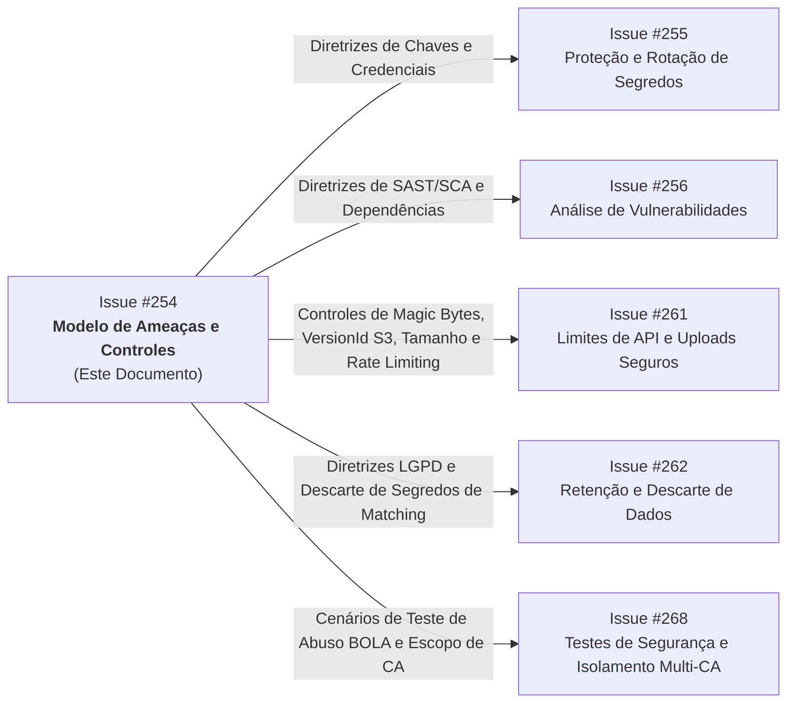

# Modelo de Ameaças e Controles de Segurança — Projeto CApp

## 1. Contexto, Objetivos e Escopo

### 1.1 Contexto da Plataforma
O **CApp** é uma plataforma institucional multi-tenant concebida para atender à comunidade universitária (com suporte inicial à Universidade de Brasília — UnB e arquitetura extensível para múltiplas instituições de ensino cadastradas), fornecendo infraestrutura comum para que diferentes Centros Acadêmicos (CAs) gerenciem informações, processos eleitorais, representação estudantil, comunicação, eventos, demandas acadêmicas, programas de acolhimento e governança interna.

A arquitetura adota o modelo de *Modular Monolith* no backend (desenvolvido em Rust utilizando Axum, SQLx e PostgreSQL), clientes distribuídos (aplicativo móvel em Flutter/Dart e interfaces web futuras) e especificações comportamentais BDD compartilhadas (Gherkin).

### 1.2 Objetivo do Documento
Este documento formaliza o **Mapeamento de Riscos e Definição de Controles de Segurança** do CApp, em atendimento à **Issue #254** ("Mapear riscos e definir controles de segurança do CApp"), vinculada à entrega incremental **I01 ("Acesso e meu CA")** e à issue agregadora **#248 ("Reforçar a segurança e a proteção de dados da plataforma")** da Milestone 13.

Seus objetivos específicos são:
1. Estabelecer o inventário exaustivo de ativos de informação, integrações externas, credenciais operacionais e superfícies de ataque da plataforma.
2. Mapear os limites de confiança (*trust boundaries*) e isolamentos lógicos essenciais, especialmente entre diferentes Centros Acadêmicos (*Multi-CA Tenant Isolation*).
3. Aplicar metodologia estruturada de modelagem de ameaças (**STRIDE** e **OWASP Top 10 / OWASP API Security Top 10**), com ênfase nas especificidades de negócio do produto.
4. Definir a matriz de riscos (Probabilidade x Impacto) e documentar as decisões técnicas de tratamento e os controles de segurança proporcionais.
5. Estabelecer o processo contínuo de revisão e governança de segurança após mudanças arquiteturais.

### 1.3 Rastreabilidade de Diretrizes e Invariantes Institucionais
O modelo de segurança implementado respeita rigorosamente as invariantes documentadas na Wiki institucional do projeto e nas especificações de arquitetura do repositório (com destaque para `features/identidade_e_acesso/autenticacao_institucional.feature`):
- **Instituição Cadastrada e Vínculo Estudantil Confirmado**: O acesso à plataforma é restrito a contas vinculadas a instituições de ensino formalmente cadastradas no CApp (com suporte inicial à UnB e suporte arquitetural a múltiplas instituições cadastradas). A instituição é identificada exclusivamente pelo *tenant* do diretório Microsoft e pelo cadastro correspondente no banco de dados. O vínculo estudantil é comprovado pela participação ativa no grupo institucional configurado para estudantes no diretório da instituição (e **não** pelo domínio do e-mail nem pelo curso informado).
- **Isolamento de Preferência**: O campo `favorite_ca_id` em `user_preference` é uma mera facilidade de interface para definição do contexto inicial exibido; **não confere vínculo acadêmico, nem privilégios de gestão, nem direitos eleitorais**.
- **Privacidade e Proteção de Dados**: Aderência aos princípios da Lei Geral de Proteção de Dados (LGPD - Lei 13.709/2018), com minimização de coleta, finalidade específica e vedação à discriminação discente.
- **Proibição de Dados Reais**: Utilização exclusiva de dados e identificadores didáticos homologados nos testes e documentações (ex.: CAER `018f0000-0000-7000-8000-000000000001`, CACC `018f0000-0000-7000-8000-000000000002`, usuários `241098765@aluno.unb.br`, `231012345@aluno.unb.br`, `262001234@aluno.unb.br`, `estudante@aluno.example.edu`).

---

## 2. Fronteiras de Confiança e Arquitetura de Defesa

O sistema opera sobre fronteiras de confiança explícitas (*Trust Boundaries*), representadas no fluxo de dados abaixo:

```mermaid
flowchart TD
    subgraph UntrustedZone["Zona Não Confiável (Ambiente do Usuário)"]
        MobileApp["Cliente Mobile (Flutter Android/iOS)"]
        WebClient["Futuro Cliente Web"]
    end

    subgraph ExternalAuthZone["Provedores Externos de Identidade"]
        MS_Auth["Microsoft Entra ID (Tenants Institucionais Cadastrados)"]
        Firebase_Auth["Firebase Authentication"]
        MS_Graph["Microsoft Graph API (Dados Acadêmicos e Grupos)"]
    end

    subgraph DMZ["Ponto de Entrada e Trânsito"]
        ReverseProxy["Reverse Proxy / API Gateway (TLS 1.3 Termination)"]
    end

    subgraph TrustedBackend["Backend CApp (Rust Modular Monolith)"]
        AuthMiddleware["Middleware de Autenticação & Contexto"]
        RBACMiddleware["Middleware de Autorização Multi-CA & RBAC"]
        ModuleIdentity["Módulo Identity"]
        ModuleCA["Módulo CA & Governança"]
        ModuleElections["Módulo Elections & Sigilo"]
        ModuleStrikes["Módulo Strikes & Ocorrências"]
        ModuleMentorship["Módulo Mentorship & Matching"]
        ModuleStorage["Módulo Storage & Uploads"]
    end

    subgraph SecurePersistence["Persistência e Armazenamento Seguro"]
        PostgresDB[("PostgreSQL 17 (Banco Relacional)")]
        ObjectStorage[("Object Storage (S3 / MinIO) - Arquivos & PDFs")]
        SecretsService["KMS / Gerenciador de Segredos Operacionais"]
    end

    MobileApp -->|HTTPS / REST API| ReverseProxy
    WebClient -->|HTTPS / REST API| ReverseProxy
    MobileApp -.->|Login Interativo OIDC| MS_Auth
    MS_Auth -.->|OAuth Token / Claims| Firebase_Auth
    Firebase_Auth -.->|ID Token JWT| MobileApp

    ReverseProxy --> AuthMiddleware
    AuthMiddleware -->|Validação Local de Assinatura & Claims (JWKS)| Firebase_Auth
    AuthMiddleware --> RBACMiddleware

    RBACMiddleware --> ModuleIdentity
    RBACMiddleware --> ModuleCA
    RBACMiddleware --> ModuleElections
    RBACMiddleware --> ModuleStrikes
    RBACMiddleware --> ModuleMentorship
    RBACMiddleware --> ModuleStorage

    ModuleIdentity -.->|Consulta Escolar & Grupos Delegada| MS_Graph
    ModuleIdentity --> PostgresDB
    ModuleCA --> PostgresDB
    ModuleElections --> PostgresDB
    ModuleStrikes --> PostgresDB
    ModuleMentorship --> PostgresDB
    ModuleStorage --> PostgresDB

    ModuleStorage -->|Pre-signed URLs / Validação| ObjectStorage
    ModuleMentorship -->|Envelope Encryption / Chaves| SecretsService
    ModuleElections -->|Chaves Criptográficas de Eleição| SecretsService
```

### Limites de Confiança Identificados (TB - Trust Boundaries)
1. **TB-01 (Cliente vs. API Backend)**: Dispositivos móveis e navegadores web são ambientes sob controle do usuário, sujeitos a descompilação, engenharia reversa e manipulação de requisições. O backend nunca confia em cabeçalhos, parâmetros ou estados enviados pelo cliente sem validação criptográfica e semântica.
2. **TB-02 (Backend vs. Provedores Externos de Identidade)**: Integração com Microsoft Entra ID e Firebase Authentication. O backend valida localmente a assinatura RS256 e as *claims* de emissor (*issuer*), audiência (*audience*), prazo de expiração (*expiration*) e identificador do usuário (*subject*) via JWKS público (`FirebaseTokenVerifier` — controle existente). O backend **não** consulta atualmente revogação de tokens nem verifica o estado em tempo real da conta no provedor upstream (controle pendente).
3. **TB-03 (Tenant Boundary / Isolamento Multi-CA)**: Cada Centro Acadêmico constitui um domínio administrativo independente. A posse de privilégios de gestão no CA "A" (ex.: CAER) não concede qualquer permissão sobre o CA "B" (ex.: CACC).
4. **TB-04 (Administração da Plataforma vs. Gestão Local de CA)**: Segregação formal entre os fluxos de verificação de ações globais de plataforma (`PlatformAdministration`) e ações de gestão local de Centro Acadêmico (`CaManagement`). Operações de escopo global (como a homologação de solicitações de verificação de CAs ou concessão de administradores de plataforma) verificam a permissão global em `platform_administrator`, enquanto operações de CA verificam cargo ativo, mandato vigente e permissões específicas em `management_assignment`. Acumular papéis globais e locais nunca invalida nem degrada permissões legítimas em nenhum dos escopos.
5. **TB-05 (Separação Eleitoral, Quadro Público e Voto Secreto)**: Distinção estrita entre a associação pública auditável (identificação do eleitor, cédula cifrada e assinatura do eleitor presentes no recibo assinado e no quadro público auditável para verificação de inclusão da cédula) e a revelação da escolha eleitoral em texto claro, cujo sigilo é absoluto e desassociado da identidade do eleitor na apuração final.
6. **TB-06 (Armazenamento de Arquivos Privados)**: Documentos de verificação e comprovação financeira possuem classificação restrita e nunca são expostos por links públicos perpétuos ou previsíveis.

---

## 3. Inventário Exaustivo de Ativos

A tabela a seguir consolida os ativos críticos da plataforma, categorizados por domínio, classificação da informação, requisitos de segurança (Confidencialidade, Integridade, Disponibilidade) e regulamentação aplicável.

| ID Ativo | Ativo de Informação / Técnico | Descrição e Componentes | Classificação | Requisitos (C/I/D) | Base Legal / Regra |
| :--- | :--- | :--- | :--- | :--- | :--- |
| **AST-01** | **Identidade Institucional Discente** | `app_user`, `external_identity`, e-mail institucional de instituição cadastrada, `display_name`, `firebase_uid`, `microsoft_subject`, `institution_id`. | Confidencial / Pessoal | C: Alta<br>I: Crítica<br>D: Alta | LGPD Art. 7º (Execução de políticas públicas/regulatórias) |
| **AST-02** | **Dados Acadêmicos e Vínculo** | `academic_record`, `course_id`, `academic_status`, códigos de matérias cursadas (`discipline`). | Confidencial | C: Alta<br>I: Crítica<br>D: Alta | LGPD / Segredo Acadêmico |
| **AST-03** | **Matrícula Discente** | Número de matrícula institucional (formato institucional). | Restrito / Sensível | C: Alta<br>I: Crítica<br>D: Alta | Regra do Projeto: Proibição de uso da matrícula real nos testes e vedação à exposição pública desnecessária |
| **AST-04** | **Preferência de CA Favorito** | `user_preference.favorite_ca_id`. | Interno | C: Baixa<br>I: Média<br>D: Média | Invariante: Preferência de interface, sem efeito de autorização |
| **AST-05** | **Documentos de Verificação de CA** | `verification_request`, `verification_document`, atas de eleição, posse e estatutos armazenados em `stored_file`. | Confidencial / Restrito | C: Crítica<br>I: Crítica<br>D: Média | Segurança Institucional / Prevenção a usurpação de CAs |
| **AST-06** | **Cédula Cifrada e Quadro Público** | `secret_ballot` (`id`, `election_id`, `encrypted_choice`, `validity_proof`). No quadro público, associada à identidade e assinatura do eleitor sem revelar a escolha em texto claro. | Altamente Confidencial (Escolha) / Auditável Público (Cédula cifrada e prova) | C: Máxima (Escolha)<br>I: Crítica<br>D: Crítica | Estatuto Eleitoral / Sigilo Constitucional do Voto |
| **AST-07** | **Registro e Recibo Eleitoral** | `election_elector`, `electoral_participation`, recibo assinado digitalmente fornecido ao eleitor (marcação de voto único e comprovação de depósito da cédula). | Restrito / Auditável | C: Média<br>I: Crítica<br>D: Crítica | Integridade Eleitoral / Prevenção a voto duplo e auditoria |
| **AST-08** | **Histórico Individual de Strikes** | `occurrence`, `strike`, `consequence_application` associados a `target_user_id`. | Restrito / Pessoal Sensível | C: Máxima<br>I: Crítica<br>D: Alta | LGPD Art. 11 / Dignidade do Estudante / Vedação a linchamento digital |
| **AST-09** | **Histórico Institucional do CA** | Ocorrências e strikes onde `target_kind = academic_center` e política `strike_policy.publish_ca_history`. | Público ou Interno ao CA | C: Média<br>I: Crítica<br>D: Média | Governança e Transparência do CA |
| **AST-10** | **Identificadores Secretos de Matching** | `matching_secret` (`field_key`, `encrypted_value`, `encryption_key_ref`). | Altamente Confidencial | C: Máxima<br>I: Alta<br>D: Média | Privacidade Discente / Segredo Compartilhado |
| **AST-11** | **Respostas de Quizzes & Recomendações** | `quiz_submission`, `quiz_answer`, `mentor_endorsement`. | Confidencial | C: Alta<br>I: Alta<br>D: Média | LGPD / Privacidade do Programa de Apadrinhamento |
| **AST-12** | **Arquivos do Sistema (Storage Objects)** | Objetos no MinIO/S3 referenciados por `stored_file` (imagens, comprovantes, PDFs). Chaves imutáveis por tentativa de upload e versionamento habilitado (`storage_version_id`). | Conforme `access_class` (Public / Restricted / Confidential) | C: Variável<br>I: Alta<br>D: Alta | Política de Gestão de Arquivos |
| **AST-13** | **Trilha de Auditoria Geral** | `audit_event`, `election_audit_event`, `occurrence_history`. | Restrito / Imutável | C: Alta<br>I: Crítica<br>D: Alta | Rastreabilidade e Não Repúdio |
| **AST-14** | **Credenciais e Chaves de Aplicação** | Chaves do Firebase Admin, Microsoft Client Secret, `DATABASE_URL`, chaves KMS para criptografia de matching e eleição. | Crítico / Segredo Operacional | C: Máxima<br>I: Máxima<br>D: Máxima | Segurança da Infraestrutura |

---

## 4. Superfícies de Entrada e Vetores de Exposição

O mapeamento das portas de entrada do sistema é essencial para delimitar o perímetro defensivo:

1. **API REST HTTP (Backend Axum)**:
   - Endpoints públicos: rotas de health check (`/health`), descoberta de CAs públicos e webhook de autenticação/tokens.
   - Endpoints autenticados de usuário discente: perfil, preferências, consulta de notícias, eventos, materiais e participação em apadrinhamento.
   - Endpoints de gestão de CA: criação de notícias, moderação de eventos, aplicação de strikes locais, gestão de chapas eleitorais.
   - Endpoints da administração da plataforma: concessão/revogação de `platform_administrator`, aprovação de `verification_request`.
2. **Upload e Download de Arquivos**:
   - Requisição de pre-signed URLs de upload para S3/MinIO geradas com chaves imutáveis por tentativa de upload (`attempt_uuid`) e notificação de conclusão para o backend.
   - Vinculação de integridade ao `versionId` gerado pelo S3 Object Versioning e enfileiramento para quarentena e validação de segurança.
   - Download de materiais acadêmicos e documentos anexos através de tokens de acesso temporários vinculados à versão exata validada.
3. **Integrações Externas em Rede (Saída e Retorno)**:
   - Troca de chaves JWKS com Google/Firebase para validação de tokens JWT.
   - Chamadas HTTP REST para Microsoft Graph para enriquecimento de matrícula, status escolar discente e confirmação de participação no grupo institucional de estudantes.
   - Envio de notificações push para o Firebase Cloud Messaging (FCM).
4. **Armazenamento Persistente (PostgreSQL)**:
   - Pool de conexões SQLx conectado via credenciais com privilégios de aplicação (sem permissões de DDL em tempo de execução).

---

## 5. Modelagem de Ameaças Estruturada (STRIDE)

A aplicação do framework STRIDE sobre os componentes do CApp detalha cenários plausíveis de abuso e o impacto correspondente:

### 5.1 Spoofing (Falsificação de Identidade)
- **AME-S01: Login com conta pessoal, de instituição não cadastrada ou sem vínculo discente**:
  - *Cenário*: Atacante utiliza conta pessoal Microsoft (@outlook, @hotmail, etc.), conta de instituição não cadastrada no CApp ou conta institucional válida cujo usuário não pertence ao grupo discente institucional configurado no diretório Microsoft para tentar autenticar via Firebase e forjar sessão no CApp.
  - *Impacto*: Tentativa de acesso indevido a serviços, materiais acadêmicos restritos e processos de CAs.
- **AME-S02: Falsificação de identidade em eleição**:
  - *Cenário*: Usuário tenta reutilizar credenciais ou injetar cabeçalhos de outros alunos para computar voto fraudulento.
  - *Impacto*: Viciação da eleição do CA, quebra da soberania do sufrágio.
- **AME-S03: Usurpação de papel administrativo de CA**:
  - *Cenário*: Discente manipula token ou IDs em requisição para agir como coordenador de CA sem ter sido nomeado em `management_assignment`.
  - *Impacto*: Publicação de notícias falsas, manipulação de ocorrências e eventos.

### 5.2 Tampering (Adulteração de Dados)
- **AME-T01: Manipulação do contexto ativo de CA para contornar checagens**:
  - *Cenário*: Atacante altera a preferência `favorite_ca_id` e tenta submeter requisições administrativas alegando que seu contexto ativo lhe concede autoridade.
  - *Impacto*: Tentativa de bypass de RBAC.
- **AME-T02: Adulteração de documentos de verificação de CA**:
  - *Cenário*: Discente altera PDF de ata eleitoral após envio ou intercepta o trânsito do upload para enviar arquivo adulterado para obter selo oficial do CA.
  - *Impacto*: Concessão fraudulenta de selo verificado para entidade ilegítima.
- **AME-T03: Adulteração de votos ou contagem eleitoral**:
  - *Cenário*: Modificação indevida de registros em `secret_ballot` ou forja do total apurado em `slate_vote_total`.
  - *Impacto*: Fraude no resultado da gestão eleita.
- **AME-T04: Upload de malware mascarado em materiais de estudo ou comprovantes**:
  - *Cenário*: Upload de executável malicioso, scripts XSS ou arquivos PDF formalmente válidos contendo payloads/exploits embutidos (JavaScript malicioso, streams corrompidos) em `stored_file`.
  - *Impacto*: Comprometimento de dispositivos de estudantes ou administradores que realizarem o download e abertura dos arquivos.
- **AME-T05: Sobrescrita pós-validação de arquivo em URL pré-assinada S3**:
  - *Cenário*: Atacante envia um arquivo legítimo através da URL pré-assinada, aguarda a validação do backend (magic bytes e cálculo de hash SHA-256), e, aproveitando a janela de validade restante da URL pré-assinada S3, envia um arquivo adulterado ou malicioso sobre a mesma chave antes que a operação seja encerrada.
  - *Impacto*: Substituição de documento oficial aprovado por documento malicioso ou adulterado sem nova inspeção de segurança.

### 5.3 Repudiation (Repúdio de Ações)
- **AME-R01: Aplicação de strike sem registro de autoridade**:
  - *Cenário*: Gestor aplica penalidade severa a um desafeto político dentro do CA e o sistema não grava a autoria da ação em `occurrence_history`.
  - *Impacto*: Impossibilidade de apurar abuso de autoridade por membros da diretoria do CA.
- **AME-R02: Votação sem trilha de elegibilidade**:
  - *Cenário*: Discente questiona o resultado eleitoral alegando que não votou ou que seu voto foi computado sem ele estar apto.
  - *Impacto*: Insegurança jurídica e anulação judicial/estatutária do pleito.

### 5.4 Information Disclosure (Exposição Indevida de Informações)
- **AME-I01: Quebra do sigilo do voto secreto discente**:
  - *Cenário*: Revelação da escolha eleitoral em texto claro nos dados públicos, exposição antecipada de chaves privadas da eleição, ou correlação estatística/temporal entre requisições HTTP e inserções na apuração eleitoral que permitam desvendar o voto individual.
  - *Impacto*: Quebra do sigilo constitucional e estatutário do voto, gerando coação e retaliação política contra estudantes.
- **AME-I02: Exposição pública do histórico individual de strikes**:
  - *Cenário*: Ocorrências e strikes de um discente vazam por endpoint mal configurado ou através da flag `publish_ca_history`.
  - *Impacto*: Exposição vexatória do estudante perante a comunidade acadêmica; infração direta à LGPD e risco de litígio judicial.
- **AME-I03: Vazamento de documentos de verificação de CA**:
  - *Cenário*: Acesso direto não autenticado aos arquivos probatórios de posse e dados pessoais de diretores do CA por meio de URLs públicas previsíveis no bucket.
  - *Impacto*: Vazamento de dados de dirigentes e documentos internos.
- **AME-I04: Vazamento de segredos de matching e respostas privadas de quizzes**:
  - *Cenário*: Respostas íntimas do questionário de apadrinhamento expostas na API ou inclusão de identificadores secretos em dumps de telemetria/treinamento de modelo neural.
  - *Impacto*: Violação de intimidade e quebra de confiança no programa de recepção de calouros.

### 5.5 Denial of Service (Negação de Serviço)
- **AME-D01: Esgotamento de conexões ou CPU por requisições descontroladas**:
  - *Cenário*: Varredura massiva em rotas de listagem de matérias, notícias ou fóruns sem limitação de taxa (*rate limiting*).
  - *Impacto*: Indisponibilidade do backend durante períodos críticos (ex.: apuração eleitoral ou matrícula).
- **AME-D02: Esgotamento de storage via upload abusivo**:
  - *Cenário*: Atacante solicita centenas de URLs de upload de arquivos pesados, exaurindo cota do bucket ou espaço de banco.
  - *Impacto*: Parada de serviços de upload legítimos.

### 5.6 Elevation of Privilege (Elevação de Privilégio / BOLA / BFLA)
- **AME-E01: Quebra de isolamento Multi-CA (BOLA - Broken Object Level Authorization)**:
  - *Cenário*: Gestor do CAER envia payload em `/api/v1/news` informando o `ca_id` do CACC para publicar notícia oficial em nome de outro centro acadêmico.
  - *Impacto*: Comunicação fraudulenta em nome de CA alheio.
- **AME-E02: Autoaprovação de verificação de CA**:
  - *Cenário*: Solicitante de verificação de um CA manipula a chamada de decisão (`POST /api/v1/ca/verifications/{id}/decide`) para aprovar a própria solicitação sem possuir a permissão global `PlatformAdministration`.
  - *Impacto*: Concessão ilegítima de selo oficial e status verificado na plataforma.
- **AME-E03: Extrapolação de consequência de strike para banimento global**:
  - *Cenário*: Gestor local tenta criar regra de consequência que bloqueia o login do aluno em toda a plataforma CApp ou em outros CAs.
  - *Impacto*: Usurpação de competência institucional privativa da universidade.

---

## 6. Matriz de Avaliação e Priorização de Riscos

A metodologia adota uma escala de severidade 5x5:
- **Probabilidade (P)**: 1 (Rara), 2 (Improvável), 3 (Possível), 4 (Provável), 5 (Muito Provável).
- **Impacto (I)**: 1 (Insignificante), 2 (Baixo), 3 (Médio), 4 (Alto), 5 (Crítico).
- **Nível de Severidade (Score = P × I)**:
  - **15 a 25**: Crítico (Ação imediata obrigatória e testes automatizados de bloqueio)
  - **10 a 14**: Alto (Controles técnicos preventivos mandatórios)
  - **5 a 9**: Médio (Controles padrões e monitoramento)
  - **1 a 4**: Baixo (Procedimentos operacionais e boas práticas)

### Classificação do Ciclo de Vida dos Controles
Para garantir total transparência sobre a maturidade de segurança da plataforma, os controles técnicos são categorizados em:
- **[Existente]**: Controles já implementados, testados e funcionais no código atual do backend/mobile (ex.: verificação local de assinatura RS256 e claims via JWKS pelo `FirebaseTokenVerifier`).
- **[Planejado]**: Controles com desenho técnico aprovado e subissues vinculadas para entrega na milestone/roadmap atual (ex.: subissues #255, #261, #268, #282).
- **[Pendente]**: Controles essenciais identificados no modelo de ameaças que demandam integrações ou serviços futuros ainda não construídos no backend (ex.: verificação ativa de revogação de tokens e estado da conta junto à API upstream; pipeline de quarentena e varredura antimalware de arquivos; embaralhamento/mixnet na apuração eleitoral).

> [!IMPORTANT]
> **Condicionalidade dos Riscos Residuais Baixos**: Os níveis de **Risco Residual** classificados como **Baixo** na tabela abaixo constituem **estimativas projetadas e estritamente condicionadas à implementação futura integral dos controles planejados e pendentes**. No estado operacional atual da base de código — onde vigoram apenas os controles *[Existentes]* (com ausência de consulta de revogação de tokens e ausência de varredura antimalware em PDFs válidos) —, o risco residual real imediato permanece em patamares superiores (**Médio** ou **Alto**). Conforme os controles *[Planejados]* e *[Pendentes]* forem integrados, o risco residual efetivo convergirá para as estimativas projetadas.

| ID Risco | Ameaça Mapeada | Ativos Afetados | P (Inerente) | I (Inerente) | Risco Inerente | Decisão de Tratamento e Classificação dos Controles | P (Residual) | I (Residual) | Risco Residual Projetado | Subissue Relacionada |
| :--- | :--- | :--- | :---: | :---: | :---: | :--- | :---: | :---: | :---: | :---: |
| **RSK-01** | Login com conta de instituição não cadastrada, pessoal ou sem vínculo estudantil | AST-01, AST-02 | 4 | 5 | **Crítico (20)** | **Mitigar**: `[Existente]` Validação local de assinatura RS256 e claims (`iss`, `aud`, `exp`, `sub`) via JWKS pelo `FirebaseTokenVerifier`; `[Planejado]` Mapeamento de `tenant_id` contra instituições cadastradas na base e verificação de vínculo por grupo institucional configurado via MS Graph; `[Pendente]` Consulta ativa de revogação de tokens e estado da conta. | 1 | 4 | **Baixo (4)\*** | #248, #254 |
| **RSK-02** | Quebra de isolamento Multi-CA (BOLA) | AST-05, AST-08, AST-09 | 4 | 5 | **Crítico (20)** | **Mitigar**: `[Existente]` Checagem básica de papéis no banco; `[Planejado]` Segregação de fluxos RBAC: ações globais de plataforma (`PlatformAdministration`) vs. gestão local de CA (`CaManagement`), com validação tripla `(user, ca_id, permission)` e checagem de vigência de mandato. | 1 | 4 | **Baixo (4)\*** | #268 |
| **RSK-03** | Quebra do sigilo da escolha do eleitor na votação secreta | AST-06, AST-07 | 3 | 5 | **Crítico (15)** | **Mitigar**: `[Planejado]` Cédula cifrada com chave do pleito (não revela a escolha em texto claro), quadro público auditável com vínculo eleitor-cédula cifrada-assinatura e recibo assinado pelo servidor (#282); `[Pendente]` Desacoplamento da identidade na apuração via limiar criptográfico/mixnet e ausência de logs correlacionáveis. | 1 | 4 | **Baixo (4)\*** | #248, #282 |
| **RSK-04** | Exposição do histórico individual de strikes | AST-08 | 3 | 5 | **Crítico (15)** | **Mitigar**: `[Planejado]` Isolamento rígido de rotas por `target_user_id`; `publish_ca_history` restrito a dados institucionais do CA (`target_kind = academic_center`); proibição absoluta de listagem de discentes. | 1 | 4 | **Baixo (4)\*** | #262, #268 |
| **RSK-05** | Vazamento de documentos de verificação de CA | AST-05, AST-12 | 3 | 4 | **Alto (12)** | **Mitigar**: `[Planejado]` Armazenamento com classe confidencial restrita; download via URLs pré-assinadas efêmeras (TTL 5 min) vinculadas ao `versionId` exato; autorização estrita via `PlatformAdministration` ou solicitante. | 1 | 3 | **Baixo (3)\*** | #261 |
| **RSK-06** | Upload de arquivo malicioso, executável ou PDF válido com malware | AST-12 | 4 | 4 | **Crítico (16)** | **Mitigar**: `[Planejado]` Validação de magic bytes (MIME type real), limite estrito de tamanho (10 MB), hash digest SHA-256 e sanitização (#261); `[Pendente]` Pipeline assíncrono de quarentena (`scan_status`), varredura antimalware de PDFs e headers HTTP defensivos de entrega (`Content-Disposition: attachment`, CSP estrito). *(Risco residual atual sem quarentena: Médio [6])*. | 1 | 3 | **Baixo (3)\*** | #261 |
| **RSK-07** | Vazamento ou dedução de segredos de matching | AST-10, AST-11 | 3 | 4 | **Alto (12)** | **Mitigar**: `[Planejado]` Envelope encryption com KMS externo; proibição de hash simples de baixa entropia; exclusão de logs e dumps neurais. | 1 | 3 | **Baixo (3)\*** | #255, #262 |
| **RSK-08** | Autoaprovação de verificação de CA | AST-05 | 3 | 4 | **Alto (12)** | **Mitigar**: `[Planejado]` Autorização restrita exclusivamente ao fluxo global `PlatformAdministration` no banco; impedimento de aprovação via permissões locais de CA. | 1 | 3 | **Baixo (3)\*** | #268 |
| **RSK-09** | Abuso de preferência `favorite_ca_id` para privilégio | AST-04 | 4 | 3 | **Alto (12)** | **Mitigar**: `[Existente/Planejado]` Invariante arquitetural no código: permissões são consultadas unicamente via `management_assignment`. | 1 | 2 | **Baixo (2)\*** | #254, #268 |
| **RSK-10** | DoS por saturação de requisições ou uploads | AST-12, AST-14 | 4 | 3 | **Alto (12)** | **Mitigar**: `[Planejado]` Limitação de taxa de requisições por IP e usuário no gateway; cotas por CA; timeouts rigorosos em integrações. | 2 | 2 | **Baixo (4)\*** | #259, #261 |
| **RSK-11** | Comprometimento ou vazamento de segredos/credenciais | AST-14 | 2 | 5 | **Alto (10)** | **Mitigar**: `[Existente]` Segredos excluídos do repositório Git e `.env` no `.gitignore`; `[Planejado]` Segredos injetados em runtime via Secret Manager (#255); varredura estática de commits (#256). | 1 | 4 | **Baixo (4)\*** | #255, #256 |
| **RSK-12** | Extrapolação de strike para banimento global | AST-08 | 3 | 4 | **Alto (12)** | **Mitigar**: `[Planejado]` Invariante de domínio: consequência de strike só atua no escopo local do CA (`consequence_application.ca_id`). | 1 | 2 | **Baixo (2)\*** | #254 |
| **RSK-13** | Substituição pós-validação de arquivo em URL pré-assinada S3 | AST-05, AST-12 | 3 | 4 | **Alto (12)** | **Mitigar**: `[Planejado]` Chaves unívocas e imutáveis por tentativa de upload (`attempt_uuid`), S3 Object Versioning obrigatório com captura do `versionId` na confirmação e vinculação estrita de download e integridade à versão exata validada (#261). | 1 | 3 | **Baixo (3)\*** | #261 |

*\* Nota: Estimativas de risco residual baixo condicionadas à implementação futura integral dos controles planejados e pendentes.*

---

## 7. Decisões de Tratamento e Controles Técnicos Detalhados

### 7.1 Controles de Autenticação e Gestão de Sessão Institucional
1. **Validação de Token e Claims (Controles Existentes e Pendentes)**:
   - *Validação Criptográfica Local [Existente]*: O backend implementa no componente `FirebaseTokenVerifier` a verificação local de ID Tokens JWT emitidos pelo Firebase Authentication, assinados com RS256, utilizando chaves públicas obtidas do endpoint JWKS do Google (armazenadas em cache com sincronização por `RwLock`/`Mutex` e respeito a diretivas HTTP de cache). São validadas localmente as claims padrão de emissor (`iss`), audiência (`aud`), expiração (`exp`) e identificador do usuário (`sub`).
   - *Limitação Operacional e Consulta de Revogação [Pendente]*: Conforme documentado no `FirebaseTokenVerifier`, a verificação local comprova a autenticidade e o prazo do token, mas **não** consulta o estado em tempo real da conta nem verifica se o token foi revogado no Firebase ou no provedor upstream. Portanto, um token revogado administrativamente pode permanecer aceito pelo backend até sua expiração natural (`exp`). A implementação de consulta ativa de revogação de tokens e a sincronização periódica do estado da conta junto à API do Firebase constituem controles pendentes de implementação futura.
2. **Arquitetura Multi-Instituição e Confirmação de Vínculo Estudantil [Planejado]**:
   - *Identificação da Instituição por Diretório e Cadastro*: Em conformidade com a especificação funcional `features/identidade_e_acesso/autenticacao_institucional.feature`, o CApp é uma plataforma multi-instituição. O acesso não é restrito exclusivamente à UnB, nem se impõe um formato ou domínio específico de e-mail institucional. A instituição de origem do estudante é identificada unicamente pelo identificador de diretório (*tenant*) Microsoft (`tenant_id`) vinculado ao token e pelo cadastro ativo correspondente da instituição na tabela `institution` do banco de dados relacional.
   - *Comprovação do Vínculo Estudantil*: O vínculo estudantil discente é comprovado exclusivamente pela confirmação de participação ativa da conta no grupo institucional configurado para estudantes no diretório Microsoft da instituição (verificado via Microsoft Graph / claims upstream). O domínio do e-mail da conta (ex.: `@aluno.unb.br`, `@aluno.example.edu`) e o curso informado pelo estudante na conta **não** comprovam nem substituem a confirmação de vínculo estudantil pelo serviço.
   - *Bloqueio Semântico de Contas Não Elegíveis*: Contas pessoais Microsoft (@outlook, @hotmail, etc.), contas pertencentes a tenants institucionais não cadastrados no CApp e contas institucionais sem participação confirmada no grupo discente configurado da instituição são categoricamente rejeitadas com erro semântico amigável, sem estabelecimento de sessão na plataforma.
3. **Provisionamento Idempotente e Seguro [Existente/Planejado]**:
   - A criação de registros em `app_user` e `external_identity` utiliza chaves unívocas (`firebase_uid` e o par `institution_id, microsoft_subject`). Tentativas repetidas reaproveitam a identidade existente, prevenindo duplicações de perfis e ataques de corrida concorrente.
   - O provisionamento não solicita nem aceita parâmetros privilegiados enviados pelo cliente HTTP (ex.: cargos ou flags de administração).

### 7.2 Controles de Isolamento Estrito Multi-CA e Autorização Granular
1. **Desacoplamento entre Navegação e Autorização [Existente/Planejado]**:
   - O campo `user_preference.favorite_ca_id` é tratado pelo backend como dado meramente cosmético de preferência visual. Nenhum middleware de autorização utiliza esse valor para inferir privilégios.
2. **Segregação de Fluxos de Autorização: Global vs. Local [Planejado]**:
   - As operações administrativas da plataforma dividem-se rigidamente em dois fluxos de verificação independentes:
     - **Fluxo 1: Ações Globais de Plataforma (`PlatformAdministration`)**:
       - Aplicável a operações de escopo global da plataforma (ex.: decidir sobre solicitações de verificação de CAs em `POST /api/v1/ca/verifications/{id}/decide`, concessão e revogação de administradores da plataforma e trilhas de auditoria globais).
       - O middleware valida se o usuário autenticado possui registro ativo e irrevogável na tabela `platform_administrator`, outorgando-lhe a permissão administrativa global `PlatformAdministration`.
       - Não depende nem consulta nenhum contexto ou cargo de Centro Acadêmico local.
     - **Fluxo 2: Ações Locais de Centro Acadêmico (`CaManagement`)**:
       - Aplicável a operações restritas ao âmbito de governança de um CA específico (ex.: publicação de notícias, moderação de eventos, aplicação de advertências/strikes locais e gestão de chapas eleitorais).
       - O middleware exige obrigatoriamente o identificador do CA alvo (`ca_id`) e executa a validação em camadas:
         1. O usuário possui atribuição de cargo ativa em `management_assignment` para um cargo (`ca_role`) pertencente especificamente ao CA alvo (`ca_id`);
         2. O mandato de gestão correspondente (`management_term`) possui status `'active'` e está na vigência temporal atual (`starts_on <= hoje <= ends_on`);
         3. O cargo (`ca_role`) do usuário possui a permissão requerida associada em `role_permission` (permissões locais do domínio `CaManagement`).
       - Caso qualquer uma dessas condições não seja atendida, o acesso é sumariamente negado com HTTP `403 Forbidden` e log auditável.
3. **Independência, Não-Interferência e Acúmulo de Papéis [Planejado]**:
   - Um usuário discente pode acumular simultaneamente o papel de administrador global de plataforma e cargos de gestão local em um ou mais Centros Acadêmicos.
   - **O acúmulo de ambos os papéis nunca invalida nem degrada permissões legítimas**:
     - Quando o usuário executa uma ação de governança local de CA onde possui cargo ativo e mandato vigente, suas permissões de `CaManagement` são avaliadas normalmente no escopo daquele CA.
     - Quando o mesmo usuário executa uma ação global de plataforma, sua permissão de `PlatformAdministration` é avaliada pelo fluxo global, sem sofrer qualquer interferência de suas atribuições locais de CA.
   - **Impedimento de Conflito de Interesses**: Nenhum gestor local de CA pode aprovar ou rejeitar solicitações de verificação (`verification_request`) do seu próprio CA ou de terceiros com base em permissões locais de CA. Decisões de verificação exigem estritamente a permissão global `PlatformAdministration`.

### 7.3 Controles de Proteção para Documentos de Verificação de CA e Upload de Arquivos
1. **Upload Seguro via Pre-Signed URLs e Prevenção de Sobrescrita Pós-Validação [Planejado]**:
   - O aplicativo móvel nunca envia arquivos diretamente através de conexões de longa duração no servidor da API principal.
   - **Chaves Imutáveis por Tentativa de Upload**: Cada solicitação de upload gera no backend uma URL pré-assinada para o serviço de armazenamento (S3/MinIO) com validade restrita a 15 minutos, restrita ao verbo `PUT` e associada a uma chave unívoca com identificador de tentativa (ex.: `uploads/verifications/{ca_id}/{attempt_uuid}/{file_uuid}.pdf`). A tentativa de upload é consumida e encerrada no backend no momento da notificação de conclusão, impedindo que a mesma URL pré-assinada seja reaproveitada para uploads subsequentes.
   - **S3 Object Versioning e Vinculação ao VersionId Exato**: Para mitigar o risco de substituição maliciosa pós-validação (onde um atacante envia um arquivo legítimo, aguarda a validação do backend e em seguida sobrescreve o objeto antes da expiração da URL pré-assinada), o bucket S3 opera com versionamento ativado (*Object Versioning*):
     - No momento em que o cliente notifica a conclusão do upload, o backend consulta os metadados do objeto no S3 e extrai o `versionId` exato gerado (`x-amz-version-id`).
     - A validação de magic bytes e o cálculo do digest criptográfico SHA-256 são executados **especificamente sobre esse `versionId`**, gravando de forma imutável o par `(storage_key, storage_version_id, digest)` em `stored_file`.
     - Todas as URLs pré-assinadas temporárias de download geradas para leitura vinculam-se obrigatoriamente a esse `versionId` exato validado. Caso o cliente tente reenviar um novo payload sobre a mesma chave via URL pré-assinada reaproveitada, o S3 gerará um novo `versionId`, o qual será ignorado pela aplicação, preservando intocada a integridade do arquivo validado.
2. **Inspeção de Integridade, Limites e Risco Residual de Malware [Planejado e Pendente]**:
   - *Validações de Formato e Integridade [Planejado]*:
     - Validação estrita do cabeçalho real do arquivo (*magic bytes*) na confirmação de upload, assegurando conformidade de tipo MIME (`application/pdf`, `image/png`, `image/jpeg`).
     - Limite máximo estrito de 10 MB por documento.
     - Cálculo do digest SHA-256 do arquivo e gravação em `stored_file.digest`.
     - Sanitização rigorosa de nomes de arquivos para evitar ataques de *directory traversal* e injeções.
   - *Limitação Crítica Identificada*:
     - **A validação de magic bytes e o cálculo do hash SHA-256 asseguram exclusivamente a conformidade do formato e a integridade pós-upload; eles NÃO detectam malware, exploits ou scripts embutidos em arquivos PDF válidos**. Um arquivo PDF com estrutura sintática perfeitamente válida pode conter payloads maliciosos (ex.: exploits voltados a vulnerabilidades de visualizadores de PDF, JavaScript malicioso embutido em streams).
   - *Estratégia de Inspeção, Quarentena e Proteções Defensivas [Pendente]*:
     - **Quarentena Assíncrona de Uploads**: Todo novo arquivo enviado recebe inicialmente o status `scan_status = 'pending_scan'` / `'quarantined'`, permanecendo bloqueado para download e visualização até conclusão satisfatória da varredura de segurança.
     - **Varredura Antimalware**: Implementação de pipeline assíncrono com antivírus/scanner de segurança (ex.: ClamAV ou serviço de análise estática de PDFs) para verificar ausência de assinaturas de malware, exploits e scripts executáveis antes de transicionar o arquivo para `scan_status = 'clean'` / `access_status = 'available'`.
     - **Cabeçalhos HTTP Defensivos na Entrega**: Todas as URLs temporárias de download e visualização de documentos anexos forçam o envio de cabeçalhos de segurança: `Content-Disposition: attachment; filename="documento.pdf"`, `Content-Security-Policy: default-src 'none'`, `X-Content-Type-Options: nosniff`, impedindo que navegadores ou visualizadores embutidos executem scripts ou interpretem conteúdos não confiáveis no contexto de origem da aplicação.
3. **Controle de Acesso ao Documento [Planejado]**:
   - Arquivos vinculados a `verification_document` recebem classificação `access_class = 'confidential'`. O download é restrito a administradores da plataforma (`PlatformAdministration`) e ao solicitante original mediante geração de link temporário de leitura (TTL de 5 minutos), sempre vinculado ao `storage_version_id` exato homologado.

### 7.4 Controles Criptográficos, Quadro Público e Arquitetura do Voto Secreto
1. **Associação Pública Auditável e Recibo Assinado vs. Sigilo da Escolha [Planejado e Pendente]**:
   - Em conformidade com a especificação comportamental `features/votacao.feature` (cenário *"Verificar a inclusão da cédula secreta por meio de recibo assinado"*), o modelo de votação do CApp estabelece uma distinção técnica rigorosa entre verificabilidade pública e sigilo da escolha:
     - **Registro Público Auditável e Recibo Assinado [Planejado]**: Para viabilizar a auditabilidade de ponta a ponta e a verificabilidade de inclusão pelo eleitor (*verifiable inclusion* / *receipt-freeness*), o servidor fornece um **recibo assinado digitalmente** da cédula recebida e mantém um **quadro público de votação**. Nesse quadro público, **existe expressamente a associação entre a identificação do eleitor, a cédula cifrada (`encrypted_choice`) e a assinatura digital do eleitor**. Isso permite que o estudante verifique com transparência que sua cédula específica foi computada no pleito.
     - **Sigilo Absoluto da Escolha nos Dados Públicos [Planejado]**: A cédula cifrada **não revela a escolha do eleitor em texto claro nos dados públicos**, nem no momento do voto, nem na confirmação enviada ao eleitor, nem na observação pública da ordem e do momento de submissão das cédulas.
     - **Desacoplamento Criptográfico na Apuração [Pendente]**: O conteúdo da escolha em texto claro permanece protegido durante todo o período eleitoral. Durante a fase de apuração, a quebra de vínculo entre a identidade do eleitor e a escolha computada é garantida pelo protocolo criptográfico (como descriptografia homomórfica agregada ou rede de embaralhamento verificável / *mixnet* com divisão de segredos de Shamir entre os membros da comissão eleitoral). Dessa forma, a apuração revela os totais apurados sem nunca revelar ou correlacionar a escolha individual de cada eleitor com sua identidade no quadro público.
2. **Prevenção contra Voto Duplo [Planejado]**:
   - O registro em `electoral_participation` é atômico e assegura que apenas um voto seja registrado por eleitor no pleito. Tentativas subsequentes são rejeitadas por participação já realizada, sem sobrescrever nem duplicar a cédula anterior.
3. **Cifragem da Cédula e Limiar de Chaves [Planejado e Pendente]**:
   - O campo `secret_ballot.encrypted_choice` armazena o voto cifrado com a chave pública do pleito gerada pela comissão eleitoral. A reconstrução da chave privada necessária para apuração é condicionada à cooperação dos membros da comissão através de esquema criptográfico de limiar (*threshold cryptography*).
4. **Sanitização de Trilha e Logs de Auditoria [Planejado]**:
   - É terminantemente proibido registrar nos logs de aplicação, nos logs do proxy reverso ou nos registros de auditoria (`election_audit_event`) o endereço IP, identificadores de dispositivo ou timestamps com granularidade temporal que permita correlacionar uma requisição de voto com um registro de apuração ou com a escolha individual.

### 7.5 Controles de Privacidade para Histórico de Strikes e Ocorrências
1. **Isolamento de Visibilidade**:
   - O estudante possui acesso exclusivo para visualizar seus próprios registros de ocorrências e strikes (`target_user_id = auth_user.id`).
   - Gestores autorizados de um CA só podem visualizar ocorrências e strikes registrados no contexto daquele CA específico.
2. **Regra Inviolável de Publicidade do CA**:
   - O parâmetro `strike_policy.publish_ca_history` controla exclusivamente a exibição pública do histórico de infrações cometidas pela entidade jurídica/estudantil do CA (`target_kind = 'academic_center'`).
   - **É terminantemente proibida a publicação ou listagem de strikes individuais de estudantes (`target_kind = 'student'`)**, garantindo proteção contra constrangimento ilegal e violação da LGPD.
3. **Escopo Local de Penalidades**:
   - Consequências aplicadas a estudantes em decorrência de strikes (ex.: suspensão temporária de empréstimo de livros ou materiais do CA) operam estritamente no âmbito local daquele CA (`consequence_application.ca_id`).
   - É vedada a aplicação de penalidades que bloqueiem o acesso geral à plataforma CApp, a outros CAs ou a direitos acadêmicos universais.

### 7.6 Controles para Segredos de Matching e Quizzes de Apadrinhamento
1. **Proteção de Segredos de Pareamento**:
   - Valores informados em `matching_secret.encrypted_value` são cifrados em repouso utilizando criptografia autenticada (ex.: AES-256-GCM ou ChaCha20-Poly1305), utilizando chaves gerenciadas externamente e referenciadas por `encryption_key_ref`.
   - Vedado o uso de funções de hash não salgadas (ex.: SHA-256 direto de respostas previsíveis como "calouro", "veterano", "turno"), pois são vulneráveis a ataques de dicionário e tabelas arco-íris.
2. **Isolamento em Relação ao Modelo Neural**:
   - Os questionários (`questionnaire`) e suas submissões (`quiz_submission`) são versionados.
   - Segredos de participantes nunca são incluídos em `configuration_snapshot` de execuções de matching (`matching_run`) ou nos datasets de treino de modelos neurais (`training_dataset`).
   - Apenas características vetorizadas anonimizadas são submetidas a algoritmos de recomendação.

### 7.7 Controles de Gestão de Credenciais e Segredos Operacionais
1. **Separação de Ambientes e Proibição de Hardcoding**:
   - Nenhuma credencial de produção, chave privada, senha de banco de dados ou token de serviço é comitada no repositório Git. Arquivos `.env` permanecem excluídos pelo `.gitignore`.
2. **Injeção Segura e Rotação**:
   - Em produção, credenciais são injetadas exclusivamente via variáveis de ambiente seguras ou ferramentas de gerenciamento de segredos (Secret Manager).
   - Definição de ciclo semestral obrigatório de rotação de chaves de API externas (Firebase e Microsoft Graph) e processo emergencial documentado de rotação imediata em caso de incidente.

---

## 8. Processo de Revisão Contínua e Governança de Riscos

Para assegurar que a segurança permaneça aderente à evolução incremental da plataforma, estabelece-se o seguinte processo contínuo de governança:

### 8.1 Critérios de Gatilho para Revisão do Modelo de Ameaças
O modelo de ameaças e a matriz de riscos devem ser formalmente revisados sempre que ocorrer um dos seguintes eventos:
1. **Evolução Arquitetural ou Novos Módulos**: Introdução de novos módulos backend ou migração de componentes.
2. **Novas Superfícies de Integração**: Adição de integrações com terceiros (ex.: novos gateways de notificação ou sistemas acadêmicos).
3. **Mudanças no Modelo de Permissões**: Alteração no catálogo de permissões (`permission.code`), adição de novos papéis (`ca_role`) ou fluxos de autorização.
4. **Modificações nos Protocolos Críticos**: Alteração na implementação criptográfica do voto secreto (#282) ou nos algoritmos de pareamento do matching (#288).
5. **Incidentes de Segurança**: Ocorrência de qualquer incidente ou tentativa de invasão reportada.
6. **Revisão Periódica**: Auditoria semestral obrigatória antes de cada início de semestre letivo na UnB.

### 8.2 Matriz de Responsabilidades (RACI)

| Atividade de Segurança | Engenharia de Segurança / Arquiteto | Desenvolvedores Backend (Rust) | Desenvolvedores Mobile (Flutter) | Gestores de CA / Administradores |
| :--- | :---: | :---: | :---: | :---: |
| Manutenção do Modelo de Ameaças | **R / A** | C | C | I |
| Implementação de Controles de API e RBAC | C | **R / A** | I | I |
| Armazenamento Seguro de Tokens no Cliente | C | I | **R / A** | I |
| Execução de Análise Estática de Vulnerabilidades | **A** | **R** | **R** | I |
| Gestão e Rotação de Segredos Operacionais | **A** | **R** | I | I |
| Homologação de Documentos de Verificação | I | I | I | **R / A** |

*Legenda: R = Responsável pela execução, A = Aprovador final (Accountable), C = Consultado, I = Informado.*

### 8.3 Integração com Pipeline de Entrega Contínua (DevSecOps)
A verificação dos controles de segurança integra o ciclo de desenvolvimento:
- **Verificação Estática e Qualidade do Código (Backend Rust)**:
  * `cargo fmt --all -- --check`: integridade de formatação.
  * `cargo clippy --all-targets --all-features --locked -- -D warnings`: conformidade de código sem advertências.
  * `cargo audit`: verificação contínua de vulnerabilidades em crates e dependências (atendendo à subissue #256).
- **Testes de Comportamento e Segurança (BDD)**:
  * Suíte BDD em Rust (`cargo test --test bdd`) com cenários @sad cobrindo recusa de credenciais inválidas, contas pessoais ou pertencentes a instituições não cadastradas, contas sem vínculo estudantil comprovado, tokens expirados, tentativas de acesso a recursos restritos sem sessão e tentativas de violação de isolamento multi-CA (atendendo à subissue #268).
- **Checklist de Revisão de Pull Requests (PRs)**:
  1. O PR altera rotas de entrada ou adiciona parâmetros de query/body? As validações de tipos e limites estão presentes?
  2. Há checagem estrita de contexto de CA (`ca_id`) em handlers administrativos locais e segregação em relação a handlers globais?
  3. Foi verificado que nenhuma credencial ou dado pessoal foi incluído no código ou testes?
  4. Nenhuma menção a matrículas ou identificadores reais foi inserida?

---

## 9. Rastreabilidade com as Próximas Subissues de Segurança

Este modelo de ameaças atua como documento-mestre norteador para o planejamento e implementação técnica das subissues da frente de segurança (Milestone 13 / Issue #248):



1. **Subissue #255 (Proteger e rotacionar segredos e credenciais dos ambientes)**:
   - Recebe as diretrizes da Seção 7.7 e AST-14 para implementação do gerenciador de segredos e script de rotação de tokens Firebase e Microsoft Graph.
2. **Subissue #256 (Automatizar análise de vulnerabilidades e atualização de dependências)**:
   - Recebe as diretrizes da Seção 8.3 para inclusão do `cargo audit` e scanners de vulnerabilidades no pipeline de CI/CD.
3. **Subissue #261 (Aplicar limites e validações de segurança à API e aos uploads)**:
   - Recebe os controles das Seções 7.3 e 7.6 (inspeção de magic bytes, limites de 10 MB, digest SHA-256, geração de chaves unívocas de upload, captura e vinculação obrigatória ao `versionId` do S3, cabeçalhos defensivos de download e rate limiting na API Axum).
   - Registra o direcionamento para especificação do pipeline assíncrono de quarentena e varredura antimalware de PDFs válidos (controle pendente).
4. **Subissue #262 (Definir e aplicar retenção e descarte de dados sensíveis)**:
   - Recebe os critérios de descarte criptográfico para segredos de matching (`matching_secret`), retenção de ocorrências de strikes e expiração de logs de auditoria.
5. **Subissue #268 (Automatizar testes de segurança e isolamento entre Centros Acadêmicos)**:
   - Recebe os cenários de ataque BOLA / Multi-CA (Seção 5.6 e RSK-02) para implementação de testes automatizados de tentativa de acesso cruzado entre CAs distintos.
