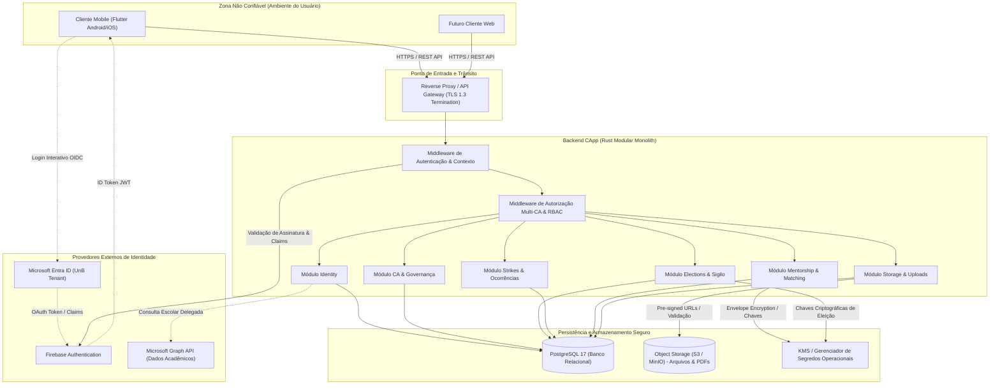
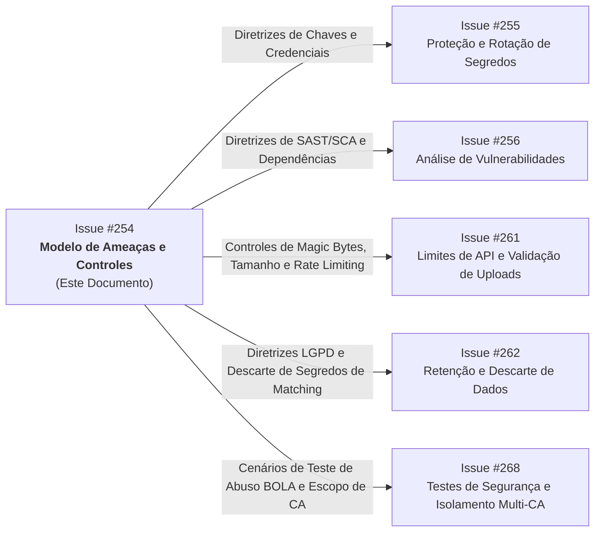

# Modelo de Ameaças e Controles de Segurança — Projeto CApp

## 1. Contexto, Objetivos e Escopo

### 1.1 Contexto da Plataforma
O **CApp** é uma plataforma institucional multi-tenant concebida para atender à comunidade universitária da Universidade de Brasília (UnB), fornecendo infraestrutura comum para que diferentes Centros Acadêmicos (CAs) gerenciem informações, processos eleitorais, representação estudantil, comunicação, eventos, demandas acadêmicas, programas de acolhimento e governança interna.

A arquitetura adota o modelo de *Modular Monolith* no backend (desenvolvido em Rust utilizando Axum, SQLx e PostgreSQL), clientes distribuídos (aplicativo móvel em Flutter/Dart e interfaces web futuras) e especificações comportamentais BDD compartilhadas (Gherkin).

### 1.2 Objetivo do Documento
Este documento formaliza o **Mapeamento de Riscos e Definição de Controles de Segurança** do CApp, em atendimento à **Issue #254** ("Mapear riscos e definir controles de segurança do CApp"), vinculada à entrega incremental **I01 ("Acesso e meu CA")** e à issue agregadora **#248 ("Reforçar a segurança e a proteção de dados da plataforma")** da Milestone 13.

Seus objetivos específicos são:
1. Estabelecer o inventário exaustivo de ativos de informação, integrações externas, credenciais operacionais e superfícies de ataque da plataforma.
2. Mapear os limites de confiança (*trust boundaries*) e isolamentos lógicos essenciais, especialmente entre diferentes Centros Acadêmicos (*Multi-CA Tenant Isolation*).
3. Aplicar metodologia estruturada de modelagem de ameaças (**STRIDE** e **OWASP Top 10 / OWASP API Security Top 10**), com ênfase nas especificidades de negócio do produto.
4. Definir a matriz de riscos (Probabilidade x Impacto) e documentar as decisões técnicas de tratamento e os controles de segurança proporcionais.
5. Estabelecer o processo contínuo de revisão e governança de segurança após mudanças arquiteturais.

### 1.3 Rastreabilidade de Diretrizes e Invariantes Institucionais
O modelo de segurança implementado respeita rigorosamente as invariantes documentadas em `.agent/INDICE_DOCUMENTACAO.md` e `.agent/capp_context.md`:
- **Domínio Institucional Exclusivo**: O acesso inicial é restrito a contas institucionais discentes ativas da UnB com sufixo obrigatório `@aluno.unb.br`.
- **Isolamento de Preferência**: O campo `favorite_ca_id` em `user_preference` é uma mera facilidade de interface para definição do contexto inicial exibido; **não confere vínculo acadêmico, nem privilégios de gestão, nem direitos eleitorais**.
- **Privacidade e Proteção de Dados**: Aderência aos princípios da Lei Geral de Proteção de Dados (LGPD - Lei 13.709/2018), com minimização de coleta, finalidade específica e vedação à discriminação discente.
- **Proibição de Dados Reais**: Utilização exclusiva de dados e identificadores didáticos homologados nos testes e documentações (ex.: CAER `018f0000-0000-7000-8000-000000000001`, CACC `018f0000-0000-7000-8000-000000000002`, usuários `241098765@aluno.unb.br`, `231012345@aluno.unb.br`, `262001234@aluno.unb.br`).

---

## 2. Fronteiras de Confiança e Arquitetura de Defesa

O sistema opera sobre fronteiras de confiança explícitas (*Trust Boundaries*), representadas no fluxo de dados abaixo:



### Limites de Confiança Identificados (TB - Trust Boundaries)
1. **TB-01 (Cliente vs. API Backend)**: Dispositivos móveis e navegadores web são ambientes sob controle do usuário, sujeitos a descompilação, engenharia reversa e manipulação de requisições. O backend nunca confia em cabeçalhos, parâmetros ou estados enviados pelo cliente sem validação criptográfica e semântica.
2. **TB-02 (Backend vs. Provedores Externos de Identidade)**: Integração com Microsoft Entra ID e Firebase Authentication. O backend valida a assinatura, emissor (*issuer*), audiência (*audience*), prazo de validade e revogação de tokens antes de aceitar qualquer declaração de identidade.
3. **TB-03 (Tenant Boundary / Isolamento Multi-CA)**: Cada Centro Acadêmico constitui um domínio administrativo independente. A posse de privilégios de gestão no CA "A" (ex.: CAER) não concede qualquer permissão sobre o CA "B" (ex.: CACC).
4. **TB-04 (Administração da Plataforma vs. Gestão Local de CA)**: A aprovação de CAs e auditorias globais é restrita a administradores da plataforma (`platform_administrator`), sendo inacessível para gestores locais de CAs (`ca_role` / `management_assignment`).
5. **TB-05 (Isolamento de Cédulas e Voto Secreto)**: Barreira física e lógica estrita que separa a identificação do eleitor (`election_elector` / `electoral_participation`) do conteúdo do voto (`secret_ballot`).
6. **TB-06 (Armazenamento de Arquivos Privados)**: Documentos de verificação e comprovação financeira possuem classificação restrita e nunca são expostos por links públicos perpétuos ou previsíveis.

---

## 3. Inventário Exaustivo de Ativos

A tabela a seguir consolida os ativos críticos da plataforma, categorizados por domínio, classificação da informação, requisitos de segurança (Confidencialidade, Integridade, Disponibilidade) e regulamentação aplicável.

| ID Ativo | Ativo de Informação / Técnico | Descrição e Componentes | Classificação | Requisitos (C/I/D) | Base Legal / Regra |
| :--- | :--- | :--- | :--- | :--- | :--- |
| **AST-01** | **Identidade Institucional Discente** | `app_user`, `external_identity`, e-mail `@aluno.unb.br`, `display_name`, `firebase_uid`, `microsoft_subject`. | Confidencial / Pessoal | C: Alta<br>I: Crítica<br>D: Alta | LGPD Art. 7º (Execução de políticas públicas/regulatórias) |
| **AST-02** | **Dados Acadêmicos e Vínculo** | `academic_enrollment`, `course_id`, `academic_status`, códigos de matérias cursadas (`discipline`). | Confidencial | C: Alta<br>I: Crítica<br>D: Alta | LGPD / Segredo Acadêmico UnB |
| **AST-03** | **Matrícula Discente** | Número de matrícula institucional (formato UnB `AASXXXXXX`). | Restrito / Sensível | C: Alta<br>I: Crítica<br>D: Alta | Regra do Projeto: Proibição de uso da matrícula real nos testes e vedação à exposição pública desnecessária |
| **AST-04** | **Preferência de CA Favorito** | `user_preference.favorite_ca_id`. | Interno | C: Baixa<br>I: Média<br>D: Média | Invariante: Preferência de interface, sem efeito de autorização |
| **AST-05** | **Documentos de Verificação de CA** | `verification_request`, `verification_document`, atas de eleição, posse e estatutos armazenados em `stored_file`. | Confidencial / Restrito | C: Crítica<br>I: Crítica<br>D: Média | Segurança Institucional / Prevenção a usurpação de CAs |
| **AST-06** | **Cédula de Voto Secreto** | `secret_ballot` (`id`, `nullifier`, `encrypted_choice`, `validity_proof`). | Altamente Confidencial | C: Máxima<br>I: Crítica<br>D: Crítica | Estatuto Eleitoral / Sigilo Constitucional do Voto |
| **AST-07** | **Registro de Participação Eleitoral** | `election_elector`, `electoral_participation` (marcação de que o eleitor votou). | Restrito | C: Média<br>I: Crítica<br>D: Crítica | Integridade Eleitoral (impedir voto duplo) |
| **AST-08** | **Histórico Individual de Strikes** | `occurrence`, `strike`, `consequence_application` associados a `target_user_id`. | Restrito / Pessoal Sensível | C: Máxima<br>I: Crítica<br>D: Alta | LGPD Art. 11 / Dignidade do Estudante / Vedação a linchamento digital |
| **AST-09** | **Histórico Institucional do CA** | Ocorrências e strikes onde `target_kind = academic_center` e política `strike_policy.publish_ca_history`. | Público ou Interno ao CA | C: Média<br>I: Crítica<br>D: Média | Governança e Transparência do CA |
| **AST-10** | **Identificadores Secretos de Matching** | `matching_secret` (`field_key`, `encrypted_value`, `encryption_key_ref`). | Altamente Confidencial | C: Máxima<br>I: Alta<br>D: Média | Privacidade Discente / Segredo Compartilhado |
| **AST-11** | **Respostas de Quizzes & Recomendações** | `quiz_submission`, `quiz_answer`, `mentor_endorsement`. | Confidencial | C: Alta<br>I: Alta<br>D: Média | LGPD / Privacidade do Programa de Apadrinhamento |
| **AST-12** | **Arquivos do Sistema (Storage Objects)** | Objetos no MinIO/S3 referenciados por `stored_file` (imagens, comprovantes, PDFs acadêmicos). | Conforme `access_class` (Public / Restricted / Confidential) | C: Variável<br>I: Alta<br>D: Alta | Política de Gestão de Arquivos |
| **AST-13** | **Trilha de Auditoria Geral** | `audit_event`, `election_audit_event`, `occurrence_history`. | Restrito / Imutável | C: Alta<br>I: Crítica<br>D: Alta | Rastreabilidade e Não Repúdio |
| **AST-14** | **Credenciais e Chaves de Aplicação** | Chaves do Firebase Admin, Microsoft Client Secret, `DATABASE_URL`, chaves KMS para criptografia de matching e eleição. | Crítico / Segredo Operacional | C: Máxima<br>I: Máxima<br>D: Máxima | Segurança da Infraestrutura |

---

## 4. Superfícies de Entrada e Vetores de Exposição

O mapeamento das portas de entrada do sistema é essencial para delimitar o perímetro defensivo:

1. **API REST HTTP (Backend Axum)**:
   - Endpoints públicos: rotas de health check (`/health`), descoberta de CAs públicos e webhook de autenticação/tokens.
   - Endpoints autenticados de usuário discente: perfil, preferências, consulta de notícias, eventos, materiais e participação em apadrinhamento.
   - Endpoints de gestão de CA: criação de notícias, moderação de eventos, aplicação de strikes locais, gestão de chapas eleitorais.
   - Endpoints da administração da plataforma: concessão/revogação de `platform_administrator`, aprovação de `verification_request`.
2. **Upload e Download de Arquivos**:
   - Requisição de pre-signed URLs de upload para S3/MinIO e notificação de conclusão para o backend.
   - Download de materiais acadêmicos e documentos anexos através de tokens de acesso temporários.
3. **Integrações Externas em Rede (Saída e Retorno)**:
   - Troca de chaves JWKS com Google/Firebase para validação de tokens JWT.
   - Chamadas HTTP REST para Microsoft Graph para enriquecimento de matrícula e status escolar discente.
   - Envio de notificações push para o Firebase Cloud Messaging (FCM).
4. **Armazenamento Persistente (PostgreSQL)**:
   - Pool de conexões SQLx conectado via credenciais com privilégios de aplicação (sem permissões de DDL em tempo de execução).

---

## 5. Modelagem de Ameaças Estruturada (STRIDE)

A aplicação do framework STRIDE sobre os componentes do CApp detalha cenários plausíveis de abuso e o impacto correspondente:

### 5.1 Spoofing (Falsificação de Identidade)
- **AME-S01: Login com conta institucional forjada ou de outra universidade**:
  - *Cenário*: Atacante utiliza conta Microsoft válida de instituição externa (ex.: `@aluno.usp.br`) ou conta pessoal Microsoft para autenticar via Firebase e forjar sessão no CApp.
  - *Impacto*: Acesso indevido a serviços, materiais restritos da UnB e processos de CAs.
- **AME-S02: Falsificação de identidade em eleição**:
  - *Cenário*: Usuário tenta reutilizar credenciais ou injetar cabeçalhos de outros alunos para computar voto fraudulento.
  - *Impacto*: Viciação da eleição do CA, quebra da soberania do sufrágio.
- **AME-S03: Usurpação de papel administrativo de CA**:
  - *Cenário*: Discente manipula token ou IDs em requisição para agir como coordenador de CA sem ter sido nomeado em `management_assignment`.
  - *Impacto*: Publicação de notícias falsas, manipulação de ocorrências e eventos.

### 5.2 Tampering (Adulteração de Dados)
- **AME-T01: Manipulação do contexto ativo de CA para contornar checagens**:
  - *Cenário*: Atacante altera a preferência `favorite_ca_id` e tenta submeter requisições administrativas alegando que seu contexto ativo lhe concede autoridade.
  - *Impacto*: Tentativa de bypass de RBAC.
- **AME-T02: Adulteração de documentos de verificação de CA**:
  - *Cenário*: Discente altera PDF de ata eleitoral após envio ou intercepta o trânsito do upload para enviar arquivo adulterado para obter selo oficial do CA.
  - *Impacto*: Concessão fraudulenta de selo verificado para entidade ilegítima.
- **AME-T03: Adulteração de votos ou contagem eleitoral**:
  - *Cenário*: Modificação indevida de registros em `secret_ballot` ou forja do total apurado em `slate_vote_total`.
  - *Impacto*: Fraude no resultado da gestão eleita.
- **AME-T04: Upload de malware mascarado em materiais de estudo ou comprovantes**:
  - *Cenário*: Upload de executável malicioso ou scripts XSS em arquivos SVG/HTML renomeados com extensão `.pdf` em `stored_file`.
  - *Impacto*: Comprometimento de dispositivos de estudantes que realizarem o download.

### 5.3 Repudiation (Repúdio de Ações)
- **AME-R01: Aplicação de strike sem registro de autoridade**:
  - *Cenário*: Gestor aplica penalidade severa a um desafeto político dentro do CA e o sistema não grava a autoria da ação em `occurrence_history`.
  - *Impacto*: Impossibilidade de apurar abuso de autoridade por membros da diretoria do CA.
- **AME-R02: Votação sem trilha de elegibilidade**:
  - *Cenário*: Discente questiona o resultado eleitoral alegando que não votou ou que seu voto foi computado sem ele estar apto.
  - *Impacto*: Insegurança jurídica e anulação judicial/estatutária do pleito.

### 5.4 Information Disclosure (Exposição Indevida de Informações)
- **AME-I01: Quebra do sigilo do voto secreto discente**:
  - *Cenário*: Correlação temporal entre requisições HTTP registradas em logs de acesso e inserções na tabela `secret_ballot`, ou inclusão de IDs do eleitor em tabelas eleitorais.
  - *Impacto*: Coação e retaliação política contra estudantes; violação grave de preceito estatutário.
- **AME-I02: Exposição pública do histórico individual de strikes**:
  - *Cenário*: Ocorrências e strikes de um discente vazam por endpoint mal configurado ou através da flag `publish_ca_history`.
  - *Impacto*: Exposição vexatória do estudante perante a comunidade acadêmica; infração direta à LGPD e risco de litígio judicial.
- **AME-I03: Vazamento de documentos de verificação de CA**:
  - *Cenário*: Acesso direto não autenticado aos arquivos probatórios de posse e dados pessoais de diretores do CA por meio de URLs públicas previsíveis no bucket.
  - *Impacto*: Vazamento de dados de dirigentes e documentos internos.
- **AME-I04: Vazamento de segredos de matching e respostas privadas de quizzes**:
  - *Cenário*: Respostas íntimas do questionário de apadrinhamento expostas na API ou inclusão de identificadores secretos em dumps de telemetria/treinamento de modelo neural.
  - *Impacto*: Violação de intimidade e quebra de confiança no programa de recepção de calouros.

### 5.5 Denial of Service (Negação de Serviço)
- **AME-D01: Esgotamento de conexões ou CPU por requisições descontroladas**:
  - *Cenário*: Varredura massiva em rotas de listagem de matérias, notícias ou fóruns sem limitação de taxa (*rate limiting*).
  - *Impacto*: Indisponibilidade do backend durante períodos críticos (ex.: apuração eleitoral ou matrícula).
- **AME-D02: Esgotamento de storage via upload abusivo**:
  - *Cenário*: Atacante solicita centenas de URLs de upload de arquivos pesados, exaurindo cota do bucket ou espaço de banco.
  - *Impacto*: Parada de serviços de upload legítimos.

### 5.6 Elevation of Privilege (Elevação de Privilégio / BOLA / BFLA)
- **AME-E01: Quebra de isolamento Multi-CA (BOLA - Broken Object Level Authorization)**:
  - *Cenário*: Gestor do CAER envia payload em `/api/v1/news` informando o `ca_id` do CACC para publicar notícia oficial em nome de outro centro acadêmico.
  - *Impacto*: Comunicação fraudulenta em nome de CA alheio.
- **AME-E02: Autoaprovação de verificação de CA**:
  - *Cenário*: Solicitante de verificação de um CA manipula a chamada de decisão (`POST /api/v1/ca/verifications/{id}/decide`) para aprovar a própria solicitação sem ser administrador da plataforma.
  - *Impacto*: Concessão ilegítima de selo oficial e status verificado na plataforma.
- **AME-E03: Extrapolação de consequência de strike para banimento global**:
  - *Cenário*: Gestor local tenta criar regra de consequência que bloqueia o login do aluno em toda a plataforma CApp ou em outros CAs.
  - *Impacto*: Usurpação de competência institucional privativa da universidade.

---

## 6. Matriz de Avaliação e Priorização de Riscos

A metodologia adota uma escala de severidade 5x5:
- **Probabilidade (P)**: 1 (Rara), 2 (Improvável), 3 (Possível), 4 (Provável), 5 (Muito Provável).
- **Impacto (I)**: 1 (Insignificante), 2 (Baixo), 3 (Médio), 4 (Alto), 5 (Crítico).
- **Nível de Severidade (Score = P × I)**:
  - **15 a 25**: Crítico (Ação imediata obrigatória e testes automatizados de bloqueio)
  - **10 a 14**: Alto (Controles técnicos preventivos mandatórios)
  - **5 a 9**: Médio (Controles padrões e monitoramento)
  - **1 a 4**: Baixo (Procedimentos operacionais e boas práticas)

| ID Risco | Ameaça Mapeada | Ativos Afetados | P (Inerente) | I (Inerente) | Risco Inerente | Decisão de Tratamento | P (Residual) | I (Residual) | Risco Residual | Subissue Relacionada |
| :--- | :--- | :--- | :---: | :---: | :---: | :---: | :---: | :---: | :---: | :---: |
| **RSK-01** | Login com conta não-UnB / forjada | AST-01, AST-02 | 4 | 5 | **Crítico (20)** | **Mitigar**: Validação estrita de claims Microsoft no backend + verificação de domínio `@aluno.unb.br`. | 1 | 4 | **Baixo (4)** | #248, #254 |
| **RSK-02** | Quebra de isolamento Multi-CA (BOLA) | AST-05, AST-08, AST-09 | 4 | 5 | **Crítico (20)** | **Mitigar**: Middleware RBAC com validação tripla `(user, ca_id, permission)` e checagem de vigência de mandato. | 1 | 4 | **Baixo (4)** | #268 |
| **RSK-03** | Quebra do sigilo do voto secreto | AST-06, AST-07 | 3 | 5 | **Crítico (15)** | **Mitigar**: Desacoplamento físico e lógico entre eleitor e cédula + `nullifier` criptográfico + ausência de logs correlacionáveis (#282). | 1 | 4 | **Baixo (4)** | #248, #282 |
| **RSK-04** | Exposição do histórico individual de strikes | AST-08 | 3 | 5 | **Crítico (15)** | **Mitigar**: Isolamento rígido de rotas; `publish_ca_history` restrito a dados agregados do CA; vedação de listagem pública. | 1 | 4 | **Baixo (4)** | #262, #268 |
| **RSK-05** | Vazamento de documentos de verificação de CA | AST-05, AST-12 | 3 | 4 | **Alto (12)** | **Mitigar**: Armazenamento com classe restrita; download via URLs assinadas e efêmeras (TTL curto); autorização estrita. | 1 | 3 | **Baixo (3)** | #261 |
| **RSK-06** | Upload de arquivo malicioso ou executável | AST-12 | 4 | 4 | **Crítico (16)** | **Mitigar**: Validação de magic bytes (MIME type real), limite estrito de tamanho (10 MB), hash digest SHA-256 e sanitização de nome. | 1 | 3 | **Baixo (3)** | #261 |
| **RSK-07** | Vazamento ou dedução de segredos de matching | AST-10, AST-11 | 3 | 4 | **Alto (12)** | **Mitigar**: Envelope encryption com KMS externo; proibição de hash simples de baixa entropia; exclusão de logs e dumps neurais. | 1 | 3 | **Baixo (3)** | #255, #262 |
| **RSK-08** | Autoaprovação de verificação de CA | AST-05 | 3 | 4 | **Alto (12)** | **Mitigar**: Autorização restrita a `platform_administrator` via verificação de registro ativo e irrevogável no banco. | 1 | 3 | **Baixo (3)** | #268 |
| **RSK-09** | Abuso de preferência `favorite_ca_id` para privilégio | AST-04 | 4 | 3 | **Alto (12)** | **Mitigar**: Invariante arquitetural no código: permissões são consultadas unicamente via `management_assignment`. | 1 | 2 | **Baixo (2)** | #254, #268 |
| **RSK-10** | DoS por saturação de requisições ou uploads | AST-12, AST-14 | 4 | 3 | **Alto (12)** | **Mitigar**: Limitação de taxa de requisições por IP e usuário; cotas por CA; timeouts rigorosos em integrações. | 2 | 2 | **Baixo (4)** | #259, #261 |
| **RSK-11** | Comprometimento ou vazamento de segredos/credenciais | AST-14 | 2 | 5 | **Alto (10)** | **Mitigar**: Segredos injetados em runtime; proibição em repositório; varredura estática de commits; rotação documentada. | 1 | 4 | **Baixo (4)** | #255, #256 |
| **RSK-12** | Extrapolação de strike para banimento global | AST-08 | 3 | 4 | **Alto (12)** | **Mitigar**: Invariante de domínio: consequência de strike só atua no escopo local do CA (`consequence_application.ca_id`). | 1 | 2 | **Baixo (2)** | #254 |

---

## 7. Decisões de Tratamento e Controles Técnicos Detalhados

### 7.1 Controles de Autenticação e Gestão de Sessão Institucional
1. **Validação de Token e Claims**:
   - O backend valida a assinatura RSA/ECDSA do token JWT emitido pelo Firebase Authentication contra o conjunto público de chaves (JWKS) do Google.
   - O backend inspeciona as *claims* para assegurar que o provedor upstream é a Microsoft institucional (`tenant_id` correspondente à UnB).
   - O e-mail discente autenticado é verificado com expressão regular estrita para o padrão `^[a-zA-Z0-9._%+-]+@aluno\.unb\.br$`.
   - Contas pessoais Microsoft (@outlook, @hotmail, etc.) e contas de outras instituições de ensino são categoricamente rejeitadas com erro semântico amigável, sem estabelecimento de sessão.
2. **Provisionamento Idempotente e Seguro**:
   - A criação de registros em `app_user` e `external_identity` utiliza chaves unívocas (`firebase_uid` e o par `institution_id, microsoft_subject`). Tentativas repetidas reaproveitam a identidade existente, prevenindo duplicações de perfis e ataques de corrida concorrente.
   - O provisionamento não solicita nem aceita parâmetros privilegiados enviados pelo cliente HTTP (ex.: cargos ou flags de administração).

### 7.2 Controles de Isolamento Estrito Multi-CA e Autorização Granular
1. **Desacoplamento entre Navegação e Autorização**:
   - O campo `user_preference.favorite_ca_id` é tratado pelo backend como dado meramente cosmético de preferência visual. Nenhum middleware de autorização utiliza esse valor para inferir privilégios.
2. **Matriz RBAC por Contexto de CA**:
   - Cada operação administrativa recebe obrigatoriamente o identificador do CA alvo (`ca_id`) na rota ou corpo da requisição.
   - O middleware de autorização executa a validação em camadas:
     ```text
     Para a ação X no contexto do CA Y solicitada pelo usuário U:
     1. U possui registro ativo em management_assignment para um ca_role pertencente a Y?
     2. O termo de gestão correspondente (management_term) está com status = 'active' e na vigência atual (starts_on <= hoje <= ends_on)?
     3. O ca_role de U possui a permission necessária associada em role_permission?
     4. Se U for platform_administrator, a ação requer escopo global de plataforma (ex.: verificação oficial de CA)?
     ```
   - Caso qualquer condição falhe, a requisição é negada com código HTTP `403 Forbidden`, registrando o evento para fins de auditoria de segurança.
3. **Impedimento de Conflito de Interesses**:
   - Nenhum gestor local de CA pode aprovar ou rejeitar solicitações de verificação (`verification_request`) do seu próprio CA ou de terceiros. A decisão é prerrogativa exclusiva de `platform_administrator`.

### 7.3 Controles de Proteção para Documentos de Verificação de CA
1. **Upload via Pre-Signed URLs**:
   - O aplicativo móvel nunca envia arquivos diretamente através de conexões de longa duração no servidor da API principal.
   - O backend gera uma URL pré-assinada temporária para o serviço de armazenamento (S3/MinIO) com validade restrita a 15 minutos, restrita ao verbo `PUT` e associada a um UUID pré-gerado.
2. **Inspeção de Integridade e Tipos de Arquivo**:
   - Ao receber a confirmação de upload, o backend valida o cabeçalho real do arquivo (*magic bytes*) para confirmar que o conteúdo corresponde efetivamente a `application/pdf` ou `image/png`/`image/jpeg`.
   - Limite máximo estrito de 10 MB por documento.
   - Cálculo do digest SHA-256 e gravação em `stored_file.digest`.
3. **Controle de Acesso ao Documento**:
   - Arquivos vinculados a `verification_document` recebem `access_class = 'confidential'`. O download é restrito a administradores da plataforma e ao solicitante original mediante geração de link temporário de leitura (TTL de 5 minutos).

### 7.4 Controles Criptográficos e Arquitetura do Voto Secreto
1. **Desacoplamento Cédula-Eleitor**:
   - As tabelas `electoral_participation` e `secret_ballot` não possuem chaves estrangeiras ou relações de dependência que permitam junção (JOIN) entre a identidade do estudante e seu voto.
2. **Mecanismo de Nullifier**:
   - A prevenção contra voto múltiplo utiliza o conceito de `nullifier`: uma prova criptográfica derivada do segredo do eleitor e da eleição que permite ao sistema registrar que o direito de voto daquele eleitor foi consumido sem registrar quem ele escolheu.
3. **Cifragem da Escolha**:
   - O campo `secret_ballot.encrypted_choice` armazena o voto cifrado com a chave pública da comissão eleitoral do pleito. A chave privada correspondente só é reconstruída no encerramento da eleição (utilizando esquema de divisão de segredos de Shamir entre os membros da comissão eleitoral).
4. **Sanitização de Trilha e Logs**:
   - Fica terminantemente proibido registrar nos logs de aplicação, nos logs do proxy reverso ou nos registros de auditoria (`election_audit_event`) o endereço IP, cabeçalhos de identificação de dispositivo ou timestamp com precisão que permita correlação com a inserção em `secret_ballot`.

### 7.5 Controles de Privacidade para Histórico de Strikes e Ocorrências
1. **Isolamento de Visibilidade**:
   - O estudante possui acesso exclusivo para visualizar seus próprios registros de ocorrências e strikes (`target_user_id = auth_user.id`).
   - Gestores autorizados de um CA só podem visualizar ocorrências e strikes registrados no contexto daquele CA específico.
2. **Regra Inviolável de Publicidade do CA**:
   - O parâmetro `strike_policy.publish_ca_history` controla exclusivamente a exibição pública do histórico de infrações cometidas pela entidade jurídica/estudantil do CA (`target_kind = 'academic_center'`).
   - **É terminantemente proibida a publicação ou listagem de strikes individuais de estudantes (`target_kind = 'student'`)**, garantindo proteção contra constrangimento ilegal e violação da LGPD.
3. **Escopo Local de Penalidades**:
   - Consequências aplicadas a estudantes em decorrência de strikes (ex.: suspensão temporária de empréstimo de livros ou materiais do CA) operam estritamente no âmbito local daquele CA (`consequence_application.ca_id`).
   - É vedada a aplicação de penalidades que bloqueiem o acesso geral à plataforma CApp, a outros CAs ou a direitos acadêmicos universais.

### 7.6 Controles para Segredos de Matching e Quizzes de Apadrinhamento
1. **Proteção de Segredos de Pareamento**:
   - Valores informados em `matching_secret.encrypted_value` são cifrados em repouso utilizando criptografia autenticada (ex.: AES-256-GCM ou ChaCha20-Poly1305), utilizando chaves gerenciadas externamente e referenciadas por `encryption_key_ref`.
   - Vedado o uso de funções de hash não salgadas (ex.: SHA-256 direto de respostas previsíveis como "calouro", "veterano", "turno"), pois são vulneráveis a ataques de dicionário e tabelas arco-íris.
2. **Isolamento em Relação ao Modelo Neural**:
   - Os questionários (`questionnaire`) e suas submissões (`quiz_submission`) são versionados.
   - Segredos de participantes nunca são incluídos em `configuration_snapshot` de execuções de matching (`matching_run`) ou nos datasets de treino de modelos neurais (`training_dataset`).
   - Apenas características vetorizadas anonimizadas são submetidas a algoritmos de recomendação.

### 7.7 Controles de Gestão de Credenciais e Segredos Operacionais
1. **Separação de Ambientes e Proibição de Hardcoding**:
   - Nenhuma credencial de produção, chave privada, senha de banco de dados ou token de serviço é comitada no repositório Git. Arquivos `.env` permanecem excluídos pelo `.gitignore`.
2. **Injeção Segura e Rotação**:
   - Em produção, credenciais são injetadas exclusivamente via variáveis de ambiente seguras ou ferramentas de gerenciamento de segredos (Secret Manager).
   - Definição de ciclo semestral obrigatório de rotação de chaves de API externas (Firebase e Microsoft Graph) e processo emergencial documentado de rotação imediata em caso de incidente.

---

## 8. Processo de Revisão Contínua e Governança de Riscos

Para assegurar que a segurança permaneça aderente à evolução incremental da plataforma, estabelece-se o seguinte processo contínuo de governança:

### 8.1 Critérios de Gatilho para Revisão do Modelo de Ameaças
O modelo de ameaças e a matriz de riscos devem ser formalmente revisados sempre que ocorrer um dos seguintes eventos:
1. **Evolução Arquitetural ou Novos Módulos**: Introdução de novos módulos backend ou migração de componentes.
2. **Novas Superfícies de Integração**: Adição de integrações com terceiros (ex.: novos gateways de notificação ou sistemas acadêmicos).
3. **Mudanças no Modelo de Permissões**: Alteração no catálogo de permissões (`permission.code`), adição de novos papéis (`ca_role`) ou fluxos de autorização.
4. **Modificações nos Protocolos Críticos**: Alteração na implementação criptográfica do voto secreto (#282) ou nos algoritmos de pareamento do matching (#288).
5. **Incidentes de Segurança**: Ocorrência de qualquer incidente ou tentativa de invasão reportada.
6. **Revisão Periódica**: Auditoria semestral obrigatória antes de cada início de semestre letivo na UnB.

### 8.2 Matriz de Responsabilidades (RACI)

| Atividade de Segurança | Engenharia de Segurança / Arquiteto | Desenvolvedores Backend (Rust) | Desenvolvedores Mobile (Flutter) | Gestores de CA / Administradores |
| :--- | :---: | :---: | :---: | :---: |
| Manutenção do Modelo de Ameaças | **R / A** | C | C | I |
| Implementação de Controles de API e RBAC | C | **R / A** | I | I |
| Armazenamento Seguro de Tokens no Cliente | C | I | **R / A** | I |
| Execução de Análise Estática de Vulnerabilidades | **A** | **R** | **R** | I |
| Gestão e Rotação de Segredos Operacionais | **A** | **R** | I | I |
| Homologação de Documentos de Verificação | I | I | I | **R / A** |

*Legenda: R = Responsável pela execução, A = Aprovador final (Accountable), C = Consultado, I = Informado.*

### 8.3 Integração com Pipeline de Entrega Contínua (DevSecOps)
A verificação dos controles de segurança integra o ciclo de desenvolvimento:
- **Verificação Estática e Qualidade do Código (Backend Rust)**:
  * `cargo fmt --all -- --check`: integridade de formatação.
  * `cargo clippy --all-targets --all-features --locked -- -D warnings`: conformidade de código sem advertências.
  * `cargo audit`: verificação contínua de vulnerabilidades em crates e dependências (atendendo à subissue #256).
- **Testes de Comportamento e Segurança (BDD)**:
  * Suíte BDD em Rust (`cargo test --test bdd`) com cenários @sad cobrindo recusa de credenciais não-UnB, tokens expirados, tentativas de acesso a recursos restritos sem sessão e tentativas de violação de isolamento multi-CA (atendendo à subissue #268).
- **Checklist de Revisão de Pull Requests (PRs)**:
  1. O PR altera rotas de entrada ou adiciona parâmetros de query/body? As validações de tipos e limites estão presentes?
  2. Há checagem estrita de contexto de CA (`ca_id`) em handlers administrativos?
  3. Foi verificado que nenhuma credencial ou dado pessoal foi incluído no código ou testes?
  4. Nenhuma menção a matrículas ou identificadores reais foi inserida?

---

## 9. Rastreabilidade com as Próximas Subissues de Segurança

Este modelo de ameaças atua como documento-mestre norteador para o planejamento e implementação técnica das subissues da frente de segurança (Milestone 13 / Issue #248):



1. **Subissue #255 (Proteger e rotacionar segredos e credenciais dos ambientes)**:
   - Recebe as diretrizes da Seção 7.7 e AST-14 para implementação do gerenciador de segredos e script de rotação de tokens Firebase e Microsoft Graph.
2. **Subissue #256 (Automatizar análise de vulnerabilidades e atualização de dependências)**:
   - Recebe as diretrizes da Seção 8.3 para inclusão do `cargo audit` e scanners de vulnerabilidades no pipeline de CI/CD.
3. **Subissue #261 (Aplicar limites e validações de segurança à API e aos uploads)**:
   - Recebe os controles das Seções 7.3 e 7.6 (inspeção de magic bytes, limites de 10 MB, digest SHA-256 e rate limiting na API Axum).
4. **Subissue #262 (Definir e aplicar retenção e descarte de dados sensíveis)**:
   - Recebe os critérios de descarte criptográfico para segredos de matching (`matching_secret`), retenção de ocorrências de strikes e expiração de logs de auditoria.
5. **Subissue #268 (Automatizar testes de segurança e isolamento entre Centros Acadêmicos)**:
   - Recebe os cenários de ataque BOLA / Multi-CA (Seção 5.6 e RSK-02) para implementação de testes automatizados de tentativa de acesso cruzado entre CAs distintos.
